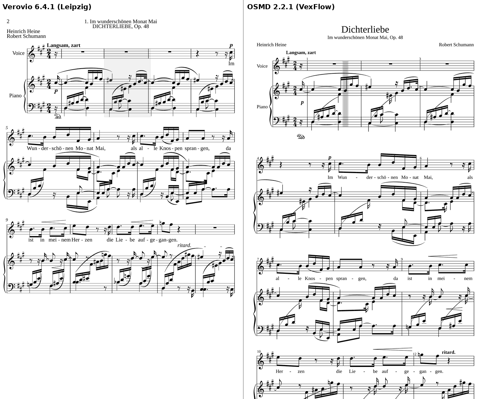
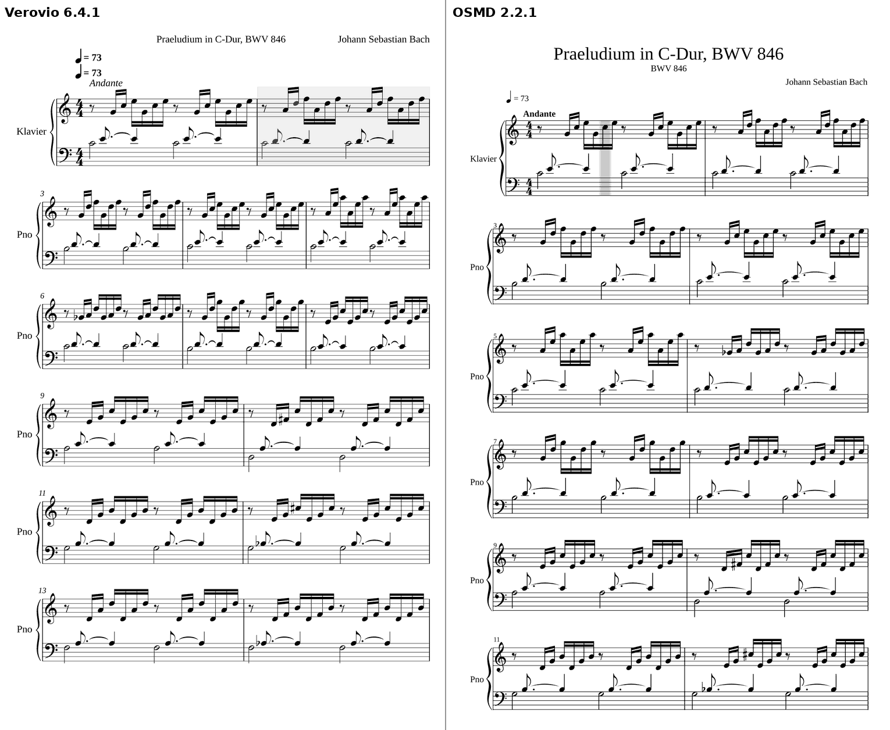
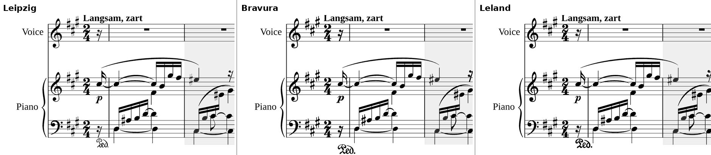

# Music: the Library

This covers how Prima's Library gets real piano music, grades it onto the reading ladder, shows it on the 13" tablet and follows
you through it from the P-225B's MIDI. It's written like [research.md](research.md) and uses the same labels:

- **Strong**, **Moderate**, **Weak**, **Tradition** and **Weak source** mean what they mean there.
- **[K]**: cited from memory with its link, not re-checked.
- **[unverified]**: the source exists, but this detail wasn't confirmed in it.
- **Measured**: a hands-on check run for this document. It ran on a desktop-class cloud container (4-core Xeon, headless
  Chromium 153), **not on the tablet**. Each section says how to confirm the numbers on the device.

Licences are described as their own texts state them. That's a reading for a personal app, not legal advice.

---

## Summary: what matters most

1. **Clean, openly licensed piano files are scarce, and the best ones are non-commercial.** There are three sources you can
   bundle with no strings beyond credit:
   - **PDMX**: MusicXML from MuseScore.com. The dataset is CC BY 4.0, and each file has a public-domain or CC0 tag set by
     whoever uploaded it ([Zenodo](https://zenodo.org/records/15571083)).
   - **Mutopia**: public domain, CC BY or CC BY-SA, but only as LilyPond, PDF and MIDI ([Mutopia](https://www.mutopiaproject.org/legal.html)).
   - **OpenScore**: CC0, but only songs and string quartets, no solo piano ([OpenScore](https://github.com/OpenScore)).

   The best-edited solo piano encodings are CC BY-NC-SA 4.0 or carry no licence at all. That covers Sapp's Humdrum Mozart,
   Haydn, Scarlatti and Joplin, the DCML corpora, ASAP and CIPI
   ([mozart LICENSE](https://github.com/craigsapp/mozart-piano-sonatas/blob/main/LICENSE.txt);
   [ASAP](https://github.com/fosfrancesco/asap-dataset)). They're fine for a personal, non-commercial app that credits them.
   They're not fine for anything you'd sell or share.
2. **Nobody has encoded the beginner teaching books cleanly.** There's no curated symbolic set of Gurlitt, Beyer, Köhler or
   Czerny Op. 599. PDMX holds about **120–150 usable teaching pieces**, mostly Lemoine Op. 37, Duvernoy Op. 176, Schumann
   Op. 68, the Anna Magdalena pieces, Mozart's childhood minuets and Tchaikovsky Op. 39 (measured from its catalogue). Levels 1–3
   have no real repertoire at all. **The generator has to carry the bottom of the ladder.**
3. **In the US in 2026, music published before 1931 is public domain** ([Cornell](https://guides.library.cornell.edu/copyright/publicdomain)).
   A faithful new engraving of it gets no new US copyright, but an editor's own fingerings and markings can
   ([Circular 14](https://www.copyright.gov/circs/circ14.pdf); [IMSLP](https://imslp.org/wiki/Public_domain)). PDMX's PD tags
   are the uploader's claim. Post-1930 works and modern arrangements have to be filtered out by composer and work.
4. **Automatic grading is coarse.** The best published models get the exact level right about **40%** of the time on Henle's
   nine levels, and within one level **87%** of the time ([CIPI](https://ar5iv.labs.arxiv.org/html/2306.08480);
   [RubricNet](https://arxiv.org/html/2408.00473v1)). Those labels rate performing a piece, not reading it at sight. So Prima
   grades each **excerpt** with rules taken from its own ladder: the level is the highest any one feature needs. A small
   continuous score then orders excerpts within a level. Exam sight-reading tests sit **2–3 grades below** the same exam's pieces
   ([research.md §6](research.md)).
5. **Verovio holds up as the engraver.** In a side-by-side check it engraved piano music the most like print. It has a page
   layout and a single-line layout, and its timing calls give the current-bar highlight and the cursor for free (measured).
   Its costs are a **7.4 MB** script (2.4 MB gzipped) and the LGPL-3.0 licence. OSMD is the fallback: 1.4 MB and BSD-licensed,
   but its spacing is looser and its cross-staff slurs are cruder. concept.md and plan.md already use Verovio.
6. **PDFs show well with pdf.js. Reading notes out of a PDF (OMR) isn't a tablet feature.**
   - pdf.js drew a full-width page in about **0.3 s** on the desktop (measured).
   - The best research OMR still gets about **18% of symbols wrong** on real piano scans
     ([Mayer et al. 2024](https://arxiv.org/abs/2403.13763)).
   - So a PDF "plays out" without recognition: page and half-page turns, tempo-driven scrolling a system at a time, and systems
     found automatically and fixed with the pen.
   - The P-225 sends its pedals as MIDI CC 64, 66 and 67 ([Yamaha manual, p. 57](https://usa.yamaha.com/files/download/other_assets/4/2145734/P-225_P-223_Reference_Manual_En_C0.pdf)),
     so a pedal or a spare key can turn pages.
7. **Following MIDI against a score is a solved problem for clean playing. Learners make it hard by restarting and skipping.**
   A follower that can't jump about doubles its error rate during practice, from about 9–10% to 21–23%
   ([Nakamura et al. 2014](https://arxiv.org/pdf/1404.2313)). A windowed chord matcher with a re-anchor search is simple
   enough for C#. Marks are set afterwards by a full alignment, which is far more accurate (under 1% error,
   [Nakamura et al. 2017](https://archives.ismir.net/ismir2017/paper/000035.pdf)).
8. **Turn early, and turn half a page.** The eyes run about **1 s** ahead of the hands
   ([Furneaux & Land 1999](https://doi.org/10.1098/rspb.1999.0943)). New music should be on screen at least the larger of
   **2 s or 2 beats** before it's needed.
9. **In portrait, the 13" screen is nearly a printed page.** It's 175 × 280 mm, the same height as US Letter. At the
   traditional **7 mm** piano staff ([LilyPond](https://lilypond.org/doc/v2.24/Documentation/notation/setting-the-staff-size)),
   that's **6 grand-staff systems with a title, 7 without**. Landscape fits about 4 (measured and calculated).
10. **The tablet still has to confirm the numbers.** Every timing here is from a desktop, so time the same pages in the
    tablet's WebView. Its CSS-pixel density is also unknown (assumed 2.0–2.25), and it sets the staff size in pixels.

---

## 1. Where real piano music comes from, and on what terms

### What's known

**The sources, one by one:**

| Source | Piano content | Formats | Licence | Cleanliness | Bulk download |
|---|---|---|---|---|---|
| **IMSLP** | 117,095 pages in "Scores featuring the piano" ([IMSLP](https://imslp.org/wiki/Category:Scores_featuring_the_piano)) | Mostly scanned PDFs; some typeset PDFs and a few source files | Per file: PD, or a CC licence for new typesettings [K] | Scans vary; typeset PDFs are clean | No download API. Its API only lists people and works ([IMSLP:API](https://imslp.org/wiki/IMSLP:API)). No bot policy page was found. Third parties report a timed wait and a bot check (**Weak source**, [Apify](https://apify.com/crawlerbros/imslp-scraper)) |
| **Mutopia** | 2,124 pieces in all; Bach, Beethoven sonatas, teaching pieces ([Mutopia](https://www.mutopiaproject.org/)) | LilyPond, PDF, MIDI. No MusicXML | Per piece: PD, CC BY or CC BY-SA ([legal](https://www.mutopiaproject.org/legal.html)) | Volunteer-typeset from PD editions; no claim of accuracy ([legal](https://www.mutopiaproject.org/legal.html)) | The whole archive is on GitHub ([ftp tree](https://github.com/MutopiaProject/MutopiaProject/tree/master/ftp)) |
| **OpenScore** | Lieder: about 1,200–1,500 songs with piano. String quartets. No solo piano ([OpenScore](https://fourscoreandmore.org/openscore/)) | MuseScore `.mscx`; batch-converts to `.mxl` with `mscore -j` ([Lieder](https://github.com/OpenScore/Lieder)) | **CC0** ([LICENSE](https://github.com/OpenScore/Lieder/blob/main/LICENSE.txt)) | Carefully transcribed and checked ([Gotham 2026](https://doi.org/10.5334/johd.456)) | GitHub repos |
| **KernScores / Humdrum (Sapp)** | Beethoven 103 movements, Mozart 69, Haydn 25, Scarlatti 65, Joplin 47, Chopin, Hummel ([humdrum-data](https://github.com/humdrum-tools/humdrum-data)) | Humdrum `**kern`, which Verovio reads directly | Mozart, Haydn, Scarlatti and Joplin: **CC BY-NC-SA 4.0**. Beethoven, Chopin and Hummel: **no licence file**. Bach WTC and Inventions: "Rights to all derivative electronic formats reserved" ([inventions](https://github.com/humdrum-tools/inventions)) | Scholarly, from named PD editions; each file has a reference scan | `make <set>` / `humcat` scripts ([humdrum-data](https://github.com/humdrum-tools/humdrum-data)) |
| **DCML** | Mozart sonatas, Beethoven sonatas, Chopin mazurkas, Grieg Lyric Pieces, Kinderszenen, Tchaikovsky's Seasons and others ([DCMLab](https://github.com/DCMLab)) | MuseScore 3 `.mscx` with harmony annotations | **CC BY-NC-SA 4.0** ([mozart](https://github.com/DCMLab/mozart_piano_sonatas)) | Research quality ([TISMIR](https://doi.org/10.5334/tismir.63)) | GitHub repos |
| **MuseScore.com** | Huge; user uploads | `.mscz`, with MusicXML and PDF exports | The uploader's choice per score | Uneven | The terms page refused scripted reads (HTTP 403). The public API was reportedly withdrawn (**Weak source**, [forum](https://musescore.org/en/node/373269)) |
| **PDMX** | 254,077 scores scraped from MuseScore.com, every one tagged PD or CC0. 199,637 are piano by track type (measured: tracks "0" or "0-0") | MXL, PDF, MIDI, JSON; one 1.9 GB `mxl.tar.gz` ([Zenodo](https://zenodo.org/records/15571083)) | Dataset **CC BY 4.0**. Per file: `publicdomain` 210,364, `cc-zero` 43,713 (measured) | User transcriptions. The site's licence and the file's own copyright data disagree for **12.29%** (31,221). Use the 222,856-score `no_license_conflict` subset ([PDMX](https://github.com/pnlong/PDMX)) | One Zenodo download |
| **(n)ASAP** | 222 scores aligned with 1,068 performances: Bach, Beethoven and others ([ASAP](https://github.com/fosfrancesco/asap-dataset)) | MusicXML + MIDI + annotations | **CC BY-NC-SA 4.0**; (n)ASAP's own licence [unverified] ([TISMIR](https://doi.org/10.5334/tismir.149)) | Derived from MuseScore community scores [K] | GitHub |
| **CIPI** | 652 pieces with Henle levels ([Zenodo](https://zenodo.org/records/8037327)) | MusicXML | CC BY-NC-SA 4.0; access on request, for research | Hand-checked matches ([paper](https://ar5iv.labs.arxiv.org/html/2306.08480)) | Request through Zenodo |
| **Musopen** | "Over 100,000" PD PDFs ([Musopen](https://musopen.org/sheetmusic), seen through search; the page returned 403) | PDF only | Per-file CC0 not confirmed (**Weak source**) | — | — |
| **Open Hymnal** | 301 hymns, SATB on a grand staff ([mirror](https://github.com/mzealey/openhymnal)) | ABC | "copyright: public domain" in every file | One maintainer's own statement | GitHub mirror |
| **Project Gutenberg, Internet Archive** | Not researched. Gutenberg's music shelf wasn't found, and the Archive's terms page needs JavaScript ([archive.org](https://archive.org/about/terms.php)) | — | — | — | — |

MAESTRO and GiantMIDI-Piano are recordings turned into MIDI, not scores, so they can't be engraved
([MAESTRO](https://magenta.tensorflow.org/datasets/maestro); [GiantMIDI](https://github.com/bytedance/GiantMIDI-Piano)).

**What's public domain in the US in 2026:**

- Works published in the US before 1931 are public domain ([Duke 2026](https://web.law.duke.edu/cspd/publicdomainday/2026/);
  [Cornell](https://guides.library.cornell.edu/copyright/publicdomain)).
- Works first published abroad before 1931 are too. Foreign works from 1931–1977 may have had their copyright restored
  ([Cornell](https://guides.library.cornell.edu/copyright/publicdomain)).
- On 1 January 2027, works from 1931 join them. That's the 95-year rule applied, not a statement from a source.
- Kabalevsky's teaching pieces date from after 1930 ([IMSLP](https://imslp.org/wiki/Category:Kabalevsky,_Dmitry)).
  Bartók's *Mikrokosmos* (1940) is "probably still protected" in the US
  ([IMSLP](https://imslp.org/wiki/Mikrokosmos%2C_Sz.107_%28Bart%C3%B3k%2C_B%C3%A9la%29)). Leave both out.

**A new edition is not a new work:**

- A derivative work's copyright "covers only the additions, changes, or other new material"
  ([Circular 14](https://www.copyright.gov/circs/circ14.pdf)). US originality needs a "modicum of creativity" (Feist, 1991
  [K](https://supreme.justia.com/cases/federal/us/499/340/)). So a faithful re-typesetting of a PD edition adds nothing
  protectable in the US.
- Original fingerings, original performance markings and realised continuo lines are likely protectable
  ([IMSLP](https://imslp.org/wiki/Public_domain)).
- The UK has a separate 25-year right in typographical arrangements [K](https://www.legislation.gov.uk/ukpga/1988/48/section/15).
  IMSLP waits 25 years before accepting critical editions ([IMSLP](https://imslp.org/wiki/Public_domain)).
- An encoder's licence still binds you when you download under it. A file with no licence at all defaults to "all rights
  reserved" for whatever original work the encoding holds, even though the music itself is PD. That last point is a reading
  of copyright law, not a sourced statement.

### How sure we can be

- The licence and format facts are read from the projects' own pages and LICENSE files, so they're solid.
- The PD dates come from law-school and library guides, which agree with each other.
- Weak spots:
  - MuseScore.com's terms couldn't be read, and IMSLP has no stated bulk policy.
  - No study measures error rates in any of these corpora.
  - Gutenberg, Internet Archive and CPDL weren't checked at all.
  - No US case covers whether a digital encoding itself can be copyrighted.

---

## 2. Graded teaching pieces as clean files

### What's known

The core repertoire is well encoded: Bach, Mozart, Haydn, Scarlatti, Beethoven, Chopin and Joplin, mostly under NC-SA. The
teaching books are not. Here's where each collection can be found as a symbolic file (measured, by cloning the repos and
filtering PDMX's catalogue):

| Collection | Mutopia (LilyPond) | PDMX (MXL, piano, no conflict) | Other |
|---|---|---|---|
| Anna Magdalena notebook (BWV Anh.) | 13 pieces: 12 PD, 1 CC BY-SA 2.5 | 44 files (26 after removing duplicates; one is a jazz arrangement) | — |
| Bach Little Preludes, Inventions | 11 of 18 preludes; all 30 Inventions and Sinfonias (PD or CC BY-SA 3.0) | — | Huron kern, all rights reserved |
| Burgmüller Op. 100 | 18 of 25, all PD | 3 | IMSLP: typeset PDFs under CC BY 4.0 and CC BY-SA 4.0 ([IMSLP](https://imslp.org/wiki/25_%C3%89tudes_faciles_et_progressives,_Op.100_(Burgm%C3%BCller,_Friedrich))) |
| Czerny Op. 821 | 19 files, PD | 10 | — |
| Czerny Op. 599 | — | 2 | IMSLP: complete typeset PDF under **CC0** ([IMSLP](https://imslp.org/wiki/Erster_Lehrmeister,_Op.599_(Czerny,_Carl))) |
| Schumann Op. 68 | 20 folders, CC BY-SA 2.5 and 3.0 | 22 files (22 rated) | — |
| Schumann Kinderszenen Op. 15 | 7: CC BY 3.0 and PD | — | DCML, 13, NC-SA |
| Kuhlau Op. 20; Clementi Op. 36 | 3 (PD); 1 (PD) | — ; 5 | — |
| Tchaikovsky Op. 39 | 3, PD | about 10 single pieces, plus the whole album in one file | — |
| Lemoine Op. 37 | — | about 35 of the 50 | — |
| Duvernoy Op. 176 | — | 16 | — |
| Mozart's childhood pieces (K. 1–5, K. 15) | — | 36 | — |
| Beethoven sonatinas (Anh. 5) | 1 folder | 7 | — |
| Gurlitt, Beyer | none | 5; 4 | IMSLP Beyer: scans only |
| Köhler, Le Couppey, Heller, Concone, Türk | none | none (the "Köhler" matches were false) | — |
| Grieg Lyric Pieces | a few | — | DCML, 66, NC-SA |
| Joplin | 18, PD | — | Sapp kern, 47, NC-SA |

Sources for the table: [Mutopia ftp tree](https://github.com/MutopiaProject/MutopiaProject/tree/master/ftp),
[PDMX.csv](https://zenodo.org/records/15571083), [DCMLab](https://github.com/DCMLab), [craigsapp](https://github.com/craigsapp).

**Do the files render?**

- Sapp's kern files render cleanly in Verovio, with correct bar counts: The Entertainer, Chopin Op. 28/7, K. 545, Invention 1,
  WTC fugue 1 (measured).
- All six PDMX samples rendered as two-staff piano with no errors, and one minor slur warning (measured).
- **Mutopia's LilyPond doesn't convert.** python-ly's "experimental" MusicXML export failed outright on Burgmüller no. 2, garbled
  three Anna Magdalena pieces into six staves, and dropped chord notes from Czerny (measured;
  [python-ly](https://python-ly.readthedocs.io/en/latest/_modules/ly/musicxml.html)).
- Open Hymnal's ABC collapses onto one staff, because Verovio's ABC reader doesn't do multiple voices (measured). It needs
  abc2xml first [untested].

**Hymns and folk tunes:**

- Open Hymnal is the only hymn set with a clear PD statement ([mirror](https://github.com/mzealey/openhymnal)).
- hymnary.org offers MusicXML for PD tunes, but states no licence for the files ([hymnary](https://hymnary.org/tune/bethany_mason)).
- The Session and the Nottingham database are melody only, and neither states a licence
  ([TheSession-data](https://github.com/adactio/TheSession-data); [NMD](https://abc.sourceforge.net/NMD/)).

### Where the collections sit on Prima's ladder

The ladder is the 12-level table in [concept.md, Levels](concept.md#levels). Henle's published anchors put
Anna Magdalena nos. 4–5 at Henle 1 (playable "after about a year of good piano instruction"), Schumann Op. 68 nos. 1–3 and 5 at
2, Beethoven Op. 49/2 at 3, Grieg Op. 12/4 at 4, Mozart K. 283 at 5 and the Chopin Op. 27 nocturnes at 6
([Henle](https://www.henle.de/Levels-of-Difficulty/)).

Henle rates playing a prepared piece. Sight-reading tests sit about two grades lower (Trinity) to three (RCM) than the same
grade's pieces ([research.md §6](research.md)). So a piece's *repertoire* level is a ceiling, and most of its excerpts read lower.

| Prima level | Real material that fits (whole pieces, or excerpts of harder pieces) | Strength |
|---|---|---|
| 1–3 | Nothing real fits cleanly; the generator only. A few 2–4-bar excerpts from Czerny Op. 821 or Lemoine at level 3 at best | **Tradition** |
| 4–6 | Czerny Op. 821, Lemoine Op. 37, Duvernoy Op. 176, Mozart's childhood minuets, Anna Magdalena minuets, Schumann Op. 68 nos. 1–10, Gurlitt | **Tradition**, anchored on Henle 1–2 |
| 6–8 | Burgmüller Op. 100, Clementi Op. 36, Kuhlau Op. 20, Tchaikovsky Op. 39, Bach Little Preludes, easier Kinderszenen, Beethoven sonatinas. Hymns sit at **8** by the ladder's rule (four-part chords) | **Tradition** |
| 8–10 | Bach two-part Inventions, the easier Chopin preludes, Grieg Op. 12, easier Haydn and Mozart sonata movements, Joplin | **Tradition**, anchored on Henle 3–5 |
| 10–12 | Mozart, Haydn and Beethoven sonatas, Scarlatti, Sinfonias, mazurkas; the WTC at 12. Lieder accompaniments vary | **Tradition**, anchored on Henle 5–7 |

### How sure we can be

- The counts are file counts from the repos and the PDMX catalogue on 2026-11-05. The PDMX matching was fuzzy, so treat them
  as lower bounds with a few false matches.
- The level mapping is judgement. It's anchored on Henle's examples, and no board grades were fetched per piece.
- PDMX quality was checked on six files only.

---

## 3. Grading real pieces onto the ladder

### What's known

**Published labels:**

- **Henle** grades 1–9 by a piece's hardest bars. When unsure it picks the easier grade, and 95–98% of pieces fall in levels
  2–8. It doesn't publish a list by level ([Henle](https://www.henle.de/Levels-of-Difficulty/)).
- **Piano Syllabus** gives grades 0–10 compiled from about 15 boards, with a "consensus" grade per piece. It doesn't say how the
  consensus is computed ([help](https://pianosyllabus.com/x-help.php)).
- The boards' rankings agree at Kendall τc ≈ **0.81** on average (ABRSM 0.97 against the consensus), so the labels themselves
  disagree ([PSyllabus](https://arxiv.org/html/2403.03947v2)).
- No official conversion between boards exists. "ABRSM × 1.25 ≈ RCM" is a forum rule of thumb (**Weak source**,
  [PianoWorld](https://forum.pianoworld.com/ubbthreads.php/topics/3163849/re-the-wonderful-rcm-syllabus.html)).

**Automatic grading (Ramoneda and colleagues):**

| Study | Data | Best result | Strength |
|---|---|---|---|
| Mikrokosmos-difficulty, ICASSP 2022 | 147 pieces, 3 classes | Fingering features beat notes alone ([DeepAI](https://deepai.org/publication/score-difficulty-analysis-for-piano-performance-education-based-on-fingering)) | **Weak** |
| CIPI, *Expert Systems with Applications* 2024 | 652 MusicXML pieces, 9 Henle levels | Ensemble: **39.5%** exact, **87.3%** within one level, MSE 1.1 ([ar5iv](https://ar5iv.labs.arxiv.org/html/2306.08480)) | **Moderate** |
| RubricNet, 2024 | CIPI | **41.4%** exact from six simple features per hand; plain logistic regression 40.0% ([arXiv](https://arxiv.org/html/2408.00473v1)) | **Moderate** |
| Sheet-music images, ISMIR 2023 | over 7,500 scores | 40.3%, MSE 1.33 ([arXiv](https://arxiv.org/abs/2309.16287)) | **Moderate** |
| PSyllabus, TASLP 2025 | 7,901 recordings, 11 grades | 36.7–37.3%, τc 0.77–0.78 ([arXiv](https://arxiv.org/html/2403.03947v2)) | **Moderate** |

**Which features matter:**

- Pitch entropy, pitch range and the Lempel-Ziv complexity of the chord sequence each correlate with Henle level at
  τc ≈ 0.55–0.58.
- Leaps correlate at about 0.3. Note rate is weak (τc ≈ −0.21 through the gap between notes) ([RubricNet](https://arxiv.org/html/2408.00473v1)).
- None of these datasets is labelled for **sight-reading**.

**Cutting excerpts:**

- Rule-based phrase-boundary finders score F ≈ 0.50–0.63 on folk melodies
  ([Pearce et al. 2008](https://zenodo.org/records/1417115/files/PearceMW08.pdf);
  [SMC 2018](https://zenodo.org/records/1422505/files/smc_2018_005.pdf)).
- No study covers cutting two-staff piano music into excerpts, or compares an excerpt's difficulty with its whole piece's.

**Real or generated passages:**

- Readers do better on tonal, familiar-style music, and experts' advantage is biggest there
  ([Sloboda 1984](https://doi.org/10.2307/40285292); [Waters & Underwood 1998](https://doi.org/10.1177/0305735698261005);
  [Perra et al. 2025b](https://doi.org/10.1037/xlm0001358)).
- No study compares training on generated music with training on real music.

### What it means

- **Rules decide the level.** For each excerpt, read the ladder's features straight from the score:
  - the key signature and chromatic notes
  - the metre
  - the rhythm figures: dotted, ties, syncopation, triplets, pickups
  - hands: separate or together
  - chords per hand
  - position shifts and leaps
  - clef changes, 8va, pedal, ornaments

  Each feature gives the lowest level it's allowed at. The excerpt's level is the highest of these, the way Henle grades by the
  hardest bars.
- **A continuous score orders excerpts within a level.** It's a hand-weighted rubric on pitch entropy, range per hand, leap
  rate, complexity and density, and it also catches outliers. It's easy to write in C#.
- **Calibrate the score once** against the generator's own passages at each level.
- **Check** whole-piece grades against Piano Syllabus consensus where it exists. Expect them to agree within one or two grades,
  with the sight-reading offset taken off.
- **Excerpts:** cut only at barlines, 2, 4 or 8 bars long, preferring rests, long notes, cadences, repeats and double bars.
  Drop any cut that starts mid-tie or mid-slur. Carry the key, metre, clef and tempo into the excerpt, and remove repeated
  bars so they don't come up twice.
- **Mix the two kinds of passage.** Generated passages aim at one new skill. Real excerpts at or below your level give volume
  and style. That mix is a reasoned default, not a finding.

### How sure we can be

- The ~40% / 87% figures are solid for performance grading (**Moderate**: one research group, public data).
- The rule-based sight-reading grader is untested anywhere. Its thresholds are ours to tune.

---

## 4. Engraving offline in the WebView

### What's known

**The hands-on check (measured, desktop container, not the tablet):**

- **Pieces:** Bach's Prelude in C (BWV 846: 35 bars, two voices in the left hand, 138 ties) and Schumann's Dichterliebe no. 1
  (27 bars of voice and piano: cross-staff slurs, pedal, hairpins). Both are MusicXML from OSMD's public test files.
- **Libraries:** Verovio 6.4.1 and OSMD 2.2.1, both offline in Chromium.
- **Page:** 1095 × 1752 CSS px at device pixel ratio 2, which is the tablet's portrait panel at an assumed density of 2.0.
  The staff was set to 44 CSS px, or 7 mm.

| | Verovio 6.4.1 | OSMD 2.2.1 |
|---|---|---|
| Licence | LGPL-3.0 ([npm](https://www.npmjs.com/package/verovio)) | BSD-3-Clause ([npm](https://www.npmjs.com/package/opensheetmusicdisplay)) |
| Inputs | MusicXML, MEI, Humdrum, ABC, PAE and others. **No MIDI input** ([book](https://book.verovio.org/)) | MusicXML |
| Script | 7,426,207 B (2.39 MB gzipped), WASM inside | 1,420,444 B (0.36 MB gzipped) |
| Start-up | Script 208–298 ms, WASM 141–236 ms cold (56–89 ms cached) | Script 187–195 ms |
| Bach: load / draw | 650 ms first, then 139–290 ms / page 1 in 45–119 ms | 281 ms first, then 80–172 ms / 161–358 ms for the whole score |
| Schumann: load / draw | 91–352 ms / 66–172 ms | 71–180 ms / 155–430 ms |
| Output | 216–261 KB of SVG per page | about 1.9 MB of SVG for the whole score |
| Timing | `renderToTimemap` gives on and off times for each note, in milliseconds and beats; `getElementsAtTime` returns the bar and notes (it worked for highlighting) | A cursor (`show`, `next`, `NotesUnderCursor`); no timemap |
| Layout | Fixed pages, auto breaks, or one long line | One tall "endless" page or one long line |
| Looks | 5 bars a system on Schumann; clean cross-staff slurs; pedal and hairpins placed well | 3 bars a system (1.7 times as long); steep cross-staff slurs cutting stems; pedal far below the staff |



*Schumann, Dichterliebe no. 1. Verovio (left) fits 5 bars a system and keeps the cross-staff slurs over the beams. OSMD (right)
fits 3, and its slurs cut through stems. The grey box on the left is Verovio's current-bar highlight.*



*Bach, Prelude in C. Verovio fits 2–3 bars a system and 6 systems on the page; OSMD fits 2. Verovio printed the tempo twice,
because the file has two tempo marks.*

**The other libraries:**

- VexFlow 5 (MIT) is a drawing API with no MusicXML reader and no page layout ([npm](https://www.npmjs.com/package/vexflow)).
- abcjs reads ABC only ([npm](https://www.npmjs.com/package/abcjs)).
- alphaTab (MPL-2.0) is built for guitar tab; its piano support is [unverified] ([npm](https://www.npmjs.com/package/@coderline/alphatab)).
- webmscore runs MuseScore in WebAssembly. It reads `.mscz`, but it's GPL, has no releases, and its size is unknown
  ([GitHub](https://github.com/LibreScore/webmscore)).

**Fonts.** Verovio ships Leipzig and supports Bravura, Gootville and Leland, plus custom SMuFL fonts
([book](https://book.verovio.org/advanced-topics/smufl.html)). All three in the picture rendered offline. Leipzig and Leland look
most like a classic engraved edition, and Bravura is heavier. The fonts' licences weren't checked [unverified].



*Verovio's fonts. Leipzig (the default) and Leland read like print; Bravura is bolder.*

**MIDI to notation** takes quantising, splitting the hands, separating voices and spelling (G♯ or A♭). The best research
systems are Python neural models, not WebView code:

- PM2S, which beat Finale and MuseScore on the MV2H score (**Moderate**, [ISMIR 2022](https://ismir2022program.ismir.net/poster_335.html)).
- A transformer trained on ASAP (**Moderate**, [arXiv 2410.00210](https://arxiv.org/abs/2410.00210)).

**MuseScore files.** `.mscz` is a zip holding `.mscx`. Verovio reads neither, so convert them to MusicXML with MuseScore's
command line (`mscore -o out.musicxml in.mscz` [unverified]).

### What it means

- **Verovio is the engraver, which confirms the plan's assumption.** It's the closest to print for piano, it reads kern
  directly, and its timemap gives the bar highlight, cursor and scroll timing with no separate timing engine.
- **The LGPL can be met** by keeping Verovio's script as a separate, replaceable file in the app's assets. That's a reading of
  the licence.
- **Start the toolkit once at app start and keep it.** Turn off the header and footer, and give each passage only one tempo
  mark.
- **One engraver for everything.** concept.md's "How it's built" now has Verovio engrave all notation, generated passages
  included. That gives one look and one timing model: the Core writes MEI or MusicXML. The Studio and Vinyl looks style
  the overlays around Verovio's SVG through CSS [untested].
- **Keep OSMD as the fallback** if size or licence ever matter more than looks. Expect 1.5–2 times as many pages.

### How sure we can be

- The library facts come from their own packages and docs. Looks and timings are measured on a desktop.
- On the tablet's Snapdragon 8s Gen 4, expect the same order of magnitude, a few times slower [unverified].
- **To confirm:** open the same two pieces in the app on the tablet. Log the `loadData` and `renderToSVG` times from Blazor, or
  read them over Chrome's remote debugging of the WebView.

---

## 5. PDFs: showing them, reading them, and playing them out

### What's known

**Showing a PDF:**

- **pdf.js** (Apache-2.0) needs two files, 474 KB and 1.27 MB ([pdf.js](https://github.com/mozilla/pdf.js)).
- A two-page Mutopia A4 piano PDF drew page 1 at the tablet's full portrait width (2190 px) in **264–309 ms**, and re-drew it
  in about 60 ms. With the CPU slowed six times, the first draw took 2.6–2.8 s (measured, desktop).
- Android's own `PdfRenderer` is native and fast, but the preview host can't run it. androidx.pdf is still in beta and is a
  View/Compose component, which doesn't fit a WebView screen ([release notes](https://developer.android.com/jetpack/androidx/releases/pdf)).

**Reading the notes out of a PDF (OMR):**

- **Research.** The best pianoform model scores 2.77% symbol errors on synthetic grand staves, 11.29% on synthetic Lieder, and
  **17.72%** on real scanned systems. It works one system at a time, and the systems were cropped by hand
  (**Moderate**, [Mayer et al., ICDAR 2024](https://arxiv.org/abs/2403.13763)).
- **Commercial tools.** One reviewer tried six commercial tools on three pages of a Moonlight Sonata arrangement. Four saved
  "significant time" but all needed cleanup, and two saved "no time" (**Weak source**,
  [Scoring Notes 2024](https://www.scoringnotes.com/reviews/scanning-the-current-omr-landscape/)).
- **The common failures:** second voices, cross-staff beams and implied triplets
  ([Scoring Notes](https://www.scoringnotes.com/reviews/scanning-the-current-omr-landscape/);
  [MuseScore forum](https://musescore.org/comment/62561), **Weak source**).
- **Audiveris 5.11** (July 2026) runs on Windows, handles grand staves, writes MusicXML 4.0 and has a correction editor. It has
  no published piano accuracy figure ([releases](https://github.com/Audiveris/audiveris/releases);
  [updates](https://audiveris.github.io/audiveris/_pages/reference/updates)).
- **Python options:** oemer and homr (pitch and rhythm only) run through pip ([oemer](https://pypi.org/project/oemer/);
  [homr](https://github.com/liebharc/homr)).
- No open-source OMR is packaged for Android.

**Playing a PDF out without recognising it:**

- **Finding systems.** A row projection (a row of pixels counts as a staff line if more than half of it is dark) found all 60
  staff lines on a clean Mutopia page at 2190 px, with no errors. But grouping staves into systems by the gaps between them
  failed. The gap inside a grand staff (about 8 staff spaces) is close to the gap between systems (about 10.8). Pairing
  staves two by two gave the correct 6 systems (measured). This is the classic first stage of OMR
  (**Moderate**, [Dalitz et al. 2008](https://doi.org/10.1109/TPAMI.2007.70749)).
- **Tempo scrolling.** The arithmetic, with the beat as the time signature's counting unit:
  - seconds per bar = beats per bar × 60 ÷ BPM
  - seconds per system = bars in the system × seconds per bar
  - **scroll speed (px/s) = system pitch (px from one system's top to the next) ÷ seconds per system**

  Worked on the Bach page: systems 466 device px apart, 3 bars of 4/4 at ♩ = 60. That's 4 s a bar, 12 s a system, so about
  39 px/s. Bars per system vary down a page, so the speed changes at every system.
- **Turning from the keyboard.**
  - The P-225's MIDI chart lists CC 64, 66 and 67 as sent, marked "Pedal". Note-off is sent as 8nH with velocity 64
    (**Strong**: the maker's spec, [manual p. 57](https://usa.yamaha.com/files/download/other_assets/4/2145734/P-225_P-223_Reference_Manual_En_C0.pdf)).
  - The optional LP-1 pedal unit adds sostenuto and soft pedals (pp. 6, 43).
  - Sending controller messages can be switched off on the piano: hold [METRONOME] + [RHYTHM] and press C♯4 (p. 54). Check this
    first if a pedal does nothing.
  - Bluetooth page turners pair as keyboards and send arrow keys [K].
- **What other apps do (Weak source):**
  - forScore's half-page turns show the top of the next page while you finish the bottom of this one, and save the split point
    per page ([forScore](https://forscore.co/?p=769)).
  - MobileSheets has "link points" for repeats, often bound to a pedal ([forum](https://www.zubersoft.com/mobilesheets/forum/post-49429.html)).
  - forScore can also turn after a set number of metronome beats ([forScore](https://forscore.co)).

### What it means

- **Show PDFs with pdf.js** in the WebView. Draw the current page and the next one ahead of time, so a turn is a swap. A
  2190 × 3096 canvas is about 27 MB, so keep at most two or three pages alive.
- **OMR is a one-time step on the PC, and only when a piece must be followed note by note.** Use Audiveris on a clean,
  born-digital PDF, then check the result in MuseScore. Even then, a scanned page of about 300 symbols would need around 50
  fixes. That's arithmetic from the 17.7% error rate, not a measured count. Skip OMR whenever MusicXML already exists.
- **Play-out modes:**
  - page or half-page turns, by tap, swipe, pedal or spare key
  - tempo scrolling, a system at a time, at a speed you set
  - both with a one-bar count-in

---

## 6. Following along with live MIDI

### What's known

- **Where it started.** Dannenberg (1984) and Bloch & Dannenberg (1985) matched played notes against the score by dynamic
  programming within a window, treating a chord as a set whose notes can arrive in any order
  ([HathiTrust](https://hdl.handle.net/2027/spo.bbp2372.1984.025); [researchr](https://researchr.org/publication/BlochD85)).
- **Nakamura et al. 2014: following a learner who makes errors, repeats and skips** (**Moderate**: careful, but 3 pianists):
  - The unit is a chord. Notes of one chord arrive within about 40 ms of each other, and the model uses a 35 ms threshold.
  - Most wrong notes are near misses. From practice data: 95.0% right, 1.45% a semitone off, 2.24% a whole tone, 0.47% an
    octave, 0.86% anything else.
  - Online errors are under about 5% on play-throughs. During practice with restarts they're 8.7–10.1%, against 21.3–23.1% for
    a follower that can't jump.
  - Restarts cluster at bar and phrase starts.
  - A factored "stop here × resume there" skip model keeps each update to O(D·N).
  - Source: [arXiv 1404.2313](https://arxiv.org/pdf/1404.2313).
- **Nakamura, Yoshii & Katayose 2017: aligning after the take** (**Moderate**):
  - It realigns around detected errors (±0.3 s) and pairs a missing note with an extra note of the same pitch.
  - That gives **0.18–0.79%** alignment errors.
  - Source: [ISMIR 2017](https://archives.ismir.net/ismir2017/paper/000035.pdf).
- **Tempo** from recent onsets is robust, but lags. Ignore the last second and weight recent onsets more
  ([Arzt & Widmer 2010](https://www.cp.jku.at/research/papers/Arzt_Widmer_SMC_2010.pdf)).
- **Matchmaker**, a 2025 library, reports results for audio only ([arXiv 2510.10087](https://arxiv.org/html/2510.10087v1)).
- **Eye–hand span.** About 1 s at every skill level: 0.7 s at fast tempos, 1.3 s at slow ones
  ([Furneaux & Land 1999](https://doi.org/10.1098/rspb.1999.0943)). It shortens at accidentals and leaps
  ([Lim et al. 2019](https://doi.org/10.1038/s41598-019-54364-y)).
- No study measures how page turns disturb sight-reading, or compares half-page turns with scrolling.

### A simple design for C#

**The score.** A list of events, built from Verovio's timemap or from the generator's own model:

```
ScoreEvent { Index, Beat, ScoreMs, Pitches[], NoteIds[], Bar, BarStart, PhraseStart, System, Page }
```

Notes with the same onset are grouped into one event. Tied continuations are dropped, because they aren't played. Repeats are
unrolled into the order you play them.

**For each note-on:**

1. **Group chords.** A note within about 70 ms of the current group joins it. That's wider than the papers' 35 ms, to allow
   for learners; tune it.
2. **Match locally.** Score the next 4–6 events, plus the one just played, by pitch overlap. Give a little credit for near
   misses (±1–2 semitones, octaves). Penalise distance from the expected event, and timing far off the tempo. Move forward when
   at least half an event's notes have arrived, so the cursor never waits for a missing note.
3. **Hold on wrong notes.** Unmatched notes are logged as extra. A wrong note never moves the position backwards.
4. **Re-anchor.** If the last 3–4 groups fail locally but match 3–4 events in a row elsewhere, jump there. Look first at bar
   and phrase starts and the previous two bars, where learners restart. Use a pitch-set index to find candidates.
5. **After a silence longer than two bars,** expect a restart. Widen the search, and prefer the start of this bar or the last
   one.

**Tempo** is a weighted slope over the last ~8 matched events. Clamp it to 0.25–1.5 times the set tempo, and start it from
the passage's tempo, not the printed one. Between events, the cursor moves at that tempo but never passes the next unplayed
event.

**Marks come after the take.** A full alignment of the played notes to the score:

- Costs: right pitch 0; a near miss small; an extra or missing note a fixed cost; plus a timing term.
- Jumps are allowed at bar starts if you restarted.
- Then the same-pitch pairing within ±0.3 s.

This feeds the scoring concept.md already describes. The live follower only moves the view. It never sets marks.

**When to turn.** Turn when the time left in the visible music falls below **max(2 s, 2 beats)** at the current tempo: a
second of eye–hand span plus a second of margin. Never turn later than the start of the last bar. With half-page turns, replace
the top half once you're in the bottom half. Never turn backwards automatically, except on a confident re-anchor.

All of this is plain Core logic. It can be tested by replaying recorded MIDI with errors, restarts and skips added.

### How sure we can be

- The building blocks are **Moderate**.
- The windowed follower and its thresholds are a reasoned design, untested on learner MIDI. Tune them on your own recordings.
- The turn rule comes from the eye–hand data plus a margin of our choosing.

---

## 7. Staff size and how much fits on the 13" screen

### What's known

- **The screen.** 3504 × 2190 px across 13.0" works out at 317.9 ppi, or **280 × 175 mm**
  (**Weak source** for the panel spec, which only spec sites and retailers gave, [GSMArena](https://m.gsmarena.com/lenovo_idea_tab_pro_gen_2-14575.php)).
  In portrait that's 83% of A4's width and 94% of its height, and 81% of US Letter's area at the same height.
- **Print sizes.** Traditional piano parts used **7 mm** staves, song books 6.3 mm ([LilyPond](https://lilypond.org/doc/v2.24/Documentation/notation/setting-the-staff-size), **Tradition**).
  Rastral sizes run 2 ≈ 7.3–7.4 mm, 3 = 7.0 mm, 4 ≈ 6.5–6.7 mm, and sources differ by about 2%
  ([Steinberg forum](https://forums.steinberg.net/t/rastral-size-whats-best-for-piano-music/696728), **Weak source**).
- **A 7 mm staff on this screen** is 87.6 device px: 43.8 CSS px at density 2.0, or 38.9 at 2.25. The density is unknown. The
  rule that doesn't depend on it is **staff height = 4% of the screen's short side**.
- **Reading distance.** At an assumed 70 cm from the music stand [unverified], a 7 mm staff spans 34 arcminutes. A staff space
  spans 8.6, about 1.7 times a 20/20 letter's 5 arcminutes ([Snellen](https://en.wikipedia.org/wiki/Snellen_chart)). No study
  of readable notation size was found, so this is arithmetic, not evidence.
- **Systems per page** (measured with Verovio at 7 mm, 4.9 mm margins):

| Layout | Usable height | Grand-staff systems | Measured |
|---|---|---|---|
| Portrait, 175 × 280 mm | ≈270 mm ÷ 39 mm system pitch | **6 with a title, 7 without** | Bach: 6 systems, 14 bars on page 1. Schumann: 3 voice-and-piano systems, 14 bars |
| Landscape, 280 × 175 mm | ≈165 mm ÷ 39 mm | **4, or 3 with a title** | Schumann: 2 voice-and-piano systems of 8 bars |
| Portrait, 5.4 mm staff | — | — | All 27 bars of Schumann on one page, in 5 systems |

A printed A4 page at the same spacing holds about 6 systems, so portrait matches print. That comparison uses typical margins,
not a sourced figure.

### What it means

- **Default to 7.0 mm.** Allow 6 mm for denser pieces and 7.5–8 mm for beginner passages.
- **Set Verovio's scale from the real `devicePixelRatio`**, so the staff stays 7 mm whatever the CSS pixel count:
  - CSS px per mm = 317.9 ÷ 25.4 ÷ dpr
  - scale = staff px ÷ 72 × 100
- **Use portrait for full pages** and landscape for the Sight-read screen's short passages, where one or two systems can be
  much larger.

### How sure we can be

- The arithmetic is exact once the panel spec is right. The panel spec is from **weak sources** that agree with each other.
- **To confirm:**
  - Read `innerWidth` and `devicePixelRatio` in the WebView.
  - Check the panel on Lenovo's PSREF page ([PSREF](https://psref.lenovo.com/Product/Lenovo_Tablets/Lenovo_Idea_Tab_Pro_Gen_2)).
  - Measure a rendered staff with a ruler, and read a page from the stand.

---

## What this means for Prima's Library

### The bundled collection

Two tiers, each piece tagged with its licence. **Tier A** ships with no strings beyond credit. **Tier B** is CC BY-NC-SA:
fine for this personal, non-commercial app with credit shown, but it must never go into anything sold. Anything shared further
must keep the same licence. Files with no licence (Sapp's Beethoven, Chopin and Hummel; Huron's Bach) stay out until their
authors are asked.

| Part | Works | Source and format | Licence | Pieces | Size | Levels |
|---|---|---|---|---|---|---|
| A1 | Lemoine Op. 37, Duvernoy Op. 176, Czerny Op. 821/599/139, Mozart K. 1–5 and K. 15, Anna Magdalena (BWV Anh.), Schumann Op. 68, Tchaikovsky Op. 39 (single numbers), Clementi Op. 36, Gurlitt, Beethoven Anh. 5, Diabelli Op. 168/1, Burgmüller Op. 100 (3), Streabbog | PDMX, MXL | Dataset CC BY 4.0 (credit PDMX), plus each file's PD or CC0 tag | ~120–150 after removing duplicates and review (estimate) | ~1–2 MB (samples 4–8 KB each) | 3–8 |
| A2 | Burgmüller Op. 100 (18), Czerny Op. 821 (19 files), Kuhlau Op. 20 (3), Bach Inventions and Sinfonias (30), Bach Little Preludes (11), Joplin (18) | Mutopia **PDF + MIDI** (LilyPond doesn't convert) | Per piece: PD, CC BY or CC BY-SA (credit, keep SA) | ~99 | Not measured; one 2-page PDF was 75 KB | 6–10 |
| A3 | Hymns | Open Hymnal ABC → MusicXML through abc2xml [untested] | PD (maintainer's statement) | up to 301 | Not measured | 8 |
| A4 (optional) | A few Lieder for duet reading (the app plays the voice) | OpenScore `.mscx` → `.mxl` with MuseScore's batch file | CC0 | ~20–50, chosen | Not measured | 9–12 |
| B1 | Joplin rags, Mozart sonatas, Haydn sonatas, Scarlatti sonatas | Sapp `**kern` (Verovio reads it directly) | CC BY-NC-SA 4.0 | 47 + 69 + 25 + 65 = 206 | 3.1 MB | 8–12 |
| B2 | Grieg Lyric Pieces, Kinderszenen, Tchaikovsky's Seasons | DCML `.mscx` → MusicXML with MuseScore | CC BY-NC-SA 4.0 | 66 + 13 + 12 = 91 | Not measured | 7–12 |

Without the hymns, that's about 270 pieces in Tier A and 297 in Tier B, so roughly 570 in all. The 301 hymns would take it to
about 870. Most files are well under 100 KB, so the whole set is around 10 MB (estimate). The low levels come from A1 and the generator. **Levels 1–3 stay generator-only.**

**Grading.** At build time the Core grades every excerpt by the rules in §3, and stores the piece's level as the highest of
its excerpts. The anchors in §2 are a sanity check: flag any piece whose rule grade differs from them by more than two levels.

**The fetch list.** A script in `Music/tools/` (for example `fetch-library`) builds the bundle into `artifacts/library/`. The
fetched files are never committed to the repo. It records each file's source URL, licence and hash in a manifest the app
reads.

1. **PDMX** ([Zenodo 15571083](https://zenodo.org/records/15571083), CC BY 4.0):
   - Download `PDMX.csv` (225 MB).
   - Keep rows where all of these hold:
     - `subset:no_license_conflict` = True and `license` ∈ {`publicdomain`, `cc-zero`}
     - `tracks` ∈ {`0`, `0-0`}
     - `is_best_unique_arrangement` = True
     - preferably `is_rated` with `rating` ≥ 4.5
   - Then keep only rows whose composer and title match a **whitelist of named works**: the A1 works above, all published
     before 1931. That also removes post-1930 works wrongly tagged PD, which a PD tag alone would let through.
   - Stream `https://zenodo.org/api/records/15571083/files/mxl.tar.gz/content` once through `tar -xz -T want.txt`. That reads
     1.9 GB but writes only the chosen files.
   - Reject arrangements ("easy", "jazz") by eye in a contact sheet of first pages.
2. **Mutopia** ([GitHub ftp tree](https://github.com/MutopiaProject/MutopiaProject/tree/master/ftp)):
   - For each A2 folder (`BurgmullerJFF/O100`, `CzernyC/Op_821`, `KuhlauF/O20`, `BachJS/BWV772`–`801`, the Little Preludes
     `BachJS/BWV924`–`939`, `JoplinS`), fetch the A4 PDF and the MIDI.
   - Read the licence from each `.ly` header. Keep PD, CC BY and CC BY-SA.
3. **Sapp kern** (B1): clone [joplin](https://github.com/craigsapp/joplin), [mozart-piano-sonatas](https://github.com/craigsapp/mozart-piano-sonatas),
   [haydn-piano-sonatas](https://github.com/craigsapp/haydn-piano-sonatas) and [scarlatti-keyboard-sonatas](https://github.com/craigsapp/scarlatti-keyboard-sonatas).
   Take the `kern/*.krn` files and keep the LICENSE text.
4. **DCML** (B2): clone [grieg_lyric_pieces](https://github.com/DCMLab/grieg_lyric_pieces), [schumann_kinderszenen](https://github.com/DCMLab/schumann_kinderszenen)
   and [tchaikovsky_seasons](https://github.com/DCMLab/tchaikovsky_seasons). Convert `MS3/*.mscx` with `mscore -o x.musicxml x.mscx`
   on the PC, or in the cloud if MuseScore's command line runs there [untested].
5. **Open Hymnal** ([mirror](https://github.com/mzealey/openhymnal), `Complete/*.abc`): convert with abc2xml, then render-check.
6. **OpenScore Lieder** ([repo](https://github.com/OpenScore/Lieder)): only the chosen songs, through `corpus_conversion.json`.

The credits screen shows, for each piece: title, composer, encoder or project, source link, licence name and link, and
"converted to MusicXML" where that's true.

### The local collection (built, November 2026)

The repo is public, so what's in `Music/library` is shared on GitHub, and only Tier A goes there: the 237 pieces above, kept
as a showcase. Tier B, and anything else whose terms allow personal use but not sharing, goes into a **local collection**
instead: the Library tool builds it on the owner's PC (`-- local`) into `artifacts/library-local`, which git ignores, and packs
it as `artifacts/prima-collection.zip` for the tablet's **Import a file**. Nothing in it is committed.

| Source | What | Licence (checked as it's read) | Pieces | Left out, and why |
|---|---|---|---|---|
| Sapp, Humdrum ([craigsapp](https://github.com/craigsapp)) | Mozart's sonatas (Alte Mozart-Ausgabe), Haydn's (Universal Edition, 1901), Scarlatti's (Longo), Joplin, Bach's 370 chorales | CC BY-NC-SA 4.0, in each repository's LICENSE.txt | 576 | His Beethoven sonatas, Chopin mazurkas and preludes and Hummel preludes: no licence at all ("Copyright 2008 by Craig Stuart Sapp"), so all rights reserved |
| DCML ([DCMLab](https://github.com/DCMLab)), MuseScore 3 | Beethoven's sonatas, Bach's English and French Suites, Chopin's mazurkas, Grieg's Lyric Pieces, Kinderszenen, The Seasons, Dvořák's Silhouettes, Debussy (Préludes, Images, Estampes, Children's Corner, Suite bergamasque, Pour le piano, single pieces), Liszt's Années, Medtner's Tales, Ravel's Jeux d'eau and Miroirs, Couperin, Handel HWV 430, C. P. E., J. C. and W. F. Bach, Scarlatti | CC BY-NC-SA 4.0, in each README | 625 | Rachmaninoff's Corelli Variations (1931, in US copyright until 2028); Debussy's pieces first published after 1930 (Images oubliées 1977, Étude retrouvée 1980, Les soirs illuminés 2003, Danse bohémienne 1932, Page d'album 1933); `bach_solo` (violin and cello); the Mozart sonatas (Sapp's edition has them); 6 Scarlatti sonatas also in Sapp's |

- **Fetching**: each repository is a shallow, blobless, sparse git clone of only the folder read (`kern` or `MS3`) and the
  top-level files, about 300 MB of the repositories' 1.3 GB (the rest is PDFs, scans and analyses), written in place with its
  `.git` then removed: git's packs are read-only, which stops a delete on Windows, and Visual Studio picks up a repository
  inside the repo and holds it open, which stops a rename. Without git, the repository's zip is unpacked the same way.
- **Humdrum** is engraved by Verovio's build that reads it (`verovio-module-hum.mjs` from the npm package of the app's
  version, 6.3.0); the app's own copy leaves Humdrum out. The MEI it makes is what the app reads. A chorale is set on the grand
  staff with Verovio's `satb2gs` filter (soprano and alto above, tenor and bass below).
- **MuseScore files** are converted to MusicXML with webmscore 1.2.1 (MuseScore's engine for the web, GPL, used only by the
  tool), one file a run, since after some files its memory breaks and every later file fails; under Node 22 it needs Node's own
  `navigator` made writable and `fetch` hidden while it loads. The DCML's harmony labels are taken out first (they'd print as
  chord symbols), and so are the instrument's names (they'd print as "Piano" and "Pno.").
- **Size and time**: about 1,200 pieces, 26 MB packed; a first run about 7 minutes. Stored on the tablet in about a minute
  (20 seconds in the preview); the levels run 7–12, most of each piece reading at 7–9.
- The titles come from each corpus's metadata, and Debussy's from a list by Lesure number, since the DCML's metadata for him is
  mostly dedications and engravers' headings. Grieg's Norwegian titles come without their diacritics.

**Sites that are free to read but not to take in bulk.** Their files go on the tablet by hand, one at a time, and never into
the repo:

- **IMSLP** ([imslp.org](https://imslp.org)): mostly scans of public-domain editions, each file with its own status (some
  public domain only in Canada). Its robots.txt disallows `/wiki/File:`, `/images/`, `/imglnks/` and `/wiki/Special:` for all
  robots, and file links send a script to a bot check (`friendlyredirect.html`). A scan imports as a PDF.
- **SheetMusic-Free** ([sheetmusic-free.com](https://sheetmusic-free.com)): arrangements of current pop songs. Its terms grant
  "Print copies for personal use" and "View the sheet music on your personal devices", and forbid "Redistribute any downloaded
  content", "Edit, modify, or alter the sheet music" and "Use automated systems to access or download content"; its robots.txt
  disallows its download links.
- **Ichigo's Sheet Music** ([ichigos.com](https://ichigos.com/sheets/)): fan transcriptions of game and anime music, PDF and
  MIDI. Its [legal page](https://ichigos.com/legal) allows non-commercial use ("Can I use printed sheet music from this site for
  personal use?: Yes"), says its files "may not be reposted on other sites", and its FAQ asks anyone "taking loads of midis" to
  email first. Its robots.txt disallows only the forums. Its MIDI files now import as notation.

### Import

- **MusicXML (`.musicxml`, `.mxl`), MEI and `**kern`:** shown by Verovio directly, then graded and excerpted like the bundle.
- **PDF:** shown with pdf.js, then the "play-out" setup:
  1. Systems are found automatically and paired two by two.
  2. You fix them with the pen: drag a line, tap to split or join.
  3. You enter bars per system, with barline counts suggested.
  4. You set the time signature and tempo.
  5. You add link points for repeats.

  No recognition runs on the tablet. If a piece needs note-level following, run Audiveris on the PC once and import the
  MusicXML.
- **PDF plus a matching score MIDI** (Mutopia ships both): the MIDI supplies the notes and bar timing. Your system marks map
  bars to the page, so the follower can follow a PDF without OMR. This is an idea and untested. It holds only when the MIDI
  is score MIDI with the same bars and repeats.
- **MuseScore (`.mscz`):** convert to MusicXML in MuseScore on the PC. webmscore is too heavy, and GPL.
- **MIDI files** (built November 2026): written out as notation by the Core (`MidiNotation`), which suits score MIDI, the
  kind notation software exports: hands from the tracks (or middle C), bars from the time signatures, the key from the
  signature or the notes (Krumhansl and Kessler's profiles), each beat snapped to sixteenths, thirty-seconds or triplets by
  which fits best, held notes as a second voice, ties across beats and barlines, and a file that starts late (LilyPond's,
  after a grace note) moved back onto the beat. All 104 Mutopia MIDI files in the bundle convert, and their notation sounds
  the file's notes exactly. Performance MIDI comes out ragged, and a pickup comes out as a full bar.

### The full-page view

- **Portrait.** A 7 mm staff by default, 6–7 systems a page, with Verovio laying out pages to the screen's own size.
- **Turning.** Half-page turns are the default. Full turns, tap zones (right third forward, left third back), swipe, a spare key
  (A0 or C8), the LP-1's soft pedal (CC 67) forward and sostenuto (CC 66) back, or a Bluetooth turner sending arrow keys.
  Never the sustain pedal, which the music needs.
- **Scrolling.** A system at a time, eased over 300–500 ms at each system change, with the current system kept in the upper
  third. Speed follows the tempo formula in §5, per system.
- **Overlays.** The current bar is a pale box behind the bar, as in the Schumann picture. The tempo readout shows the set BPM
  and the followed tempo. The cursor moves on the beat. Marks appear only after the take, as concept.md requires. Overlays are
  plain SVG on Verovio's element IDs, or on the system boxes for a PDF.

### Following along

The design in §6:

- **Live:** a windowed chord matcher with a re-anchor search, a clamped tempo, and turns at max(2 s, 2 beats) before the end
  of the visible music.
- **Afterwards:** a full alignment sets the marks.
- **PDF mode:** without notes, follow tempo only, nudging the scroll towards your played tempo from note-on gaps. Or use the
  PDF-plus-MIDI route.

### Excerpts for the Sight-read screen

- Each piece is cut into 2-, 4- and 8-bar excerpts at good boundaries, each graded and given a within-level score.
- The Sight-read screen mixes generated passages with real excerpts **at or below** your level. As a starting ratio, about
  one real excerpt in three passages. That's our choice, not a finding.
- An excerpt you've read rests for a few weeks, so the material stays fresh.
- Excerpts carry their key, metre, clef and a tempo set by the app, not the printed one.
- Tier B excerpts show their credit line on the summary.

### The data to keep (in the existing SQLite file)

- **Pieces:** title, composer, catalogue number, year of first publication (for the PD check), file path and hash, format,
  tier, whole-piece level, the Henle or board anchor if known, and the tempo you set.
- **Sources:** source URL, project, encoder, edition, licence name and URL, the credit line, and "converted" notes.
- **Excerpts:** piece, start and end bar, the level, each feature's level, the within-level score, times used and last used.
- **PDF layout:** per page, each system's top and bottom and its bars. Link points (from → to). The play order as segments.
  Pen strokes per page.
- **Positions and bookmarks:** last bar or page and scroll position per piece, named bookmarks, and loop ranges.
- **Attempts:** as concept.md already has, with the alignment stored so marks can be worked out again.

### Tablet, and one-time steps on the PC

| On the tablet | Once, on the PC or in the cloud build |
|---|---|
| Verovio rendering; pdf.js | Fetching PDMX, Mutopia, Sapp, DCML, Open Hymnal |
| Grading and excerpting imports (Core C#) | Grading the bundle (the same Core code) |
| Finding systems in a PDF; pen fixes | MuseScore conversions (`.mscx`, `.mscz`, MIDI → MusicXML) |
| Following MIDI live; aligning afterwards | OMR with Audiveris, then checking in MuseScore |
| Turns from pedal, key or tap | abc2xml for hymns; any LilyPond work |

### Risks and open questions

- **Licences.**
  - Tier B is non-commercial and share-alike. If Prima is ever shared or sold, Tier B has to come out.
  - PDMX's PD tags are uploaders' claims. 12.29% of its licence data conflicts.
  - The edition a PDMX file was transcribed from is unknown.
  - Not legal advice.
- **Coverage.** Levels 1–3 have no real music. Levels 4–6 depend on PDMX files of unchecked quality.
- **Mutopia's LilyPond** doesn't convert cleanly, so A2 stays PDF-first until a better route is found.
- **The device.** Verovio's start-up and layout time in the WebView, pdf.js memory at 2190 px, and the CSS density are all
  untested on the tablet. Time them in the first build.
- **The 7.4 MB Verovio asset.** Pin one exact version (6.4.1 was tested here) and ship it as a separate file.
- **Grading.** The rule grader and the repertoire-to-reading offset are untested. Calibrate them on your own playing.
- **For the owner:** whether you have the LP-1 pedal unit or a Bluetooth turner. Which teaching books you already know, since
  pieces you've practised are no longer sight-reading. Whether hymns and Lieder belong in the Library.
- **Only the device can settle:** how far away the music stand is, and whether 7 mm reads comfortably from it. Whether the
  follower keeps up with your playing. Whether pedal turns feel natural.

---

## References

Labels as above. Library and tool facts come from their own pages or packages.

### Sources and licences

- Cornell University Library. Copyright term and the public domain. https://guides.library.cornell.edu/copyright/publicdomain
- Duke CSPD. Public Domain Day 2026. https://web.law.duke.edu/cspd/publicdomainday/2026/
- Feist Publications v. Rural Telephone Service, 499 U.S. 340 (1991). https://supreme.justia.com/cases/federal/us/499/340/ [K]
- Gotham, M. (2026). OpenScore. *Journal of Open Humanities Data* 12: 43. https://doi.org/10.5334/johd.456
- Hentschel, J., Neuwirth, M. & Rohrmeier, M. (2021). The Annotated Mozart Sonatas. *TISMIR* 4(1). https://doi.org/10.5334/tismir.63 [authors K]
- IMSLP. Public domain. https://imslp.org/wiki/Public_domain · API. https://imslp.org/wiki/IMSLP:API
- Long, P. et al. (2025). PDMX: a large-scale public domain MusicXML dataset. ICASSP 2025. https://doi.org/10.1109/ICASSP49660.2025.10890217 · https://arxiv.org/abs/2409.10831 · data https://zenodo.org/records/15571083 · code https://github.com/pnlong/PDMX
- Mutopia Project. https://www.mutopiaproject.org/ · licences https://www.mutopiaproject.org/legal.html · archive https://github.com/MutopiaProject/MutopiaProject
- OpenScore. Lieder https://github.com/OpenScore/Lieder · String Quartets https://github.com/OpenScore/StringQuartets · https://fourscoreandmore.org/openscore/
- Peter, S. D. et al. (2023). Automatic note-level score-to-performance alignments in the ASAP dataset ((n)ASAP). *TISMIR* 6(1). https://doi.org/10.5334/tismir.149 [authors K]
- ASAP dataset. https://github.com/fosfrancesco/asap-dataset
- Sapp, C. S. Humdrum collections. https://github.com/humdrum-tools/humdrum-data · https://github.com/craigsapp
- DCML corpora. https://github.com/DCMLab
- Open Hymnal (mirror). https://github.com/mzealey/openhymnal
- US Copyright Office. Circular 14: Derivative works. https://www.copyright.gov/circs/circ14.pdf · Circular 1. https://www.copyright.gov/circs/circ01.pdf
- UK CDPA 1988, s. 15. https://www.legislation.gov.uk/ukpga/1988/48/section/15 [K]
- MAESTRO. https://magenta.tensorflow.org/datasets/maestro · GiantMIDI-Piano. https://github.com/bytedance/GiantMIDI-Piano
- Musopen sheet music. https://musopen.org/sheetmusic (**Weak source**; page not read directly)
- MuseScore forum on the API. https://musescore.org/en/node/373269 (**Weak source**)

### Grading and excerpts

- Henle. Levels of difficulty. https://www.henle.de/Levels-of-Difficulty/
- Piano Syllabus. Help. https://pianosyllabus.com/x-help.php
- Ramoneda, P. et al. (2022). Score difficulty analysis for piano performance education based on fingering. ICASSP. https://deepai.org/publication/score-difficulty-analysis-for-piano-performance-education-based-on-fingering
- Ramoneda, P., Jeong, D., Eremenko, V., Tamer, N. C., Miron, M. & Serra, X. (2024). Combining piano performance dimensions for score difficulty classification (CIPI). *Expert Systems with Applications*. https://arxiv.org/abs/2306.08480 · data https://zenodo.org/records/8037327
- Ramoneda, P. et al. (2024). Towards explainable and interpretable musical difficulty estimation (RubricNet). https://arxiv.org/abs/2408.00473
- Ramoneda, P., Valero-Mas, J. J., Jeong, D. & Serra, X. (2023). Predicting performance difficulty from piano sheet music images. ISMIR. https://arxiv.org/abs/2309.16287
- Ramoneda, P. et al. (2025). Can audio reveal music performance difficulty? (PSyllabus). IEEE TASLP. https://arxiv.org/abs/2403.03947
- Pearce, M., Müllensiefen, D. & Wiggins, G. (2008). A comparison of statistical and rule-based models of melodic segmentation. ISMIR. https://zenodo.org/records/1417115/files/PearceMW08.pdf
- SMC 2018 paper on LBDM segmentation. https://zenodo.org/records/1422505/files/smc_2018_005.pdf
- Sloboda, J. A. (1984). *Music Perception* 2(2). https://doi.org/10.2307/40285292
- Waters, A. J. & Underwood, G. (1998). *Psychology of Music* 26(1). https://doi.org/10.1177/0305735698261005
- Perra, J. et al. (2025b). *JEP: Learning, Memory, and Cognition*. https://doi.org/10.1037/xlm0001358

### Engraving and notation

- Verovio. https://www.npmjs.com/package/verovio · reference book https://book.verovio.org/ · fonts https://book.verovio.org/advanced-topics/smufl.html
- OpenSheetMusicDisplay. https://www.npmjs.com/package/opensheetmusicdisplay · https://github.com/opensheetmusicdisplay/opensheetmusicdisplay
- VexFlow. https://www.npmjs.com/package/vexflow · abcjs. https://www.npmjs.com/package/abcjs · alphaTab. https://www.npmjs.com/package/@coderline/alphatab · webmscore. https://github.com/LibreScore/webmscore
- python-ly MusicXML export. https://python-ly.readthedocs.io/en/latest/_modules/ly/musicxml.html
- Liu, L., Kong, Q., Morfi, V. & Benetos, E. (2022). Performance MIDI-to-score conversion by neural beat tracking. ISMIR. https://ismir2022program.ismir.net/poster_335.html
- Beyer, T. & Dai, A. (2024). End-to-end piano performance-MIDI to score conversion with transformers. ISMIR. https://arxiv.org/abs/2410.00210
- LilyPond 2.24. Setting the staff size. https://lilypond.org/doc/v2.24/Documentation/notation/setting-the-staff-size
- Steinberg forum. Rastral size for piano. https://forums.steinberg.net/t/rastral-size-whats-best-for-piano-music/696728 (**Weak source**)
- GSMArena. Lenovo Idea Tab Pro Gen 2. https://m.gsmarena.com/lenovo_idea_tab_pro_gen_2-14575.php (**Weak source**) · Lenovo PSREF https://psref.lenovo.com/Product/Lenovo_Tablets/Lenovo_Idea_Tab_Pro_Gen_2 (not read)

### PDFs and OMR

- pdf.js. https://github.com/mozilla/pdf.js · androidx.pdf release notes. https://developer.android.com/jetpack/androidx/releases/pdf
- Mayer, J., Straka, M., Hajič jr., J. & Pecina, P. (2024). Practical end-to-end optical music recognition for pianoform music. ICDAR. https://arxiv.org/abs/2403.13763
- Ríos-Vila, A. et al. (2024). Sheet Music Transformer. https://arxiv.org/abs/2402.07596 · full-page pianoform. https://arxiv.org/abs/2405.12105
- Calvo-Zaragoza, J., Hajič jr., J. & Pacha, A. (2020). Understanding optical music recognition. *ACM Computing Surveys* 53(4). https://doi.org/10.1145/3397499 [K]
- Dalitz, C., Droettboom, M., Pranzas, B. & Fujinaga, I. (2008). A comparative study of staff removal algorithms. *IEEE TPAMI* 30(5). https://doi.org/10.1109/TPAMI.2007.70749
- Audiveris. https://github.com/Audiveris/audiveris/releases · https://audiveris.github.io/audiveris/_pages/reference/updates
- oemer. https://pypi.org/project/oemer/ · homr. https://github.com/liebharc/homr
- Morell, S. (2024). Scanning the current OMR landscape. Scoring Notes. https://www.scoringnotes.com/reviews/scanning-the-current-omr-landscape/ (**Weak source**)
- Yamaha P-225/P-223 Reference Manual (MIDI chart p. 57). https://usa.yamaha.com/files/download/other_assets/4/2145734/P-225_P-223_Reference_Manual_En_C0.pdf
- forScore, half-page turns. https://forscore.co/?p=769 · MobileSheets forum. https://www.zubersoft.com/mobilesheets/forum/post-49429.html (**Weak source**)

### Score following and turn timing

- Dannenberg, R. B. (1984). An on-line algorithm for real-time accompaniment. ICMC. https://hdl.handle.net/2027/spo.bbp2372.1984.025
- Bloch, J. J. & Dannenberg, R. B. (1985). Real-time computer accompaniment of keyboard performances. ICMC. https://researchr.org/publication/BlochD85
- Nakamura, E., Nakamura, T., Saito, Y., Ono, N. & Sagayama, S. (2014). Outer-product hidden Markov model and polyphonic MIDI score following. https://arxiv.org/abs/1404.2313
- Nakamura, E., Yoshii, K. & Katayose, H. (2017). Performance error detection and post-processing for fast and accurate symbolic music alignment. ISMIR. https://archives.ismir.net/ismir2017/paper/000035.pdf
- Arzt, A. & Widmer, G. (2010). Simple tempo models for real-time music tracking. SMC. https://www.cp.jku.at/research/papers/Arzt_Widmer_SMC_2010.pdf
- Park, J. et al. (2025). Matchmaker. https://arxiv.org/abs/2510.10087
- Cancino-Chacón, C. et al. (2023). The ACCompanion. IJCAI. https://doi.org/10.24963/ijcai.2023/641
- Furneaux, S. & Land, M. F. (1999). *Proc. R. Soc. B* 266. https://doi.org/10.1098/rspb.1999.0943
- Lim, Y. et al. (2019). *Scientific Reports*. https://doi.org/10.1038/s41598-019-54364-y
