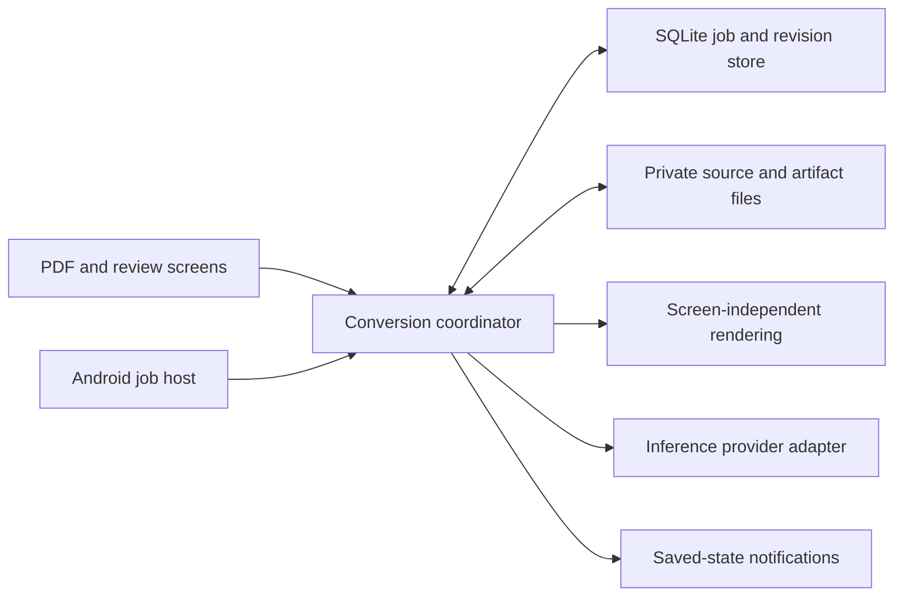

# PDF conversion: durable tablet jobs, bounded chunks, and precise review

Date: 2026-11-12

Status: implementation, native acceptance, and GitHub delivery are complete. [Prima 1.0.6](https://github.com/Saphyiere/Playground/releases/tag/prima-1.0.6) was built and published by GitHub Actions from `226025fb46ee3a5024d1148f4ba2ebae46aa9d91`, then its verified APK was installed on the tablet. The saved Sweden review reopens with its source image and no application errors. The progress record below describes the completed milestones; the original approved design that follows is retained as design history.

### Implementation progress — 2026-11-12

- Captured the original Sweden PDF, completed tablet draft, and four call records into ignored local artifacts. The downloaded same-edition MIDI corroborates all 208 reference pitches and onsets. That pre-redesign draft had twelve wrong pitches across seven bars; automatic comparison introduced two of them. See [the measured accuracy baseline](sweden-accuracy-baseline.md).
- Added an offline accuracy evaluator and synthetic regression tests. Full copyrighted score data remains under ignored `artifacts/`.
- A separate diagnostic Android application renders native PDF crops and Verovio JS/Wasm notation without an Activity or WebView. Normal rendering, explicit cancellation/resource cleanup, and screen-off rendering of the actual Sweden PDF and saved notation passed on the tablet. The repeat-start experiment exposed an Android start-ID cleanup defect, which was fixed and retested. The production managed/native bridge also passed its separate device test: exact normalized crop pixels, invalid-page rejection, cancellation and identical rendering after recovery. Evidence is in ignored `artifacts/rendering-proof/sweden-screen-off/result.json` and `artifacts/rendering-proof/managed-fixed/result.json`; see `../tools/Prima.RenderingProof/README.md` for the protocols.
- Replaced review raster tints with the existing interactive `Sheet` and exact measure selection. Native tablet checks confirmed that selecting bars 1 and 7 highlights the correct rendered measure across both staves. The manual editor saved a G3-to-G4 edit, and Undo restored the rendered bar.
- Added a provider-neutral typed inference boundary, explicit execution settings, capabilities, and normalized response metadata while preserving the existing Anthropic adapter and defaults.
- Added stable source-bar contracts, conservative complete-bar chunk planning, and immutable persisted source-map revisions. These contracts now drive the integrated durable conversion pipeline, including the completed live Sweden job.
- The actual Sweden image yields 13 + 9 proposed bars. Durable jobs, source-derived request allowances, observed-output adaptation, foreground execution, completion notifications, manual correction and targeted recheck proposals are implemented. The final automated runs passed **85/85 Core tests, 85/85 UI/coordinator tests, 36/36 shared API tests, and 15/15 JavaScript tests**, including five focused managed lifetime regressions, with no build warnings or errors in the scoped .NET validation.
- The embedded Debug build was installed with `adb install -r` after validating its signature, target SDK and service permissions. The real main-app pipeline completed seven rendering-only batches while the tablet was dozing, then stopped its service. Explicit Cancel remained Cancelled. Killing the verified main process during a separate rendering-only job preserved two completed chunks; startup recovered Interrupted and the same job resumed to Ready with zero provider attempts. Evidence is under ignored `artifacts/diagnostics/prima-conversion/installed-test/`.
- The first new live Sweden conversion was announced and started at 2026-11-13 02:05:26 UTC. It completed in 5:12.48 with seven application attempts, $1.017748 recorded cost, 69,847 input tokens and 36,918 output tokens. The independent comparison matched all 208 evaluated notes at raw/canonical/MEI/playback stages, with no missing or extra bars. Android's saved-result notification and clean service shutdown were captured. No reference MIDI or expected pitches were included in model requests.
- The final notation-fidelity pass preserves written 8va/15ma/8vb notation and exposes unresolved/dropped boundary marks as deterministic review issues, separate from model doubts. A current-writer fixture was rendered on the tablet with all three octave forms and two voices sharing one line, with clean resource/service shutdown. The live Sweden reading has no deterministic fidelity findings and still scores 208/208 through the final assembler.
- The owner authorized Computer Use and unlocked the tablet for native acceptance checks. The targeted recheck's two-step confirmation was exercised, then an announced live recheck of bar 7 completed while the app was on Android Home. Tapping its actual Android completion notification returned to the correct piece and bar 7; the saved proposal was visible and the prior score was preserved. The one request used 12,582 input tokens and 2,359 output tokens, recorded $0.097508, and took 20.20 seconds at the provider. Its proposal matched every written field of the existing bar and all 12 evaluated reference notes. It was left unaccepted, avoiding an unnecessary revision.
- Native acceptance found a separate visible regression: Back from the conversion reader left the PDF blank, while Library → the same piece rendered it correctly. The scoped `Piece`/`PdfPages` repair passed both focused lifecycle regressions and all five PDF JavaScript tests. On the installed replacement Release, Back from a cold notification route now draws the PDF correctly.
- The replacement Release, including that navigation repair, built with zero warnings and zero errors, including trimming and AOT. Its signature and packaged manifest were verified: minSdk 24, targetSdk 36, non-exported `dataSync` conversion service, and no Debug diagnostic service or debuggable flag. The APK completed at 18:32:55 local time with SHA-256 `46131C1FA19E2BAABBD655B0EEBFAB82A9FE7B92944CEA1532E1763A5F66CB7D` and was installed for the native check.
- The next Convert action exposed an asynchronous view-disposal race: a pending `Sheet` render reached a removed element and `PdfPages.Release` encountered a disposed object. The original Release log is retained as `release-reopen-error.log`. The repair now guards work by its component owner, disposes late imports, prevents disposed sheet/PDF work from reviving, and releases owned image URLs. Five focused managed lifetime regressions and the complete UI/JavaScript suites passed; active errors still propagate.
- The final local Release, including the disposal repair, built with zero warnings and zero errors and was installed after signature and manifest verification. Its SHA-256 is `FE83AC5E44B2D75E2AC1CF8F2E3F84E961FD1900471EFD2862DBF1571143F36A` (18:55:28 local build). Native acceptance passed cold notification-route launch → Back with a visible PDF → Convert with the saved review and source image, followed by two rapid Back/Convert cycles. The scoped `final-release-errors.log` is empty; screenshots `ui-final-back.png`, `ui-final-reopened.png`, and `ui-final-rapid-reopen.png` are retained under ignored `artifacts/diagnostics/prima-conversion/installed-test/`. These final navigation checks made no new model requests.
- [GitHub Actions run 43356068783](https://github.com/Saphyiere/Playground/actions/runs/43356068783) released Prima only, using the optional app-folder selector. The full CI run passed 410 Core tests and 85 UI tests; the existing optional paid live-API test was skipped because CI has no provider key. The signed arm64 Release built with zero warnings and errors. The published `prima.apk` is 59,130,920 bytes with SHA-256 `72a79b594049ff7f5e68187a052f9d7550a552e1a0642a1a96f41efb30a080e8`. Its digest, existing-device signing certificate, production service and absence of Debug diagnostics were verified before installation. The tablet reports version 1.0.6, retains the saved review, and has an empty scoped error log after opening it. The standalone rendering-proof app was removed after its evidence was saved locally.

The initial baseline and rendering proof made no paid inference calls. The original Release was restored after read-only baseline extraction. The Debug integration build included a DUMP-protected diagnostic entry point used only with a separate `Sweden — conversion test` library piece; the original imported piece and draft are preserved. The currently installed Release omits that entry point.

## 1. Decisions and scope

- Keep execution and durable job state on the tablet. No application web backend is part of this plan; the selected inference provider still receives the requested music images.
- Leaving a screen, opening another piece, switching apps, or locking the screen must not be treated as Cancel.
- Only explicit Cancel marks a job cancelled. Android process termination, reboot, loss of connectivity, or an execution deadline instead leaves recoverable interrupted/paused work.
- Save work incrementally and notify after a result or failure has been saved. Reopening a piece attaches to its existing job rather than starting another paid request.
- Keep job execution, notation contracts, persistence, review, and notifications independent of Anthropic and of any one model. Preserve the working Anthropic streaming adapter as the first implementation.
- Split by manageable ranges of complete source bars, with budgets and musical context, rather than assuming an entire printed system is a safe request.
- Make review useful even when the model has not flagged a problem. Support targeted model corrections and a bounded manual bar editor; users should not need to edit XML.
- Keep all conversion, review, acceptance, and cancellation actions outside the piano-key shortcuts.
- Retain the two-step conversion entry: the PDF toolbar opens the form; Back replaces that toolbar action; the paid confirmation remains lower in the form.

The earlier uncommitted fixes are part of the implementation baseline, including practice fullscreen, local error handling,
and the two-step toolbar/form button placement. Device installation must not interrupt an active conversion.

## 2. Pre-redesign evidence and behavior

The observations in this section describe the original application before the implementation above. They are retained to explain the approved design and the regressions it addresses.

The live tablet screenshot is saved locally at `artifacts/diagnostics/prima-conversion/review-current.png`. It shows 2 of 2 systems processed, a reported cost of $1.23, a duration of 7:54, and many bars marked in doubt. The first printed system is labelled bars 1-13; its generated notation wraps over three rendered systems.

The overlay defect is confirmed, not a model-confidence issue:

- `src/Prima.UI/Components/Sheet.razor.js`, `engrave`, returns only horizontal edges for each rendered measure.
- `src/Prima.UI/Transcription/ReadNotes.razor`, `Tint`, applies the top 56% or lower 54% of the entire image as a staff region.
- After wrapping, those horizontal edges project onto unrelated rows. The screenshot shows later-bar labels on the first row and a highlight crossing into the row beginning at bar 7.
- Source highlighting has a separate weakness: `PrintBar` requires detected barline count to equal returned bar count plus one. Otherwise it supplies no highlight. The absence of source highlights in this screenshot is consistent with that path but does not by itself prove the counts.

The musical-quality problem needs its own baseline. The user's assessment was that the conversion was extensively wrong. Do not treat a structurally valid response, a completed comparison, or an empty doubts list as proof of musical accuracy. Diagnose raw model output, notation assembly, engraving, and playback separately: at that baseline, `ReadingScore` normalized some written notation into sounding pitches and could drop unresolved ties/marks without a separate review finding.

Pre-redesign execution and cost facts, retained here to explain the changes:

- `PdfToNotation.ReadAsync` works per printed system, not per bar. It completes the first system before running later systems, with up to four concurrent later systems.
- Each system normally requires a reading request and a comparison request. Either task may be repeated once when its checks fail. Two systems therefore mean four normal requests, potentially more with repairs and transport retries.
- Both tasks allow 64,000 output tokens and inherit the high-effort Opus default. This is a ceiling, not a requirement to generate that many tokens.
- `ReadNotes` owns the cancellation source. Its close/dispose path cancels the run. The assembled draft is saved after the run returns; completed system readings inside a run are still in memory.
- Completed API calls are logged with their replies and message IDs. Those logs are useful evidence, but are not a resumable job contract.
- Cropping and comparison engraving depend on the page's WebView. Moving only the HTTP task into a singleton does not provide background execution.

## 3. The user experience

| Action or event | Required behavior |
|---|---|
| Confirm conversion | Save a job and its budget/settings, then start it. Show progress immediately. |
| Back, Library, another piece, or app navigation | Detach this view; continue the job. |
| Return to the piece | Show its saved job state and attach to progress; do not duplicate the request. |
| Switch apps or lock the screen | Continue through Android's supported background execution, with a notification. |
| Explicit Cancel | Persist cancellation, stop scheduling, cancel active requests where supported, retain completed work. |
| Network loss or transient service error | Show waiting/retry state with a bounded policy. Retain checkpoints. |
| Process death, reboot, or Android service timeout | Recover as Interrupted/Paused from saved state. Do not report cancellation or leave a permanent Running spinner. |
| Conversion ready | Save first, then show an in-app banner or Android notification that opens the review. |
| Unrecoverable failure or budget limit | Save the reason and completed work, then notify with an action to review/resume. |

Use messages such as “Sweden is ready to review - 6 bars need attention,” not an unqualified success claim. A result can be ready for review without being verified correct. Notification dismissal does not delete the result. If notification permission is declined, job status and results remain available in the Library.

Tablet-only execution cannot promise to continue after force-stop or while the device is powered off. Those events preserve checkpoints for later recovery; they cannot preserve an ordinary live HTTP stream. This limit must be stated honestly in the product.

## 4. Durable job and provider contracts

The screen becomes a viewer/controller of a conversion job. A coordinator owns scheduling and cancellation. A native Android host owns execution lifetime. Provider adapters only perform inference and report normalized results.

Proposed persisted records, finalized before SQL implementation:

| Record | Essential contents |
|---|---|
| Job | ID, piece/source revision, selected pages, state, cancellation request, settings, provider/model selection, timestamps, last heartbeat, budget, known usage and result revision. |
| Source bar | Stable source identity, page/system/order, display number, segmentation revision, full source/staff geometry, boundary context. |
| Chunk | Owned source bar IDs, read-only context IDs, phase, input/context revision, output reference, dependency state. |
| Attempt | Job/chunk/phase, attempt ID, provider/model and prompt/schema versions, started/completed status, provider request handle if supplied, usage/cost, error or uncertain completion. |
| Revision and review | Candidate notation per source bar, base revision, user flags/acceptance, accepted patch, edit history and undo linkage. |
| Artifact | Immutable or versioned crop, model response, notation and rendering files, hashes, and references to the records that own them. |

Checkpoint boundaries:

1. Persist source/crop identity and the planned request before dispatch.
2. Persist a completed reading before rendering or comparing it.
3. Persist deterministic validation and comparison findings separately.
4. Persist each proposed correction and acceptance separately.
5. Commit result readiness before notifying.

Use atomic file replacement plus database references so a crash cannot leave a successful state pointing at a partial file. Use one coordinator claim per job and revision checks on commits. Repeated starts and repeated notifications must be idempotent.

Treat the gap between dispatch and a saved response explicitly. A provider request ID is diagnostic unless that adapter actually supports retrieval. An interrupted in-flight request may have incurred cost even when its response was lost. Preserve that uncertainty, use real provider retrieval/idempotency where available, and avoid silently restarting the whole job.

Only Cancel writes Cancelled. Late responses after Cancel may be retained as attempt evidence, but must not publish a result or restart the job. A saved completed stage remains usable after cancellation.

Provider independence:

- Replace the business-layer dependency on `IClaude` with a provider-neutral inference boundary and explicit execution settings.
- Keep typed music contracts and deterministic validation outside adapters.
- Normalize text/structured result, finish reason, usage, retry information, request handle, and failures.
- Describe capabilities: image input, structured output, context/output limits, cancellation, token counting, and optional durable asynchronous retrieval.
- Pin provider/model and contract versions to each attempt. Do not silently switch models halfway through a correction.
- Keep credentials in the existing host secure-storage boundary. Do not store them in jobs, logs, WebView state, or exported notation.

## 5. Android execution and rendering feasibility gate

Start an appropriate foreground execution host from the user's confirmation action, with a progress notification and Cancel/Open actions. For this import/network workflow, evaluate a direct `dataSync` foreground service first; do not treat the service as unlimited. Android 15+ applies background time limits, and Android 16 adds job-quota considerations to long-running WorkManager work. Handle platform stop/deadline callbacks by checkpointing and marking interruption.

A short technical spike must prove the complete pipeline while the activity is not visible and while the screen is off:

- PDF rasterization and crops must be service-owned or persisted before the view detaches. WebView blob URLs cannot be the durable artifacts.
- Run the bundled Verovio without the page's DOM. First evaluate AndroidX JavaScriptEngine for JS/Wasm in a service, producing SVG, followed by native SVG-to-PNG rendering for model comparisons.
- Feature-check the engine and its data-transfer/Wasm requirements. It requires supported Android/WebView capabilities; the app currently has a lower minimum Android version than this option supports.
- If that route cannot reliably run the bundled renderer, assess native Verovio integration. Do not declare a hidden page WebView to be durable background execution.
- Interactive review geometry can be calculated by the visible SVG sheet when review opens. The background worker needs valid comparison images, not screen overlay coordinates.

Supported-device decision for the first integration: keep the application's existing Android minimum for its other features, but preflight conversion's JavaScriptEngine/Wasm capabilities before dispatch. Devices without the required API 26+ engine receive an actionable conversion-unavailable result before any paid request. Do not silently substitute a screen-owned WebView or claim that such a fallback can continue after navigation. A separate native-Verovio implementation remains a future compatibility option.

Do not proceed with the full lifecycle refactor until this spike demonstrates rendering, cancellation, memory cleanup, and screen-off operation on the target tablet. Decide the supported-device fallback explicitly if the engine is unavailable.

## 6. Source identity, geometry, and chunk planning

Establish PDF -> page -> printed system -> source bars before requesting notes. Reuse the existing staff/barline candidates, but validate bar boundaries and allow a user to correct an uncertain boundary. Braces, stems, double barlines, and repeats must not invent extra bars.

Assign a stable `SourceBarId` independent of display numbering and model output count. Link canonical notation to that identity. Pickups, repeats, alternate endings, and a bar whose displayed number repeats must remain unambiguous. A changed segmentation revision requires explicit remapping; outstanding corrections cannot silently attach to a different source region.

Persist source rectangles in normalized original-page coordinates. Generate separate rendered rectangles for the current notation/layout revision: bar ID, staff ID, rendered page/system, and x/y/width/height. Never use horizontal bounds plus a percentage of the whole image as a staff rectangle. A selection across wrapped systems needs separate rectangles, not a single large union rectangle.

Adaptive chunk policy:

- Begin evaluation with 2-4 complete bars per chunk, and 1 bar for especially dense material. These are tuning starting points, not fixed production limits.
- Consider source density, voices/chords/tuplets, crop legibility, provider limits, and observed output usage. Bar count alone cannot predict complexity or exact tokens.
- Give every chunk an owned output range plus read-only context: applicable clefs/key/meter, continuation state, and adjacent source material when necessary. The response emits only the owned source bar IDs.
- Do not run dependent chunks in parallel using stale musical context. Resolve the boundary state or an explicit source signature first. Start with conservative concurrency and a shared budget.
- Keep a configurable safe output target below the provider's maximum. Reserve space for context and structured output. Calibrate estimates from completed chunks instead of assuming a 50-bar piece always fits a fixed number of requests.
- On output-limit termination, save earlier completed work and split only the unfinished range. Never accept truncated JSON or silently raise limits/retry without a bound. A single bar that still cannot fit needs a specific failure/review path.

Here “batches” means our local chunks and queue. Provider Batch APIs are an optional adapter capability, not a prerequisite; they do not solve segmentation, musical context, or an individual request's output limit.

## 7. Accuracy, repair, and reassembly

Keep written notation as the editable source of truth. Derive sounding pitches, playback ordering, and MIDI from it. Audit the current normalization of clefs, octave lines, ties, and open marks so engraving/playback transformations are not mistaken for model errors.

For each chunk: read -> persist -> validate -> render -> verify -> propose repair -> persist. Deterministic validation should identify precise affected bars and include coverage, voice durations, valid note values, pitch range, and boundary consistency. It does not prove that the notes match the image.

Make repair a coordinator policy with a small explicit allowance. Replace the shared client's unconditional full-response rewrite for this workflow with targeted repairs. A response may replace only requested bar IDs at the expected base revision. Reject foreign/duplicate/missing IDs, invalid issue targets, malformed music, and stale proposals.

Compare small, legible source and generated regions. Evaluate whether the visual verifier actually reduces errors; agreement from the same model is not independent proof. Consider a source-first verification variant and compare it on held-out fixtures before paying for it on every chunk. Do not label an empty doubts list “Matches the print.”

Reassemble by source ownership, in written order. Every required source bar must appear exactly once. Missing chunks stay visibly missing; later bars must not be renumbered to hide a gap. Validate seams for meter/key/clef state, ties, slurs, hairpins, pedal, tuplets, and repeat/ending structure. Unresolved boundary marks must become review issues rather than being silently dropped.

A context-changing correction invalidates only dependent later context until an explicit source reset or equivalent state is reached. It does not authorize rewriting accepted neighboring bars.

## 8. Review and targeted correction

Use the source crop alongside the existing interactive SVG sheet. Reuse `Sheet.OnBarTapped`, `OnNoteTapped`, `Outline`, and the full two-dimensional geometry patterns in `bars.js`; do not create another raster-only selection system.

The review should provide:

- A compact count/filter/list of issues, with next/previous unresolved actions, instead of a long header listing every doubtful bar.
- One active outline by default. Other issues get small badges or light outlines, not overlapping orange blankets.
- Synchronized selection of a source bar and its generated notation even when line wrapping differs. Unknown source geometry is shown honestly and can be corrected.
- Actions on every bar: Mark correct, Flag a problem, Recheck selected bar/range, Edit, and History/Undo.
- Separate review states: unreviewed, model flagged, user flagged, accepted by user, and user corrected. Preserve machine-check results separately; do not invent a confidence percentage.
- Issue targets as bar plus optional staff/voice/beat/note, with concrete categories such as pitch, rhythm, missing/extra note, clef/key, voicing, or source mapping, and free text.
- A bounded manual editor for notes/rests in the selected bar: pitch/accidental/octave, duration, staff/voice, ties, and insertion/removal, with immediate validation and engraving. A full general-purpose score editor is outside the initial scope.

A model recheck receives only the allowed target bars, their high-resolution source, current notation, the user's description, and read-only neighboring context. It returns a proposed patch. Show the before/after difference and allow acceptance per bar. Accepted bars remain protected; the user can deliberately reopen them for editing or recheck. Preserve revision history, and reject or reconcile a response arriving after newer user edits.

Review does not require a connected piano. Visual inspection and editing must work independently; on-device audible preview should be assessed as a follow-up to the existing piano-only Listen path.

## 9. Budgets and observable progress

Track input, output, cache usage, provider-reported reasoning usage where available, and cost per attempt and phase. Do not double-count reasoning if it is already included in the provider's output total. Show known cost separately from estimated remaining or uncertain interrupted cost.

Input and output tokens are priced separately. The approximately 50,000 output tokens reported by the user would be about $1.00 at the current Opus 5.5 output rate; 50,000 ordinary input tokens would add about $0.20. This is illustrative, not a reconciliation of the run's bill. The screenshot's $1.23 comes from the app's own accounting. Exact analysis needs its per-request usage records.

Cumulative tokens across four requests are not one request's context/output usage. Check both per-call limits and the whole-job spending allowance. Reserve allowance for active parallel requests before dispatching another. Bound verification and repair counts, and pause with a clear reason when the allowance is exhausted.

More chunks can repeat context and increase total tokens or cost. Optimize peak request size, repair scope, and cost per correctly accepted bar together; do not promise that splitting alone makes the job cheaper.

Expose useful phase states: preparing bars, reading bars 5-8, checking, verifying, saving, waiting for network, or retrying after a service response. Include last progress time and actual attempt count. A generic Processing label must not imply progress after a dead worker.

## 10. Implementation sequence and acceptance gates

| Phase | Deliverable | Gate before proceeding |
|---|---|---|
| 0. Baseline and feasibility | Preserve this source/result, review a same-edition reference, separate model/assembly/render errors; prove service-owned rasterization and engraving. | Screen-off rendering works on the target; baseline errors and costs are recorded. |
| 1. Identity and precise review geometry | Stable source bars, separate source/render maps, interactive selection, honest issue states. | Bars 1, 7, 11 and 12 highlight only their own row/staff in the captured wrapped example. |
| 2. Durable coordinator and provider boundary | Versioned job/chunk/attempt store, checkpoints, cancellation and recovery, generic inference adapter. | Crash/restart at every phase retains completed work; no duplicate active job or silent completed-work replay. |
| 3. Bounded bar-range conversion | Adaptive chunking, context dependencies, token/cost reservations, targeted repair, seam-safe assembly. | Dense/long scores stay within configured request bounds; missing/duplicate bars and invalid seams cannot be published as complete. |
| 4. Android lifetime and notifications | Foreground host, permission flow, progress and saved-result notifications; UI detaches/reattaches. | Navigate away, switch apps, and lock screen without cancelling; OS interruption recovers honestly. |
| 5. Human correction | Every-bar actions, accepted-bar protection, targeted model proposals, manual bar editing, undo. | Non-target bars remain unchanged; stale responses cannot overwrite edits; all review state survives reopening. |
| 6. Quality and release validation | Compare old/system and new/bar-range pipelines on reviewed and held-out material. | Demonstrated accuracy/cost benefit, with agreed thresholds and no structural coverage failures. |

Focused validation must cover:

- Portrait/landscape, zoom, resize, multi-system wrapping, both/single-staff highlights, uncertain source barlines, and mismatched source/render line breaks.
- Ordinary navigation versus explicit Cancel; process kill, reboot, loss of network, service deadlines, denied notifications, late responses, and duplicate starts.
- Truncated output, malformed/foreign patches, retries, budget exhaustion, and unknown interrupted usage.
- Pickups, changing key/meter/clef, repeats/endings, cross-boundary ties and marks, multiple voices, dense chords, ledger lines, faint print, and missing/extra model bars.
- No accepted-bar mutation outside an explicitly authorized target; manual edits and undo round-trip through storage.
- Measured pitch/onset/duration and chord completeness, omissions/extras, structural coverage, cost per accepted bar, and elapsed time. A finished job or model confidence is not the accuracy metric.

Use mocked providers for routine reliability tests. On 2026-11-12 the owner authorized normal live evaluation runs and asked to be told before each actual run; they explicitly said a separate evaluation spending budget is not needed yet. Start with the stated Sweden workload and the same-edition source/MIDI baseline. Product request/output-token safeguards remain separate from that evaluation authorization. Numerical accuracy/cost thresholds and final chunk sizes are decisions to make from that baseline, not facts established by this plan.

## 11. Main source touchpoints

- `src/Prima.Core/Transcription/`: new job/chunk contracts, context/seam validation, source identities, and coordinator extraction from `PdfToNotation`.
- `src/Prima.UI/Transcription/ReadNotes.razor`: attach to job state, revised bar review and correction UX; remove ownership of job cancellation/lifetime.
- `src/Prima.UI/Storage/`: durable job, attempt, artifact and review revisions, alongside existing library storage.
- `src/Prima.UI/Components/Sheet.razor`, `Sheet.razor.js`, `PdfPages.razor.js`, and `wwwroot/bars.js`: source geometry, reusable interactive sheet, and separation of worker rendering from UI rendering.
- `src/Prima.Tablet/Platforms/Android/`: foreground host, notification permission/actions, deadlines/recovery, and screen-independent rendering bridge.
- `../Kit/Playground.AI.Assist/`: provider-neutral boundary and settings, Anthropic adapter, task-controlled repair policy. Preserve shared consumer behavior with focused adapter tests.
- `tests/Prima.Core.Tests/`, `tests/Prima.UI.Tests/`, and shared AI tests: lifecycle, chunking, geometry, review and adapter regressions.

## 12. External constraints checked for this plan

- [Android foreground services](https://developer.android.com/develop/background-work/services/fgs) and [service timeouts](https://developer.android.com/develop/background-work/services/fgs/timeout): user-visible foreground work, with platform-enforced limits; `dataSync` background execution is not unlimited.
- [Long-running WorkManager work](https://developer.android.com/develop/background-work/background-tasks/persistent/how-to/long-running): Android 16 job quotas also matter when WorkManager starts a foreground service.
- [Android JavaScriptEngine](https://developer.android.com/develop/ui/views/layout/webapps/jsengine): service-owned JS/Wasm without a WebView is a candidate to prove, not an already validated Verovio solution.
- [Verovio toolkit methods](https://book.verovio.org/toolkit-reference/toolkit-methods.html): native renderer integration is a fallback to evaluate if the JavaScript engine cannot meet the supported-device requirements.
- [Android notification permission](https://developer.android.com/develop/ui/views/notifications/notification-permission): completion notifications require handling permission denial without hiding saved results.
- [Anthropic Messages](https://platform.claude.com/docs/en/api/messages) and [batch processing](https://platform.claude.com/docs/en/build-with-claude/batch-processing): an ordinary request ID is not a general resume handle; durable batch retrieval is a separate capability.
- [Anthropic pricing](https://platform.claude.com/docs/en/about-claude/pricing): illustrative token arithmetic above, verified on the plan date; record actual provider/model usage instead of baking these rates into job logic.
