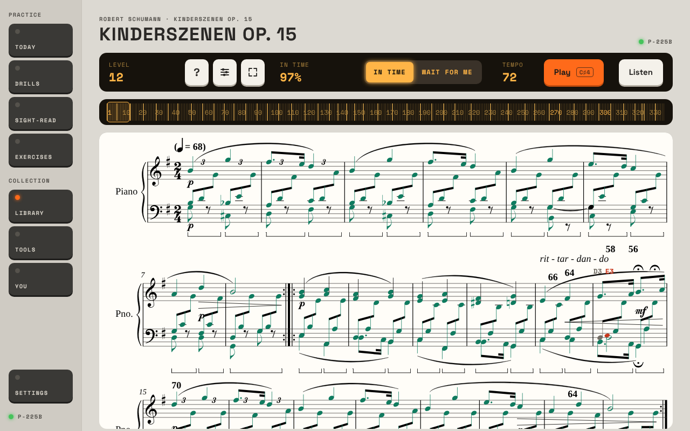
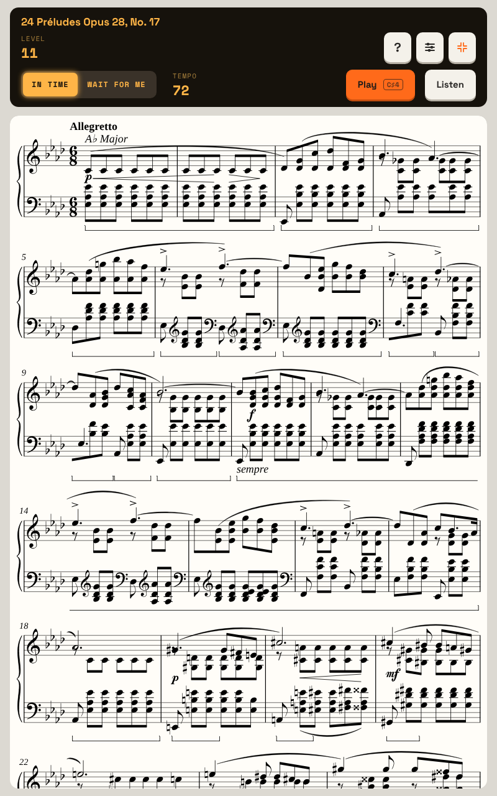
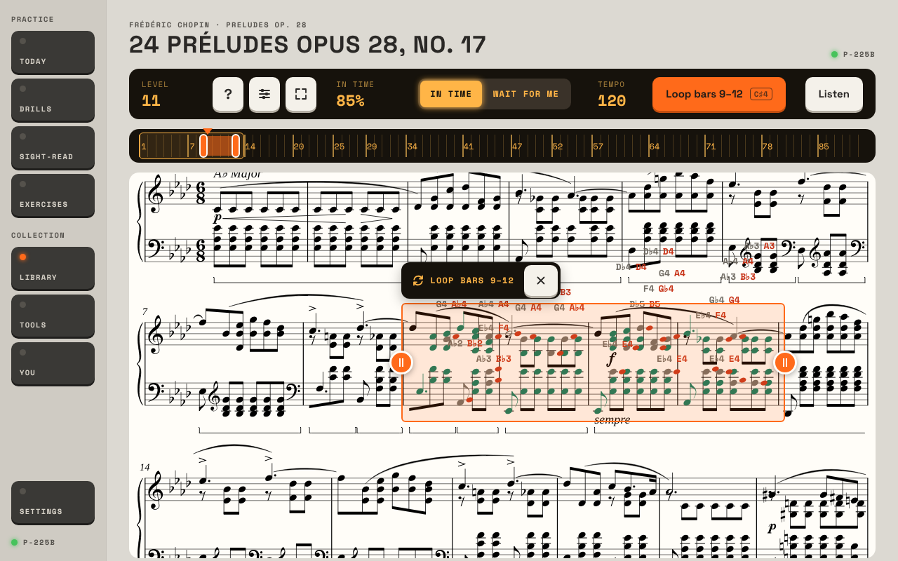
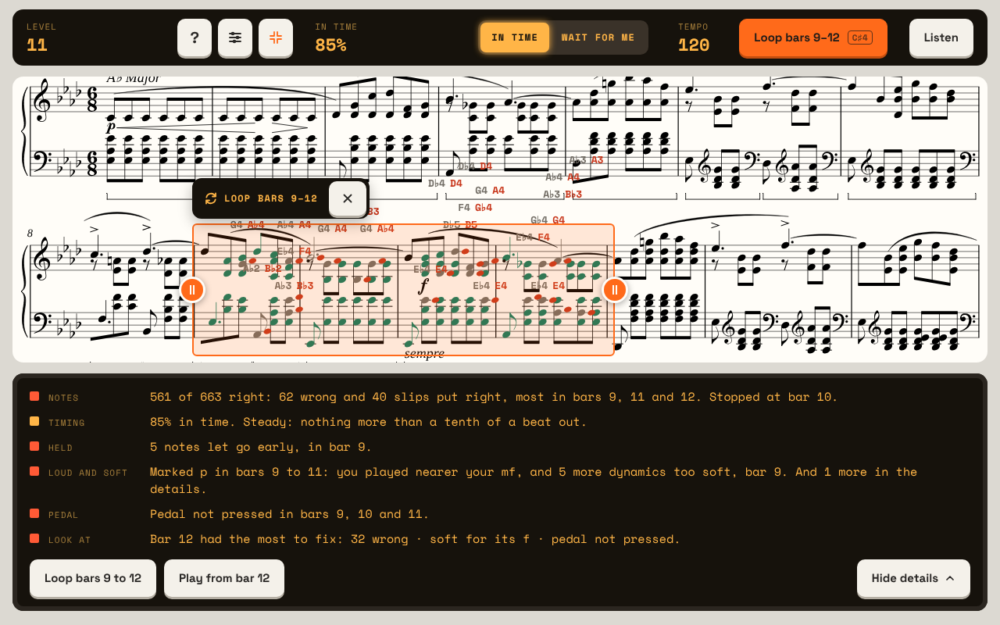
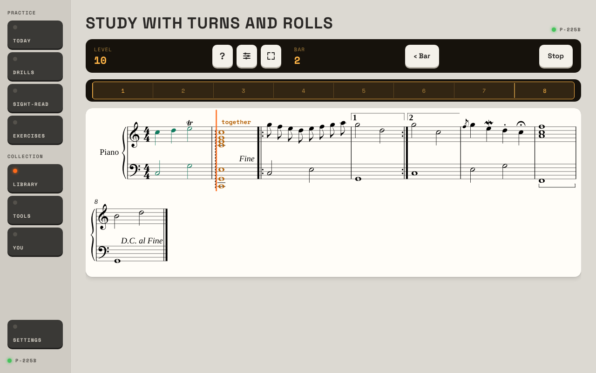

# Prima, used for a month by an advanced player, hunting the hitches

One of four reviews. This seat is a strong amateur (about grade 7 or 8) who wants Prima mostly as clever sheet music for long
pieces, and it is the review that looks for the slowdowns. Everything was done in the preview host (the real screens, a
simulated piano) at `main`, two changes after 1.0.4, in the Studio look. Each finding says whether I **saw** it in the preview,
**inferred** it from the code, or it needs **the tablet** to confirm. Nothing in the app was changed.

The other three reviews already cover the summary sitting just under the screen's edge, the app not keeping what you did on a
piece, and the Library failing to open on an empty data file. I hit all three and agree; I only add to them here.

## 1. In short

I took on the heaviest music in the Library: Schumann's Kinderszenen (all thirteen pieces as one score: 339 bars, 6,257 notes
with its repeats), Chopin's Préludes No. 17 and No. 8, The Entertainer and Für Elise. I played them through at tempo, looped
hard bars, imported a study of my own, read at level 12 and ran scales at speed. Then I slowed the browser's processor 4 and 6
times to stand in for the tablet and timed everything.

**The hitches are real, they have causes I could measure, and they all grow with the size of the piece.** On a 24-bar piece
nothing is slow. On Für Elise they are small. On a long, dense piece the app comes close to unusable. That is why they have been
hard to pin down: they depend on which piece is open, how much of it you played, and how many pieces you opened before it.

The three things that most need changing:

1. **The end of a run freezes the screen, for longer the more you played.** After the last note, every mark is drawn one at a
   time, and each one searches the whole page for its note. Für Elise: 0.3 s here, 2.3 s with the processor slowed 4 times.
   Prélude No. 17: 3.3 s and 17 s. Kinderszenen: 17 s and about 100 s. The same search runs for every note marked while you
   play, and again every time you press **‹ Bar**. This is the "there's no screen after" problem from the other side: the
   screen after exists, but a play-through is exactly the case where it arrives last.
2. **While the cursor moves, the tablet has little time left for anything else.** Each small move of the cursor makes the
   browser go over the whole piece again. With the processor slowed 4 times the cursor alone keeps it 88% busy in Für Elise and
   97% in Prélude No. 17, so a key's mark waits: about 0.05 s in Für Elise, 0.15 to 0.2 s in the Prélude, 0.3 to 0.45 s in
   Kinderszenen.
   With the cursor and the marks both switched off, this cost goes away.
3. **Every piece you open stays in memory after you leave it.** Each visit to Für Elise leaves 28,000 page elements behind
   (about 11 MB), Prélude No. 17 68,000 (about 28 MB), Kinderszenen 146,000. Nothing gives them back until the app is closed.
   An evening of moving between pieces fills the tablet's memory, and everything slows. This is the best match I found for
   "slowdowns that are hard to pin down".

For my own seat, the largest gap is that **Prima can't follow a real performance**. In time is a click at one tempo and one
metre for the whole piece; Wait for me stops at every chord and wants its keys inside 0.15 s, so a chord the music marks to be
rolled is refused when it's rolled. There is no mode for playing a piece the way it goes.

What's already right: the engraving, which is real sheet music and reads well; full screen turned upright (picture 2), which
is close to a page on the stand; repeats and second endings; trills and grace notes not being counted as slips; the bar strip,
tapping a bar to start there, and loops; the short lines at the top of the summary. The scoring itself is fast enough. Section
3 has the list.

## 2. My month

The preview's clock can't move, so the month is `seed/months` plus the runs I played.

**Week 1: sitting down.** Today offered a level 5 plan (a C major scale, six bars in C major). Nothing on it is for me and it
never mentions a piece, so I went straight to the Library. It would not open: the data file was new, and the Library fails on
an empty one (the other reviews' bug; I got past it by putting one row in the data file by hand). With it open: 283 pieces,
grouped by level, 68 of them at levels 10 to 12. I opened Kinderszenen. It took 2.9 s and showed two lines of music in a
window 430 px tall on an 800 px screen. I played all of it In time at 72 with `right=0.97&spread=15`. When the last note was
played the screen froze for 17 s, then showed one figure in the bar, "In time 97%" (picture 1). The review was below the edge.

**Week 2: Chopin.** Préludes No. 17 (90 bars of thick chords) and No. 8. I turned the screen upright and went full screen:
five lines to a screen, which is the app at its best for me (picture 2). Played through, then looped bars 9 to 12 at 120 for
several passes with slips. While it loops nothing says how a pass went. When I stopped, the review was one lump for all the
passes, off the bottom of the screen, and the wrong notes' names had piled up over the line above (picture 3). In full screen
the review took the lower half and left no whole line of music in view (picture 4). I left the piece at bar 40 and came back:
bar 1, top of the page.

**Week 3: my own music, and what it judges.** I wrote a small study as a MusicXML file (a trill, grace note and mordent,
chords marked to be rolled in both hands, a repeat with first and second endings, a pedal mark, D.C. al Fine) and imported it:
it opened at once, graded level 10, engraved correctly. The repeat and endings were followed; D.C. al Fine was not (the docs
say so). In Wait for me the trill's keys were not slips, which is right. The rolled chord was refused (picture 5). I also read
at level 12 in Sight-read (25 bars in B major in 3/4, 279 notes, sensible music) and ran the D major scale over four octaves,
hands together, where the first run produced "Tempo Infinity" (problem 9).

**Week 4: the hitches.** The same pieces again with the processor slowed 4 and 6 times, each step timed, the browser's own
work traced, and then the code read on the slow paths. Section 4 and the appendix are what came of it.

## 3. What works

Leave these alone.

- **The engraving.** Dense Chopin is as readable as print. Bars are as wide as they need to be.
- **Full screen, upright.** Five lines of the Prélude on one screen. Pedal page turns and the top and bottom keys are the
  right idea.
- **Repeats and endings.** My study's repeat was played twice and its second ending taken (51 notes, counted by hand), and
  Für Elise's run is longer than its page for the same reason.
- **Ornaments.** A trill's keys, played as a trill, made no slips (seen). Grace notes and mordents follow the same rule (code).
- **The strip of bars, tap-to-start, loops with handles.** Tapping bar 305 of 339 took 0.04 s.
- **The summary's first lines**, and **Loop bars** on them. The details and the bar map open in 0.01 s even for 339 bars.
- **Import.** A MusicXML file opened, graded and playable in a few seconds.
- **Hands, Listen, the tempo keeping its value per piece, the mode kept per screen.**
- **The parts that are not slow.** The Library list, its filters and search, leaving a piece, starting a run, and the piano's
  MIDI input code. None of these grows with the piece.

## 4. Problems, the most painful first

"x1" is this machine, "x4" and "x6" the same with the browser's processor slowed. I don't know where the tablet sits. To
find out: open Kinderszenen on the tablet and count. It takes 2.9 s here; 6 s on the tablet means about x2, 12 s about x4.

### 1. The end of a run freezes the screen. Bug (a hitch). Sure.

*What happened.* After a run's last note, or Stop, the screen is frozen until the marks are drawn. Whole pieces: Children's
Album No. 1 none; Für Elise 0.34 s (x4 2.3 s); The Entertainer 0.6 s (x4 3.4 s); Prélude No. 8 1.8 s; Prélude No. 17 3.3 s
(x4 17.5 s); Kinderszenen 16.9 s (x4 about 100 s). The time goes up with the notes played times the size of the page.

*Why (measured).* Of 17.9 s in Kinderszenen, 9.8 s was one search and 7.1 s another: for each of the 6,257 marks,
`Sheet.razor.js` looks through the whole page for the note with that id (line 568) and through all the marks drawn so far for
an older one (line 573). The page has 45,000 elements. Scoring the run took 0.4 s; the summary's own drawing is nothing.

*See it.* `seed/months`, `library/pdmx-QmfM3JtYkeZXaQbaDJrJV3V54mujUrEcGLBEn1djBtaUHM-17`, `/keys/connect`, In time, Play,
`/keys/perform?right=0.97&spread=15`. On the tablet: play Für Elise to the end and count from the last note to "In time"
appearing in the bar; then play only eight bars and Stop. The second is instant.

*What I'd change.* Look every note up once, when the music is drawn, and keep the list. Draw only the marks for the lines on
screen, the rest as they scroll into view.

### 2. The moving cursor uses most of the processor on a long piece. Bug (a hitch). Sure of the cost; the tablet's share needs the tablet.

*What happened.* With a run going and no keys played, the browser's main thread was busy 10% of the time on Children's
Album No. 1, 22% on Für Elise, 51% on Prélude No. 17 and 99% on Kinderszenen (x1). At x4: 42%, 88%, 97%, 100%. Nearly all of it
is the browser re-checking what to paint ("Layerize" and "Paint" in its trace), 25 to 30 ms a frame on Kinderszenen. Marks
then wait their turn. A key to its mark, x4: Für Elise 0.03 to 0.06 s, Prélude No. 17 0.06 to 0.19 s, Kinderszenen 0.26 to
0.45 s (worst 1.3 s). At x6 Kinderszenen fell 2.6 s behind In time and never caught up.

*Why.* The whole piece is one drawing in one scroll, and the cursor and marks are drawn on a layer the size of all of it.
Moving the cursor a pixel makes the browser walk the whole drawing again. With **Cursor** and **Marks as you play** both off,
the trace showed no painting at all.

*See it.* Any long piece, In time, Play, and watch whether the cursor glides or steps. On the tablet: Prélude No. 17 In time
with the cursor on, then Options › While playing with Cursor and Marks as you play both off (the marks come at the end). If it
runs smoothly only that way, this is it.
Children's Album No. 1 should be smooth either way.

*What I'd change.* Put the cursor on its own small layer that the browser can slide without repainting the music; let the
browser skip lines that are off screen; and split Kinderszenen into its thirteen pieces as the Préludes are (it's the only
piece over 120 bars in the collection, but the local collection's sonata movements will be this size).

### 3. Pieces are never let go of. Bug. Sure of the leak; fairly sure of the cause; its effect on the tablet needs the tablet.

*What happened.* I opened a piece, went back to the Library, forced the browser to clear its memory, and counted what was
still alive. Für Elise four times: 32,000, 61,000, 89,000, 117,000 elements, and the browser's memory up 11 MB each time.
Prélude No. 17: +68,000 and about +28 MB a visit. Kinderszenen: +146,000 a visit. An exercise page (music, but no strip of
bars) did not grow at all, and neither did turning the screen with a piece open.

*Why (inferred).* `bars.js` keeps a list of the pieces it is drawing on. When you leave, the page asks it to forget the piece,
but by then the piece's frame is already off the page, so it can't be found, and it stays on the list with all its music.

*See it.* On the tablet: open and close Für Elise twenty or thirty times, then play something. If it is sluggish, close Prima
from the recent-apps list and open it again. If it is brisk again, this is the cause.

### 4. Opening a long piece, turning the tablet, and turning a page each engrave the whole piece again. Friction (a hitch). Sure.

*What happened.* Opening: Für Elise 0.25 s frozen (x4 1.1 s), Prélude No. 17 0.5 s (x4 2.7 s), Kinderszenen 2.8 s (x4 13 to
15 s). Turning the tablet upright or back costs the same again each time. In **Pages**, every page turn loads and lays out
the whole piece to draw one page: 0.4 s a turn on the Prélude, 1.0 to 1.2 s on Kinderszenen (x1), which is too slow to turn
while playing. Pressing Play from Pages draws the piece again as one scroll first (2.3 s frozen on Kinderszenen), and
afterwards the piece has been switched to Scroll for good, though I had chosen Pages.

*See it.* Kinderszenen, turn the tablet. Then Options › Pages, and press ›.

*What I'd change.* Lay a piece out once and keep each page's drawing. Don't change my view because I pressed Play.

### 5. ‹ Bar and tapping a bar while playing score the run, redraw every mark and save it, then start again. Friction (a hitch). Sure.

After 25 s of the Prélude at 120, **‹ Bar** froze the screen for 3.4 s before the count-in came back (x1). At x4 the page
was so far behind that it took a minute. It also leaves a stored run for every press: one day of this testing left 27 In time and 26
Wait for me runs on pieces, most of them a few seconds long. Going back a bar should just move the run back.

### 6. Prima can't follow a real performance. Gap. Sure.

- **In time is one tempo and one metre.** The click and the scoring use the first tempo and the first time signature for the
  whole run (code). Kinderszenen is thirteen pieces in different metres and tempos; a ritardando, a pause or a tempo change in
  any piece is the same problem. Tempo marks aren't read at all.
- **Wait for me refuses a rolled chord.** In my study the chord is marked to be rolled. Rolled at 70 ms a note (a real roll)
  all seven notes turned amber with "together" over them and the run would not move on; rolled inside 0.1 s it passed
  (picture 5; seen). The summary then counts it as a chord played wrongly.
- **Neither mode lets me play through and be told afterwards.** Wait for me stops at every note; In time needs me on a click.

*What I'd change.* A third mode, **Follow me**: no click, the cursor goes to wherever I am, nothing waits, and timing is
judged against my own pace around each note. And read the arpeggio sign so a marked roll is a roll.

### 7. After a play-through there is one figure. Friction. Sure.

Picture 1 is the whole of what a play-through of Kinderszenen gave back without scrolling: "In time 97%". The review is under
the edge (the other reviews measured it: it starts at 810 px of 800). In full screen it shows, but takes 40% of the height and
left no whole line of the Prélude in view (picture 4). A loop is worse: no word while it runs, then all passes as one lump
("561 of 663 right"), with the names of wrong notes from every pass stacked over the line above (picture 3). Section 5 is what
I'd do.

### 8. It doesn't remember where I was. Gap. Sure.

Leaving Prélude No. 17 at bar 40 and coming back put me at bar 1, top of the page (seen). Only a PDF's page is kept. The
Library has no "pieces I'm playing" and no last-played date; for someone who lives in five pieces that is the list I need
first. There is nowhere to write a fingering or a note on the score.

### 9. A scale's first run, hands together, sets a tempo of "Infinity". Bug. Seen in the preview; on the tablet it will be a wrong tempo, not Infinity.

`drills/scales`, four octaves, Together, the first run in Wait for me. The play bar then showed "Tempo Infinity". The
comfortable speed is taken from the middle gap between one key and the next, and with two hands half the gaps are between the
two hands' keys landing together, close to nothing. The simulated piano lands them at the same instant; real hands a few
milliseconds apart would give a tempo in the thousands (inferred from the sum in `TechniquePractice.razor`).

### 10. Smaller things

- **The Library can't open on an empty data file** (bug, seen; the other reviews have the detail). It stopped me at the start.
- **Bare numbers over the music** in Kinderszenen ("58 56", "66 64": picture 1). They are hidden tempo marks from the file,
  shown as text. Cosmetic.
- **Two lines of music in the normal view** (430 px of 800). Full screen is where a player has to be, and it isn't kept.
- **Per-key work that grows with the piece** (code, timed apart from the app): each key in an In time run checks every note
  still to come (0.25 ms a key on Kinderszenen here), a timer does the same ten times a second, and scoring a whole
  Kinderszenen takes 0.4 s. On the tablet these may be 5 to 10 times more. Small beside problems 1 to 3, and only the tablet
  can say.

## 5. How I'd arrange it

For someone who mostly plays through. The owner asked: a play mode and then a summary review? For this seat, yes.

```
Library                      Piece                         Review
  Playing now (my 5)   ->      opens where I stopped   ->    how it went, on a screen of its own
  everything else              full screen as I left it      the bars as a strip, worst first
                               Play  |  Practise             Loop bars 9 to 12  ->  back to the piece
                                                             Done  ->  the session card
```

1. **Library opens on "Playing now"**: the pieces I've played lately, each with when, how far I got, and the last result.
2. **A piece opens where I left it**: same bar, same view, full screen if it was.
3. **Two ways in, named for what they're for.**
   - **Play**: the page and nothing else. No cursor, no marks, no click unless asked (Follow me, problem 6). Pages turn by
     pedal. This is "pretend it's the sheet music".
   - **Practise**: what the piece screen is now, with the cursor, marks, loops, hands, Wait for me.
4. **After Play, a Review screen, not a panel under the music.** How long I played, the bars as a strip shaded by what went
   wrong, the four short lines, and the music with its marks only for the bar I tap. It can draw only what's on screen, which
   also removes problem 1. **Loop bars** goes back to Practise with the loop set.
5. **In a loop, one line after each pass**, in the bar: "Pass 6: 31 of 34, was 24". At Stop, the passes as a row of figures.
6. **The session.** From opening the first piece to leaving the last: "38 minutes. Prélude No. 17: played through twice,
   bars 9 to 12 fourteen times, 71% to 93%." The runs are stored already; nothing reads them.

Move: Today's plan is no use at this level; let Today lead with "carry on with Prélude No. 17" when a piece is in hand.
Merge: Options' **While playing** switches into the choice between Play and Practise. Cut: nothing.

## 6. The five changes I'd make first

1. **Stop searching the page for every mark** (problem 1). It removes the freeze at the end of a run and at ‹ Bar, and most of
   the cost of each mark while playing.
2. **Let go of a piece when it's left** (problem 3), and fix the Library on an empty data file with it.
3. **Give the cursor its own layer, and split Kinderszenen** (problem 2).
4. **A Review screen after a play-through, a line after each loop pass, and open a piece where I left it** (problems 7, 8).
5. **Follow me, and rolled chords read as rolls** (problem 6).

## Pictures

1. 
   After a 17-second freeze, a whole play-through comes back as "In time 97%". The review is under the edge.
2. 
   Full screen turned upright: five lines. The nearest thing to the page on the stand.
3. 
   Several passes of bars 9 to 12, stopped. No review in sight, and the wrong notes' names stacked over the line above.
4. 
   In full screen the review shows, and takes the music's place.
5. 
   Wait for me, a chord the music marks to be rolled, rolled at 70 ms a note: amber, "together", and it waits.

## Appendix: the timings

Measured with a copy of `tools/screens/screens.mjs` that adds the DevTools processor throttle, long tasks, the browser's
timeline trace and its profiler. "Frozen" is the longest single stretch in which the page could do nothing else. In the
preview the app's .NET code runs on this machine; on the tablet it runs on the tablet, so the .NET figures at the end are
the ones the throttle doesn't cover.

**The pieces**

| Piece | Bars | Notes in a run | Elements on the page |
| --- | --- | --- | --- |
| Children's Album No. 1 | 24 | 246 | 2,300 |
| Für Elise | 106 | 933 | 8,700 |
| The Entertainer | 78 | 1,539 | 7,200 |
| Prélude No. 8 | 34 | 1,818 | 17,700 |
| Prélude No. 17 | 90 | 2,501 | 20,200 |
| Kinderszenen | 339 | 6,257 | 44,800 |

**Opening, turning, leaving** (seconds frozen)

| | x1 | x4 |
| --- | --- | --- |
| Library opens, 283 pieces | 0.04 | 0.13 to 0.47 |
| Library filter; search (0.25 s of it is a wait for typing to pause) | 0.01 to 0.04; 0.27 | 0.02 to 0.10; 0.29 |
| Children's Album No. 1 opens | 0.19 | 0.75 |
| Für Elise opens; each turn of the tablet | 0.25; 0.28 | 1.1; 1.2 to 1.5 |
| Prélude No. 17 opens; each turn | 0.47; 0.6 | 2.6; 3.2 |
| Kinderszenen opens; each turn | 2.8; 2.4 to 2.9 | 13 to 15; 14 to 15 |
| Kinderszenen, a page turn in Pages (44 pages) | 1.0 to 1.2 | not run |
| Prélude No. 17, a page turn in Pages | 0.4 | not run |
| Leaving a piece for the Library | 0.03 to 0.1 | 0.15 to 0.3 |

**A run** (seconds)

| | x1 | x4 |
| --- | --- | --- |
| Play to the cursor waiting, Wait for me, Kinderszenen | 0.1 to 0.2 | 0.9 to 1.5 |
| Play to the count-in, In time, Kinderszenen | 0.27 | 1.0 |
| Tap bar 305 of 339 on the strip | 0.04 | 0.01 (then 0.5 busy) |
| Stop after a few bars, to the summary | 0.13 | 1.9 |
| Stop after 20 s of Kinderszenen, to the summary | 0.63 | 5.6 |
| ‹ Bar after 25 s of Prélude No. 17 at 120 | 3.4 | about 60, page backed up |
| Whole piece played, last note to summary: Für Elise | 0.34 | 2.3 |
| The Entertainer | 0.59 | 3.4 |
| Prélude No. 8 | 1.8 | not run |
| Prélude No. 17 | 3.3 | 17.5 |
| Kinderszenen | 16.9 | about 100 |
| Show details; the bar map, 339 bars | 0.01 | not measured apart |

**The cursor moving, no keys played: share of the time the browser's main thread was busy**

| | x1 | x4 |
| --- | --- | --- |
| Nothing running, Kinderszenen on screen | 2% | 3% |
| Children's Album No. 1 | 10% | 42% |
| Für Elise | 22% | 88% |
| The Entertainer | 21% | 88% |
| Prélude No. 8 | 38% | not run |
| Prélude No. 17 | 51% | 97% |
| Kinderszenen | 99% | 100% |
| Kinderszenen, Cursor and Marks as you play both off | 28%, none of it painting | not run |

**A key press to its mark** (milliseconds, middle of 5 to 8 presses, worst in brackets; "start" is bar 1, "deep" nine tenths
of the way through). At x1 about 13 ms is one frame of the screen plus the preview's own round trip.

| | x1 | x4 | x6 |
| --- | --- | --- | --- |
| Children's Album No. 1, Wait for me, start; deep | 14; 13 | 26; 13 (43) | 49 (75); 28 (45) |
| Für Elise, Wait for me, start; deep | 13; 13 | 62 (92); 44 (63) | 67 (104); 65 (84) |
| Für Elise, In time | 12 | 27 (39) | 49 (107) |
| Prélude No. 17, Wait for me, start; deep | 13; 29 (46) | 157 (182); 185 (207) | 258 (366); 298 (342) |
| Prélude No. 17, In time, start; deep | 10; 9 | 121 (181); 63 (78) | 218 (450); 439 (818) |
| Kinderszenen, Wait for me, start; deep | 61 (101); 60 | 261 (574); 447 (650) | 492 (632); 389 (901) |
| Kinderszenen, In time, start; deep | 31 (52); 53 (80) | 369 (727); 306 (1,329) | 2,641 (4,401); not run |
| Kinderszenen, a wrong key to its red head, Wait for me | 17 to 20 | 80 to 116 | 104 to 127 |

**Memory after opening a piece and leaving it** (elements still alive after the browser cleared its memory; its memory in MB)

| Visits | Für Elise | Prélude No. 17 | Kinderszenen |
| --- | --- | --- | --- |
| 1 | 32,000; 216 | 185,000; 305 (after the four Für Elise) | 150,000 |
| 2 | 61,000; 227 | 253,000; 338 | 297,000 |
| 3 | 89,000; 239 | 320,000; 364 | 443,000 |
| 4 | 117,000; 250 | 388,000; 386 | 589,000 |

An exercise's page opened and left four times stayed at 1,319. Turning the screen three times with a piece open added none.

**The .NET code on its own** (this machine, outside the app; the tablet will be several times slower, and this work is on the
thread that also draws the screen)

| | Für Elise | Prélude No. 17 | Kinderszenen |
| --- | --- | --- | --- |
| Reading the piece when it opens (done off the screen's thread) | 2 ms | 5 ms | 129 ms |
| Working out a run's notes, on every bar tapped | 1 ms | 2 ms | 10 ms |
| Each key, In time, at the start of the piece | 0.05 ms | 0.09 ms | 0.25 ms |
| The 0.1 s timer's check for missed notes | 0.01 ms | 0.02 ms | 0.08 ms |
| Each key, Wait for me | 0.002 ms | 0.002 ms | 0.005 ms |
| Scoring a whole run | 8 ms | 45 ms | 421 ms |

**The suspects, ranked, with what points at each**

| # | Suspect | Where | Evidence | Confirm on the tablet |
| --- | --- | --- | --- | --- |
| 1 | Every mark searches the page | `Sheet.razor.js` `drawMark`, lines 568 and 573; `showMarks` at a run's end | Profile: 17.0 of 17.9 s in those two searches | Für Elise to the end against eight bars and Stop |
| 2 | The cursor repaints a layer the size of the piece | `Sheet.razor.js` `cursorStart`; `.sheet-overlay` in `prima.css` | Trace: Layerize and Paint 25 to 30 ms a frame; gone with the cursor and marks off | Prélude No. 17 with Cursor and Marks on, then both off |
| 3 | Pieces kept after leaving | `bars.js` `pieces` and `forget`, called from `Piece.razor` after the page has gone | Elements alive after each visit; none for a page without the strip | Open and close a piece 20 to 30 times; then restart the app |
| 4 | The whole piece engraved on the screen's thread | `Sheet.razor.js` `draw`, on open, on a change of width, and for each page | One long task each time, 2.8 s for Kinderszenen | Turn the tablet with Kinderszenen open |
| 5 | Going back restarts the run | `Piece.razor` `Restart`, `PlayAlong.razor` `Ended` | 3.4 s at ‹ Bar; a stored run for each press | ‹ Bar half a minute into a dense piece |
| 6 | Placing a wrong note's name measures every word printed on the music | `Sheet.razor.js` `label` | 0.47 of 1.4 s of marking in a 20 s stretch of Kinderszenen | Not separable by eye |
| 7 | Per-key and per-tick .NET work over every note left | `LiveJudge.Play` and `Due`, `PlayAlong.razor`'s 0.1 s timer, `PassageScorer.Score` | Timed apart, above | Only with a build that times it |
| – | Not suspects | `AndroidKeyboard.cs`, the Library, the summary and its bar map | Nothing in them grows with the piece; all under half a second at x4 | |

Two cautions about my own measuring. The preview's "live" player keeps pressing keys after a run is stopped, which spoiled
some early readings; every figure above is from a run with nothing left playing. And with the processor slowed, a long freeze
can drop the preview's link to its server, which the tablet doesn't have; the freezes themselves are the browser's own work
and don't depend on it.
