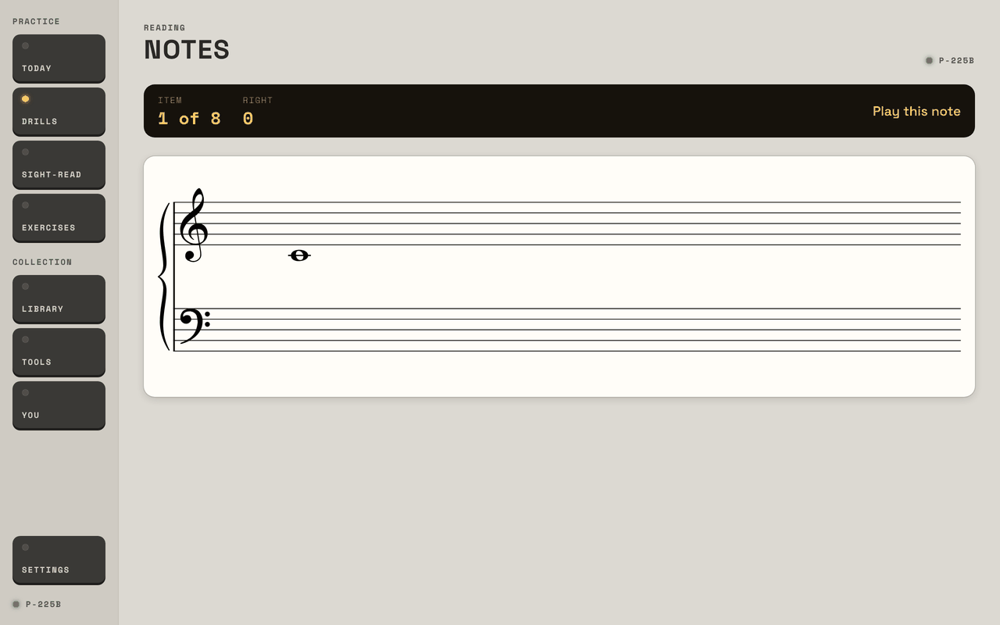
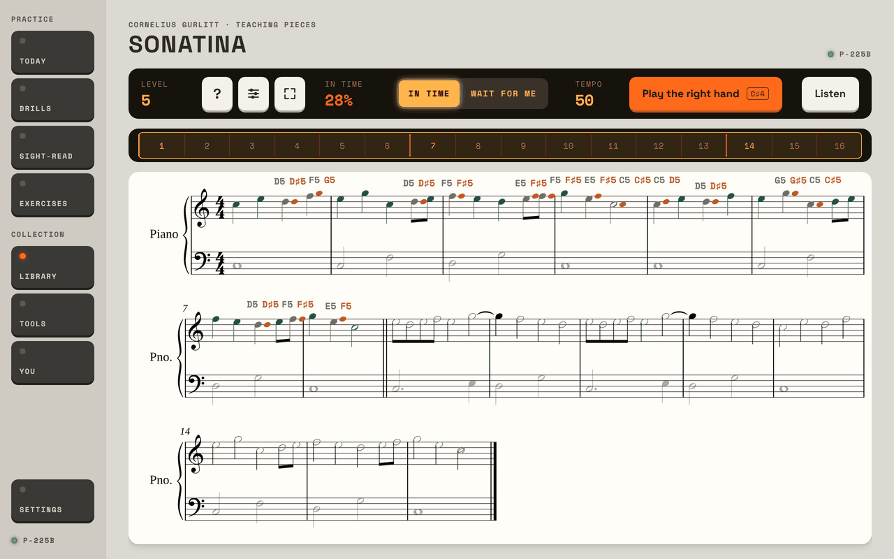

# Prima, reviewed as an adult beginner in the first month

One of four reviews (the others: an intermediate player, an advanced player, a piano teacher). Nothing in the app was changed.
Everything here was done in the preview host on `main`, in the Studio look at 1280 × 800, with the simulated piano. Each finding
says whether I **saw** it in the preview, **inferred** it from the code, or it needs the **tablet** to confirm.

## 1. In short

**Who I was.** Someone who has just bought a digital piano, can't read music, doesn't know which key is C, has 15 minutes a
day, and wants to play one real, simple piece with both hands by the end of the month and to know they're getting better.

**The three things that most need changing**

1. **Prima tests a beginner before it teaches them anything.** The first thing Today hands a new person is a C major scale
   with finger numbers, then a bare note on a staff and the words "Play this note". Nowhere on the way does it say which key
   that is. The answer exists and is very good (the Glossary's "Where the notes live", picture 5), but it is under Tools, and
   nothing on Today, the drills or the summaries leads to it. A real beginner is stuck in the first minute.
2. **There is no path to a piece, and no piece to walk it on.** The easiest piece in the Library is level 5, hands together;
   a beginner reads at level 1 and "Near my level" is empty. The tools for learning a piece are all there (Listen, one hand,
   Wait for me, slower, loop), but they're scattered over the bar and Options, nothing says what order to use them in, and
   the app forgets the piece the moment you leave it: Today, You and the Library list never mention it again.
3. **The summaries measure; they don't coach.** They are true, but written in the app's own terms ("lean", "evenness ±5.6%",
   "legato: a gap of 81 ms", "Zhukov's four"), they end without saying what to do next, and they never say "better than last
   time". After a bad run nothing changes that I'd notice; after a good one the tempo goes up by 3 without a word.

**What's already right.** The honest, calm tone: no points, no badges, no scolding streak. Wait for me, with "together" over a
chord. Wrong keys shown and named on the staff, including "an octave away". Listen. The five-minute plan. The Glossary. The
one-line end of the day. The pieces are there to build "the app as the instructor"; what's missing is the instructor's voice
and the order.

## 2. My month

The clock in the preview can't move, so the month is: a first day from `seed/empty` played through step by step, more runs of
my own for the rest of week one, a piece learnt from zero over "weeks two to four", and `seed/summary` to stand six weeks in.
I played as a beginner does: about two notes in three right, slips, late and uneven
(`/keys/perform?right=0.65&slips=0.2&early=0.35&lean=60&spread=90`), stopping halfway, wrong keys, the right note an octave
high, chords a key at a time, long silences, and with the piano unplugged.

**Day one.**

- *Welcome.* Name, minutes (I chose 15), when I'll practise, the look. Quick and friendly. It never asks whether I can read
  music or have played before. Then "Plug in the piano and set the timing" took me to a screen that begins: "The median of how
  early or late your notes land is kept as the timing offset… since they can't be told apart without a loop of wires." I
  tapped 16 beats and was told "Offset −40 ms, your spread 65 ms". I didn't know what I had done or whether it was good.
- *Today.* Six steps, 17 minutes for my 15. The orange key started step 1.
- *Step 1, Technique: "C major scale and C major arpeggio".* Picture 1. A scale in eighth notes with numbers over it. The line
  under the bar says "First, play it once in Wait for me", but the bar is set to In time and the orange key is Run, so I had
  to find and tap Wait for me myself. I played the top C instead of middle C: the screen put a red note head up high and wrote
  "C4 C5". After the run: "Your own speed came to about 59 beats a minute, so In time starts at 50", which was nice. Then In
  time, badly: "Right hand: 4 wrong, 2 extra, marked on the music. This run doesn't count for evenness. Next run a little
  slower: 45." Then four clean runs, each answered with "the gaps between notes varied by 37 ms (±5.6% of the gap)… thumb
  crossings: below what anyone can hear… touch: velocity varied by ±7. Legato: a gap of 81 ms between keys". After "Runs 5 of
  5" nothing happened. Run was still the orange key. The arpeggio never came. I went back to Today by the rail.
- *Step 2, Notes.* Picture 2. One note, "Play this note", no buttons at all. I waited twelve seconds: nothing. A wrong key:
  "That was C♯4; the note is C4, a key or two away", and on to the next note, with no second go at the one I'd missed. End of
  set: "Right 63%. Typical answer 0.7 s. Missed: C4, G4. They come back sooner." Kind enough.
- *Step 3, Rhythm.* "Tap the first bar's beat, then the rhythm, on any key." By the third try the click was gone ("No click:
  the pulse is yours"). On day one. Result: "In time 75%, lean +9%, steadiness ±9%".
- *Step 5, Sight-reading.* It opened on "Find my level: two short passages from each level… until they fall under 80% in
  time". I failed both level-1 passages and was dropped, without a word about what it had found, into a passage headed "Duet".
  Four passages at 50 to 67% (picture 3): the tempo stayed 60, the level stayed 1, and each summary had four coloured
  squares and six buttons under it (▶, Again, Slower, Find my level, Note by note, Done).
- *Step 6, One spot.* "Bar 1 of the passage you read at 19:44 had the most to fix. Play it 20% slower, then the bars around
  it." This one I understood, and at 48 I got it right. The best step of the day.

**The rest of week one.** Eight clean passages in a row: the tempo went 60, 63, 66. Nothing said so. Today's "In time, last 3"
went from "–" to "100%". A clean passage still ended "Look at: bar 1 had the most to fix: 1 let go early" beside a red square.

**Weeks two to four: a piece from zero.** "Near my level": "The collection starts around level 5. Nothing here." The easiest
piece with notes I could play along to is Gurlitt's Sonatina (16 bars, level 5, hands together), so I took that.

1. *Listen.* One tap, a bar of count-in, the piano plays it and the cursor follows. Good.
2. *Right hand alone.* Behind the sliders key: Options › Hands › Right › Back to the music. Then Wait for me. It waited for me
   as long as I liked (eight seconds of nothing was fine), showed a wrong key in red, and when I stopped at bar 7: "26 of 28
   notes right first time, up to bar 7… About 101 notes a minute at your own pace." It didn't say what to do next.
3. *Right hand, In time at 50.* I got lost at bar 9 and sat there. The bar said "IN TIME 28%" in red, and the rest of the
   summary was off the bottom of the screen (picture 4). Scrolled down: "19 of 69 right: 11 wrong, 4 slips put right and 35
   missed".
4. *Both hands, Wait for me,* the first chord a key at a time: the notes turned amber with "together" over them and it
   waited. Clear. Afterwards "1 chord was played a key at a time first… Notes written together, in one hand or both, go down
   together."
5. *Both hands, In time at 50:* 56% on a bad day, then 95% on a good one. The 95% summary didn't mention the 56%, or suggest
   a faster tempo, or say I'd done anything worth noticing.
6. *Loop bars 13 to 16* from the summary's own key. The loop's review is one lump for every time round, below the screen.
7. I left and came back. The piece remembered the tempo (50) and nothing else: no "last time", no best run, no days worked
   on. The Library's row for it looks like every other row. Today and You don't know it exists.

So: every step of "listen, one hand, the other, together, slower, a bar at a time" can be done. I invented the order, found
each control myself, and kept the score in my head.

**Six weeks in** (`seed/summary`). Level 4, hands separately, 72 bpm, streak 11. The day ends "Done for today: 21 minutes, 1
passage read at 88% in time. Tomorrow starts with the D minor scale." You says in-time went from 72% on 28 Sep to 88%, and
correct notes a minute from 29 to 49: that is exactly the "am I getting better" answer, and it's a good one. It sits among
"Zhukov's four", "RMS timing 53 ms" and a table of crossings in milliseconds. Six weeks in, the easiest piece in the Library
is still a level above me, and nothing in six weeks of plans has asked me to play one.

## 3. What works (leave alone)

- **The tone.** Plain, never gushing, never cross. "They come back sooner." "A plateau after early gains is normal."
- **Wait for me.** It's the mode a beginner lives in. The amber "together" is understood at once.
- **Wrong keys on the staff, named,** and "an octave away" / "a key or two away" in the Notes drill.
- **Listen** on a piece, with the count-in and the cursor.
- **One spot.** A small, clear task made from my own mistake.
- **The Glossary's "Where the notes live"** (picture 5). The staff, the names, the keys, tap either.
- **The scale's Wait for me run setting the tempo** ("your own speed came to about 59, so In time starts at 50").
- **Five minutes today,** the forgiving streak, and the one-line end of the day.
- **Honesty in the Library:** "The collection starts around level 5. Nothing here."
- **You's then-and-now figures** (28 Sep: 72%; 9 Nov: 88%).

## 4. Problems, most painful first

### 4.1 Nothing teaches where the notes are — gap

*What happened.* Notes drill, first item: a note and "Play this note" (picture 2). No name, no keyboard, no hint, no button,
and nothing after 12 seconds of silence. The only way to learn a note's name anywhere in the app's practice screens is to get
it wrong, when the names appear ("C4 C♯4"). "C4" itself is never explained where it's used. The Scales screen (picture 1) and
Sight-read are the same.



*See it.* `seed/empty`, welcome, Today, step 2 (`drills/notes?from=today`); wait; `/keys/answer?right=false`.

*Change.* A first-days mode for the Notes drill: each **new** note is introduced before it's asked ("This is middle C. It's
the white key left of the two black keys nearest the middle of the piano. Play it."), with the Glossary's strip of keys under
the staff, the key lit. After that, a "Show me" key that lights it (and counts the answer as not yet known). After a wrong
answer, stay on the note until it's played right. A way from every sheet to "Where the notes live".

*How sure.* Saw it. Certain it stops a true beginner; this is the one I'd fix first.

### 4.2 No piece a beginner can play, and no path through one — gap

*What happened.* Easiest piece: level 5 (one notation piece at 5, three at 6; levels 1 to 4 are empty). On a piece, the
learning steps are spread out: Listen on the bar, the hand in Options, the mode on the bar, the tempo behind its figure, the
loop from a tapped bar or the summary. It opens on In time, both hands, at the piece's tempo, which is the last step, not the
first. Nothing is remembered between visits except the settings.

*See it.* `library` › Near my level. `library/pdmx-QmVK4gcjHfrLd24KVX82mzzNM9ACraY2rgb5QewMDRRurt` (Gurlitt, Sonatina).

*Change.* Two things. (a) A shelf of first pieces at levels 1 to 4: eight-bar folk tunes and five-finger pieces (Ode to Joy's
tune, Au clair de la lune, Lightly Row, the first numbers of Beyer Op. 101 and Czerny Op. 599, all public domain), one hand,
then hands taking turns, then together. Prima's own generator could write more. (b) **Learn this piece**: see section 5.

*How sure.* Saw it. The counts are from the preview's data file after the Library stored itself.

### 4.3 Summaries don't say what to do next, or that I improved — friction

*What happened.*
- Scale: "the gaps between notes varied by 37 ms (±5.6% of the gap) at 45 beats a minute, speeding up steadily… Legato: a gap
  of 81 ms". No verdict. I can't tell if ±5.6% is good.
- Passage (picture 3): "TIMING 50% in time. Steady: nothing more than a tenth of a beat out." Those read as contradicting each
  other. (The 50% is low because half the notes were wrong, not because the timing was off.)
- A clean passage still gets "Look at: bar 1 had the most to fix" with a red square.
- 95% on the piece after 56%: no "up from 56%", no "try 56 bpm".
- Four passages at 50 to 67%: tempo and level don't move (60 is level 1's floor and there's nothing below level 1), and
  nothing is said. Six keys under the summary, one of them "Find my level" again.
- Tempo up (60 → 63 → 66) and, from the code, a level up, happen without a message.

*See it.* `sight-read`, New passage, Start, then the perform call above, four times; then with `right=1&slips=0` eight times.

*Change.* One sentence on top of every summary, in a teacher's words, chosen from what happened, with one orange key that
does it: "Half the notes were other keys. Let's find them without the click." [Note by note]. "All right, and steady. The
next ones are a little faster: 63." [Next]. "Clean. Best yet at this tempo." Call the headline "Right and in time". Don't show
"Look at" when the only thing is a note let go early. Say "up from 56% yesterday" whenever it's true. Keep the figures, one
tap down, for people who want them.

*How sure.* Saw all of it except the silent level-up, which I inferred: there's no such message in `SightRead.razor`.

### 4.4 The first day's plan is an intermediate player's plan — friction

*What happened.* Day one, in order: a scale with thumb crossings in eighths; note review; rhythm with the click taken away by
the third try; "Find my level" (a test); a duet; one spot. And before that, a calibration screen written for an engineer.
The exercises a beginner should meet first ("Sitting and hand shape", "Five-finger pattern", tagged Start here) aren't in the
plan at all, and Exercises opens on "Arm weight and rotation".

*See it.* `seed/empty` and follow Today.

*Change.* A first-month plan (section 5). Below level 3 or so: no Find my level (start at 1), no duet or read ahead, the click
stays on in Rhythm, a five-finger pattern in place of the scale, and "how to sit" once on day one. On the timing screen, one
line first: "Tap any key along with the click, 16 times. This lets Prima hear you fairly." and the explanation under "Why".

*How sure.* Saw it.

### 4.5 Today's steps don't lead on, and one promise isn't kept — bug and friction

- **The arpeggio never comes** (bug). The step says "C major scale and C major arpeggio, three to five runs each". It opens
  Scales, is ticked after three scale runs, and nothing leads to Arpeggios. *Saw* it; in the code `Today.razor` links the
  step to `drills/scales` only and `TechniquePractice.razor` marks it done at three runs.
- **After "Runs 5 of 5" the scale screen just sits there** (friction). Run is still the orange key. Notes ends with Done;
  Rhythm ends with "Another set"; Sight-read with Done. Only the rail takes you back from Scales and Rhythm. *Saw* it.
- **"First, play it once in Wait for me" while the bar is set to In time** (friction). The app should set the mode it's
  asking for. *Saw* it.
- **Two "next"s on Today.** The big screen says "Sight-read ▸ up next" with a passage, but its orange key starts step 1,
  Technique. *Saw* it.
- **The plan is 17 minutes for a 15-minute day.** *Saw* it.

*Change.* A session that carries you from step to step (section 5): each step ends with one key, "Next: Notes".

### 4.6 A piece's review is off the bottom of the screen; a loop's is one lump — friction (the owner's own point)

*What happened.* After any In time run on a piece the bar shows the headline and the summary starts at 810 px on an 800 px
screen (picture 4). After a loop it's the same, and the review pools every time round into one count; it doesn't say how many
times round, how long, or whether the last round was better than the first.



*See it.* The Sonatina, Play, the perform call; then the summary's "Loop bars 13 to 16", Play, perform again.

*Change.* For a beginner I would have a separate review screen: the music matters while playing, the review matters after,
and they don't both fit. Play › review (one sentence, the marked music small, one orange key) › back to the music at the place
the review points to. For a loop: "Bars 13 to 16, 12 times round, 4 minutes. First round 5 of 11 right; last three rounds
all right." That is the owner's "you played this part 70 times and improved this much", and the data for it is already kept
(every key with its time). In the preview the simulated piano plays a loop 50 times in one go, so the lump I saw had 1,150
notes in it; the pooling is real, the number isn't.

*How sure.* Saw it. The teacher's and the intermediate player's reviews will have more to say on this.

### 4.7 The app forgets my piece — gap

*What happened.* Runs on a piece are stored (`Piece.razor` saves an attempt for each), but nothing shows them: not the piece
(About this piece is its level and licence), not the Library row, not Today, not You. There's no "pieces I'm learning".

*Change.* "My pieces" at the top of the Library and on Today, each with where it's got to: "Sonatina: right hand ✓, left hand
✓, together at 50 (goal 72). Last played yesterday." A Pieces part in You. Today's last step offering the piece ("or a piece",
the concept says; the screen offers only One spot).

*How sure.* Saw the screens; inferred the stored runs from the code.

### 4.8 With no piano plugged in, a run starts anyway and then tells me off — bug

*What happened.* With the keyboard unplugged the only sign is "Plug in your keyboard" in the corner. Start still works, the
count-in runs, and the summary says "0 of 4 right: 4 missed… You stopped for more than a bar. Next time keep the beat going,
even past a wrong note." The run is kept.

*See it.* `/keys/disconnect`, `sight-read`, Start at level 1, Start, wait.

*Change.* Start says "Plug in the piano first" and doesn't run. (The timing screen already does: "Plug in your keyboard first.")

*How sure.* Saw it. Whether that 0% then lowers the tempo I didn't check.

### 4.9 Words I didn't understand, and couldn't look up from where they were

None of these has a way to the Glossary beside it; a piece's **?** key is the only in-place help, and it's only on pieces.

| Where | Words |
| --- | --- |
| Timing | median, offset, MIDI path, lean, spread, "a loop of wires" |
| Today | C major scale, arpeggio, "duet", "freeze", Tempo 060, Level 1, "In time, last 3" |
| Scales | Octaves, Target "First week", the numbers over the notes (fingers: never said), evenness, thumb crossings, touch, velocity, legato |
| Notes | "C4" (what the 4 is), "typical answer", "Step 1 of 1" |
| Rhythm | "the first bar's beat", lean, steadiness, "drifted 0% slower" |
| Sight-read | Find my level, Read ahead / Duet / Hear first, "five-finger position", "reading score 1.0", Held, "slips put right" |
| A piece | Level 5 with nothing saying it's far above me, the bar's three unlabelled keys (?, sliders, corners) |
| You | Zhukov's four, RMS timing, tempo drift, "lost on the keyboard", crossings, "9 Nov: 54%" on 11 Nov (it's the week's Monday) |
| Drills | Ledger lines, intervals, key signatures, tonic, "keyboard geography" |

*Change.* Dotted-underline any Glossary word where it appears, opening its entry in place. Add the app's own words to the
Glossary (in time, lean, held, level, tempo, slip, evenness).

### 4.10 The Library crashes when it has no pieces yet — bug (outside my ground; I hit it)

*What happened.* On a clean data file, opening the Library gave "An unhandled exception… a parameterless default constructor
or one matching signature (… System.Byte[] HasNotes) is required for PrimaStore+PieceRow" three times out of three, from
`Library.razor` line 94 (`GetPiecesAsync`, `PrimaStore.Library.cs` line 112). With no rows in the table, the made-up
`HasNotes` column has no type, and the read fails before the Library can store its bundle. To carry on I put one placeholder
row in the preview's own data file; the Library then opened, stored its 283 pieces, and I took the row out.

*See it.* Delete `artifacts/bin/Prima.Preview/debug/preview.db`, start the host, `seed/empty`, go to `library`.

*How sure.* Saw it in the preview. The owner's tablet already has its pieces, so it wouldn't show there; a new install, or a
second tablet, probably would. Needs the tablet (or a clean emulator) to confirm.

### 4.11 Smaller things

- Wait for me only names a note after a wrong key. A beginner would like the option of names under the notes for the first
  weeks (friction; saw).
- The octave-too-high key is shown as "C4 C5" on the scale and in Wait for me, but only the Notes drill says "an octave
  away" in words (friction; saw).
- "Runs 0 of 5" and "Try 1 of 3" start again if you leave and come back (friction; saw).
- I couldn't make my script tap a symbol for **What's this**, so I haven't tried it: not a finding, a gap in my review.

### Hitches and slow moments

| What | Time | Where |
| --- | --- | --- |
| Library crash on an empty library (4.10) | immediate | preview, saw |
| Library, first opening after that: the PDFs listed at once, the notation pieces kept arriving | under 3 s for the first rows, up to about 30 s for all 283 | preview, saw; the tablet will be slower |
| Library, later openings | about 80 ms | preview |
| Opening the Sonatina until its notes are drawn | about 280 ms | preview |
| Today, You, Tools, Glossary | 25 to 200 ms each | preview |
| Summary after a run | within the 2.5 s I waited; no stall seen | preview |

I met no slowdown in the preview apart from the Library. That says little about the tablet.

## 5. How I'd arrange it

For this person the app should be the teacher: I sit down, press one key, and am walked through. I should never have to
choose between Drills, Sight-read, Exercises and Library. Those stay, as the cupboard the teacher takes things from; a beginner
opens them later, out of curiosity.

**Is it clear today what each is for?** Not to me. Drills and Exercises both hold scales; Sight-read sounded like an exam;
the Library looked like the place I was "really" meant to be and had nothing for me. Which to open first: none. Today is right
to be the front door, and it should be the only one a beginner needs.

**Sitting down to getting up**

```
Today  ──▶  [ Start today's session ]            one orange key, nothing else to decide
              │
              ▼
   ┌─ 1 Warm up        2 min   five-finger pattern, Wait for me then with the click
   ├─ 2 Notes          3 min   one new note taught, then the ones I know
   ├─ 3 Rhythm         2 min   clap/tap with the click (the click stays, first month)
   ├─ 4 Reading        4 min   three or four tiny passages at my level
   └─ 5 My piece       5 min   today's step of the piece I'm learning
              │        each step ends:  one sentence  +  [ Next: … ]
              ▼
   Session review     "15 minutes. Two new notes: D and E. Reading 4 of 4 kept going.
                       Sonatina: right hand, bars 1–4, 9 times, last 3 clean.
                       Tomorrow: the left hand."            [ Done ]
```

- **The session is a mode,** full width, the rail hidden, a thin strip of the five steps along the top. Leaving it is one
  key; coming back picks up where I was.
- **Each step ends with one sentence and one key.** The figures are a tap away.
- **The session review** is the screen the owner is asking for: how long, what was played how many times, what got better,
  what tomorrow is.

**Learn this piece** (the same idea, for a piece; also reachable from the Library for anyone)

```
Sonatina  ▸  Learn it                                   goal: both hands at 72

 ① Listen            the piano plays it, I follow the cursor         ✓
 ② Right hand        4 bars at a time, Wait for me → In time, slow   ✓ bars 1–8   ▸ bars 9–12
 ③ Left hand         the same                                         ·
 ④ Together          Wait for me (chords "together") → In time, slow  ·
 ⑤ Up to tempo       50 → 56 → 63 → 72, a step when two runs are clean ·
 ⑥ Play it through   full screen, the page as sheet music, then the review
```

- The app chooses the next small thing: which bars, which hand, which mode, what tempo. It moves on when a section is clean
  twice running, drops back a tempo step after two poor runs, and says so each time.
- Everything it uses exists already: Listen, Hands, Wait for me, In time, the tempo steps, Loop, "the bar with the most to
  fix". What's new is the order, the memory of where I am, and the words.
- **Play, then review** as two screens. While playing: only the music (this is where full screen belongs). After: the review
  screen, with one key back to the music at the place it's talking about. For someone learning, the review's job is to pick
  the next thing to do, so it should be seen whole, not found by scrolling.
- Step ⑥ is the owner's "pretend it's the actual sheet music" with "how did I do" after it.

**What to move, merge or cut (for a beginner)**

- **Merge** Drills' Scales, Arpeggios and Finger independence into Exercises (they're listed there already). Drills then
  means reading drills.
- **Move** "Where the notes live" out of Tools into the Notes drill and onto every sheet; keep the Glossary where it is too.
- **Move** the timing calibration out of the welcome to the first time a run In time needs it, with one plain line.
- **Hide until level 3 or so:** Find my level, the variants (Read ahead, Duet, Hear first), the silent-click rhythm tries,
  ledger lines, key signatures, and most of You's figures. Show a beginner's You: days practised, notes I know (lit on the
  Glossary's keyboard), the reading level, my pieces.
- **Rename** Sight-read to "Reading" for the first months. "Sight-reading" is a goal I don't have yet.
- **Add** "My pieces" to Today and the Library.

## 6. The five changes I'd make first

1. **Teach the notes.** In the Notes drill, introduce each new note with its name and its key lit on a strip of keys; add
   "Show me"; stay on a missed note until it's right. Put a way to "Where the notes live" on every sheet. (4.1)
2. **One sentence and one key after every run:** what happened in plain words, what to do next, and "better than last time"
   when it's true. Announce tempo and level changes. (4.3)
3. **A session that leads from step to step,** with a first-month plan (five-finger pattern, a new note, rhythm with the
   click, reading, my piece) and a review at the end. Fix the missing arpeggio and the dead end after five runs on the way.
   (4.4, 4.5)
4. **First pieces and "Learn this piece":** a shelf at levels 1 to 4, the six steps above, the piece remembered and shown on
   Today, in the Library and in You. (4.2, 4.7)
5. **Play, then review, as two screens,** with the loop told as rounds: how many, how long, first against last. (4.6)

And, small but worth an afternoon: don't start a run with no piano (4.8), and the Library on an empty data file (4.10).

## Appendix: how to repeat what I did

```bash
dotnet build Music/tools/Prima.Preview/Prima.Preview.csproj
(TZ=America/Los_Angeles nohup dotnet run --no-build --project Music/tools/Prima.Preview > preview.log 2>&1 &)
curl -s http://127.0.0.1:5299/seed/empty
```

- **Day one:** `""` (the welcome) › 15 minutes › Plug in the piano and set the timing › `/keys/connect` › Start ›
  `/keys/tap-beats?from=0&count=16&offset=-30&spread=60`. Then Today › the orange key ("Start the next step").
- **Scale:** Wait for me › Run › `/keys/play?notes=72&hold=300` (an octave high) › `/keys/answer?right=false` ›
  `/keys/answer?right=true` × 15. In time › Run › the beginner's perform call; then `right=1&slips=0&early=0.1&lean=30&spread=50`
  × 4.
- **Notes:** `drills/notes?from=today`, wait 12 s, `/keys/answer?right=false`, `/keys/play?notes=72`, then right answers.
- **Rhythm:** `drills/rhythm` › Start › `/keys/tap-beats?from=0&count=12&offset=60&spread=90`, three tries.
- **Sight-read:** `sight-read?from=today&variant=Duet` › Find my level › Start › perform; then New passage / Next passage ›
  Start › perform.
- **The piece:** `library/pdmx-QmVK4gcjHfrLd24KVX82mzzNM9ACraY2rgb5QewMDRRurt`. Listen. Options › Right › Back to the music ›
  Wait for me › Play. In time, tempo 50 (tap the tempo, fill `.tempo-entry`, Done), Play, perform with `&stop=9`. Options ›
  Both › Wait for me › Play › `/keys/answer?apart=800`. In time › Play › perform (56%), then `right=0.92&slips=0.05` (95%).
  The summary's "Loop bars 13 to 16" › Play › perform.
- **No piano:** `/keys/disconnect`, then `sight-read` › Start at level 1 › Start, and wait.
- **Six weeks in:** `seed/summary`, then `""` and `you`.

Pictures: [1 the first step of day one](images/beginner-1.png), [2 "Play this note"](images/beginner-2.png),
[3 a summary after a poor passage](images/beginner-3.png), [4 a piece's review off the screen](images/beginner-4.png),
[5 "Where the notes live", in Tools](images/beginner-5.png).
