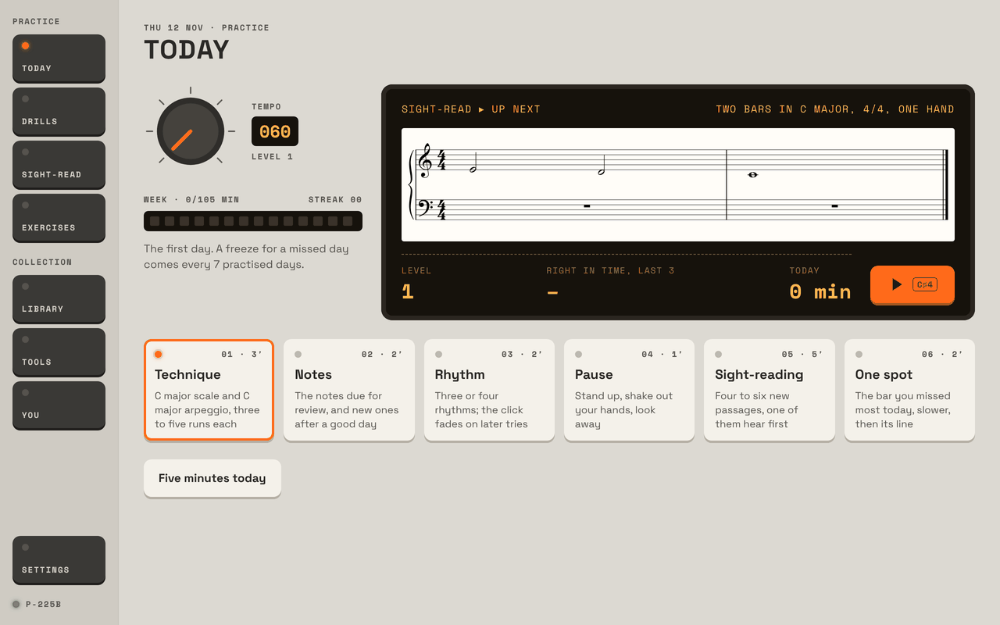
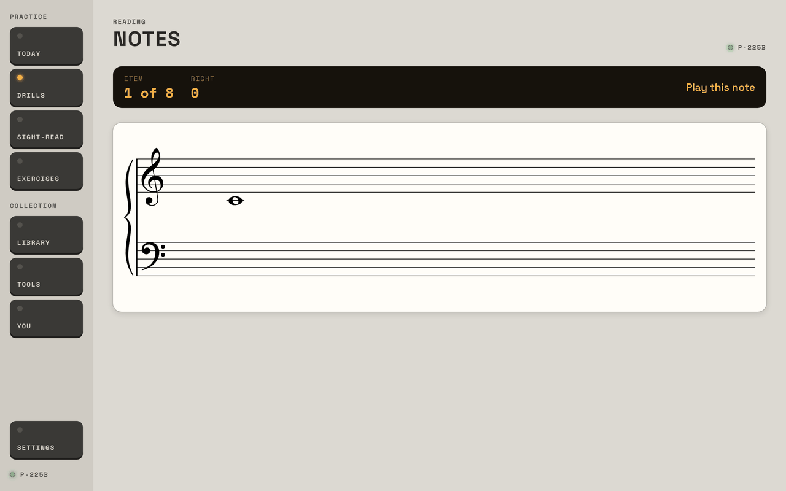
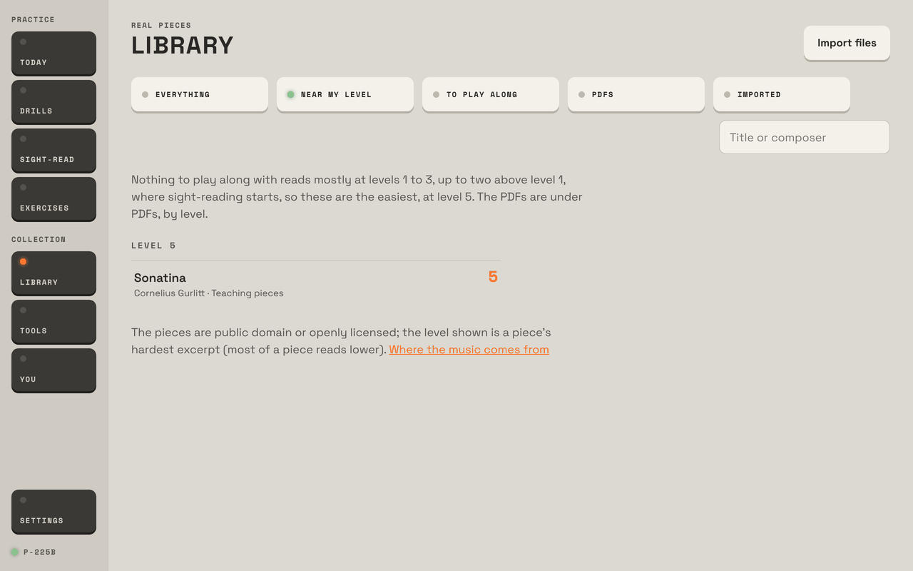
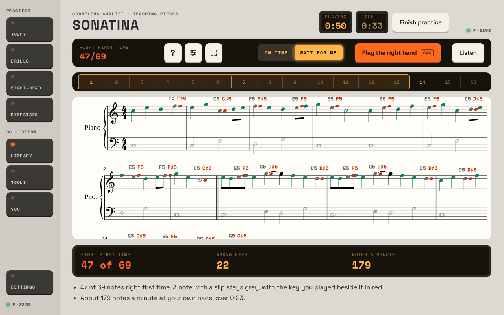
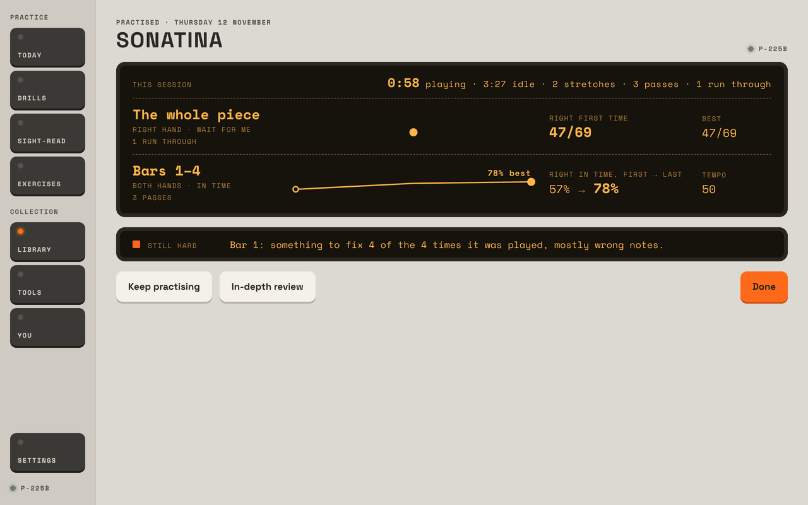
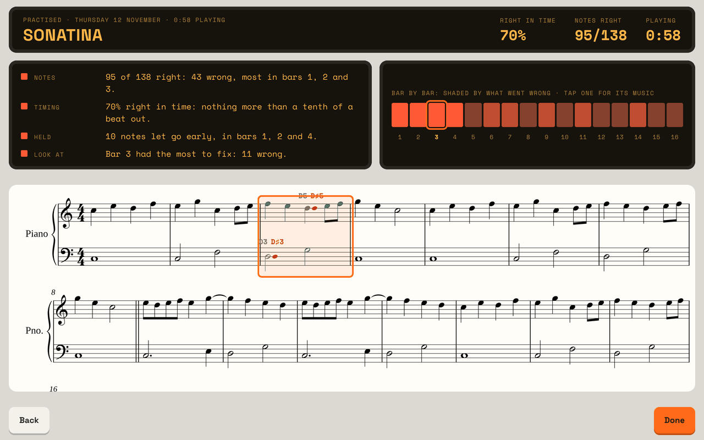

# Prima, second round: an adult beginner's first month

*Written 12 November 2026, on `main` as of "Prima: Practice and Play on a piece", in the preview host (Studio look, the tablet's
landscape, 1280 × 800). For every finding I say where it comes from: **seen** in the preview, **code** (read in the source), or
**tablet** (only the tablet and the P-225B can confirm it).*

## 1. In short

I was an adult who has just bought a digital piano: I can't read music, I don't know where middle C is, and I have 15 to 20
minutes a day. By the end of the month I wanted one real, simple piece with both hands, and to know I was getting better.

What most needs changing:

1. **There's no path from "I can't read" to "I can play this piece".** The welcome never asks whether I can read music, and day
   one's first step is a C major scale in eighth notes with a thumb crossing, then "Play this note" on a staff nobody has shown
   me. The Glossary's "where the notes live" is exactly the lesson I needed, but nothing sends me there. Words like *scale*,
   *arpeggio*, *Wait for me*, *right first time*, *lean* and *evenness* aren't in the Glossary at all; "arpeggio" finds the
   rolled-chord sign, which is something else.
2. **My piece isn't in my day.** Today's plan is drills and sight-reading; a piece shows up only as a line after
   I've played it. The Library's easiest piece is level 5 while I'm level 1, so **Near my level** offers me exactly one piece,
   with a sentence I couldn't parse. Learning it, I invented the whole path myself (listen, right hand, left hand, four bars,
   slower, together); the app has every tool for it but suggests none of them, and two of them (Hands, Loop) are behind
   unlabelled icons.
3. **The reviews speak to someone who already plays.** They're honest and often kind, but a first-week figure like 47/69 comes
   in red, the in-depth review paints every bar some shade of red, the look back and the review name two different "hard"
   bars, and the drills report "±5.0% of the gap", "velocity varied by ±6" and "Legato: a gap of 62 ms" without ever saying
   whether that's good.

What's already right: **Practice and Play** is a big step. The look back's "Bars 1–4, 57% → 78%" line was the first time in
the month I *saw* myself getting better, and it's exactly what a beginner needs. Wait for me with the marks on the music is a
patient teacher. **What's this?** on a piece ("Quarter note. C5, in the third space… press and hold for one beat") is the best
beginner feature in the app. A run where I played nothing got a kind, true summary with **Slower** and **Note by note** offered.
No piano plugged in says so plainly. Play's one line at the end ("54% right in time · 25 of 46 notes · look at bar 3 · stopped
at bar 9") is right for its job.

## 2. My month

**Day one (`seed/empty`).** The welcome is short and friendly: name, minutes (I picked 15), a cue, a look. "Plug in the piano
and set the timing" took me to the Timing tool, whose paragraph mentions a median, the MIDI path and "a loop of wires". I tapped
16 beats and pressed **Keep this offset**; it said "Kept" and left me on Tools, with no way on to Today. I found Today in the
rail.

Today said **Sight-read ▸ up next** over a little staff, with step 01 **Technique** lit below. I pressed the big orange key
expecting sight-reading and got **Scales** (picture 1).



The scale is printed in eighth notes with fingering 1 2 3 1 2 3 4 5; I
can't read it, so I'd have played whatever. The page told me to play it once in Wait for me "at your own speed": good advice,
and the Wait for me run then marked my slips on the music. Two In time runs later the tempo had quietly gone from 50 to 45; the
arpeggio from 84 to 76. I'd never have noticed.

**Notes** showed a lone note on the grand staff and "Play this note" (picture 2).



Nothing on the screen says which key that is.
A wrong guess got "That was C♯4; the note is C4, a key or two away", which is kind but assumes I know what C4 means. I finished
at 38%: "Missed: C4. They come back sooner." **Rhythm** said "Tap the first bar's beat, then the rhythm". The first bar *was*
four quarter notes, so I didn't know where the beat ended and the rhythm began, or how long the half and whole notes last. After
a 67% first try, try 2 had already taken the click away ("keep the pulse yourself"). **Sight-read** opened on **Find my level**,
which the orange key starts; I didn't know I was being tested. Its summary was clear and fair.

**Week one (`fresh`, my own runs).** I went to the Library for a piece. **Near my level** had one: Gurlitt's *Sonatina*, level 5,
with "Nothing to play along with reads mostly at levels 1 to 3, up to two above level 1, where sight-reading starts, so these
are the easiest, at level 5" (picture 3).



It turned out to be a lovely choice: sixteen bars, the right hand mostly in a C
five-finger position, the left in whole and half notes. The piece's front gave me **Practice** and **Play** and no word on which.
I chose Practice. The bar opened In time at 72 with three icon keys (?, sliders, a frame). I found **Hands** inside the sliders,
picked Right, switched to Wait for me and played the whole right hand: 47 of 69 right first time, the slips marked on the music
in red and grey (picture 4). It was useful, and the figure was red.



Then I made my own plan: bars 1–4, both hands, In time at 50, round a loop waiting after each pass. Finding the loop meant
tapping bar 1, then an unlabelled round-arrow icon on its tab (its label, "Loop bar 1", exists only for screen readers), then bar
4. Three passes: 57%, 74%, 78%. Each pass's summary was sensible and offered **Loop bars 1 to 4** and **Play from bar 3**.
**Finish practice** gave the look back (picture 5): "Bars 1–4 · both hands · in time · 3 passes · 57% → 78%" on a little rising
line. That line is the app at its best for me. Under it, "Still hard: Bar 1".



The **in-depth review** opened on bar 3 instead
("Bar 3 had the most to fix: 11 wrong"), mixed my right-hand Wait for me run with the both-hands loop into "70% right in time",
and shaded all sixteen bars in reds (picture 6).



At the end of the week I pressed **Play**, set 50 and played until bar 9, then Stop: "54% right in time · 25 of 46 notes · look
at bar 3 · stopped at bar 9". Fair, and it counts only what I reached.

I also played the things beginners do. An octave too high in Notes: "That was C5; the note is C4, an octave away", which is
excellent. In the piece, Wait for me marks it C5→C6 without a word about octaves. A chord one key at a time in **Chords**: judged
after the first key ("Not quite: F4 missing"), moved on 1.9 s later while my third key was still coming, and never said "press
them together". A whole passage with nothing played: "You stopped for more than a bar. Next time keep the beat going", with
Again, **Slower** and **Note by note**. Good. No piano: "Plug in your keyboard first." Good.

**Weeks two to four (`today`, `summary`).** Six weeks in, the seeded me is level 4, with an 8-day streak, Sonatina at 88% at 84,
and a Für Elise attempt. Today's plan is still drills and sight-reading; the Sonatina appears only as "Sonatina: 2 runs, the last
88% right in time at 84" under the steps, and in the evening's "Done for today" line. **You** is a wall: "Zhukov's four", "RMS
timing 54 ms", "Reading score 4.2", "clean (every note right, kept going) in 0%", a technique table with crossings, octaves,
velocity and legato in ms. Its first block, **Pieces**, is the one I'd read: "Sonatina · 9 runs · 6 days · 91% right in time at
84 (4 times through)". That's real progress, said plainly.

## 3. What works (leave it alone)

- **Wait for me** as the way in to a piece, and its marks: grey note, red key beside it, named. Patient and exact.
- **The look back's line per stretch** (first → last, best, tempo). Keep it, and make it the headline (below).
- **What's this?** on a piece, with "More in the glossary". And the Glossary's "where the notes live".
- **Pass-by-pass loop summaries** with **Loop bars** and **Play from bar** as the next step.
- **Play**: Start first so the tempo can be set; the quiet page; the one line after; Stop counts only what was played.
- **The empty-run summary**, the Notes drill's "an octave away", and "Plug in your keyboard first".
- **About this piece** and You's **Pieces**: "Played through 4 times… 91% at best… 9 runs on 6 days". Honest, plain progress.
- **The two clocks.** Seeing "Playing 0:58 · Idle 3:27" was a gentle, true nudge.

## 4. Problems, most painful first

**P1. Gap: nobody teaches the keyboard or the staff before testing them.** *Seen.* Day one goes Scales → Notes → Rhythm with no
introduction: no picture or words for where middle C is, how a line or space maps to a key, or how long a half note lasts. The
Glossary has all of it ("where the notes live", the strip of keys, the note lengths) but no screen links there except What's this
on a piece. *See it:* `seed/empty`, finish the welcome, press Today's orange key, then go to `drills/notes?from=today`. *Change:*
ask in the welcome "Can you read music yet?" and, for No, make the first days' plan a short **Start here** track: the keys and
middle C (Glossary's map, played on the piano), five notes under five fingers (the Exercises' five-finger pattern, already
there), note lengths with Rhythm at quarters and halves only, then the Notes drill. Give Notes and Keyboard geography a "Show me
where" that lights the key on the Glossary's strip. *How sure:* high.

**P2. Gap: a piece has no place in the day, and no path to learn it.** *Seen.* The plan's twenty minutes never include a piece,
though playing a piece is why a beginner bought the piano. Learning one, the steps a teacher would give (listen, each hand in
Wait for me, a phrase at a time, together slower, then In time, then Play) are all possible, but I had to invent them, and Hands
and Loop are hidden (P5). *See it:* `seed/fresh`, Library → Sonatina → Practice. *Change:* a **My piece** step in Today's plan
(5–7 of the minutes, the piece chosen in the Library with "Learn this"), opening Practice on the next step of a simple ladder
the app keeps per piece: Listen → right hand Wait for me → left hand → both hands Wait for me → a phrase In time at a slow tempo
→ the next phrase → Play. Each step says on the bar what it is ("Step 2 of 6: right hand, at your own speed") and moves on when
the last two runs are over about 85%. This is the "instructor" the owner put on hold; it needs no Claude to start. *How sure:*
high that it's missing; medium on the exact ladder.

**P3. Gap: the Library has nothing at a beginner's level.** *Seen.* The easiest piece is level 5 (Gurlitt's Sonatina; next are
Duvernoy's Étude 6 and two two-bar Bach fragments at 6). At level 1, **Near my level** shows the Sonatina alone, under a sentence
I couldn't follow. The famous Minuet in G that I'd have wanted is level 8 (its three-note chords). *See it:* `seed/fresh`,
Library, Near my level (picture 3). *Change:* add a first shelf of real beginner pieces at levels 1–4 (folk tunes and the
openings of the classics in five-finger position, many public domain; or let the Library tool cut the Sonatina's right hand alone
as a level-2 piece); and rewrite the sentence as "Nothing is at your level yet. This is the easiest piece here, and a good first
one: learn it slowly, a hand at a time." *How sure:* high.

**P4. Friction: Today's orange key says one thing and does another.** *Seen.* The panel says **Sight-read ▸ up next** and shows
a passage; the key under it starts step 01, Scales (picture 1). *See it:* `seed/empty` or `fresh`, Today, tap `.mu-play`.
*Change:* make the panel show the step it starts ("Up next: Technique · C major scale"), or put the key on the step. *How
sure:* high.

**P5. Friction: in Practice the tools a beginner needs are icons without words.** *Seen.* Hands is inside an unlabelled sliders
icon among eight other settings; Loop is an unlabelled round-arrow on a tab that appears only after tapping a bar; Full screen
and What's this are icons too. Practice opens In time at the piece's tempo (72), not Wait for me. *See it:* Sonatina → Practice.
*Change:* put **Hands: Both · Right · Left** on the bar itself, label the tab's key "Loop", and open a first session on a piece
in Wait for me. *How sure:* high.

**P6. Friction: the look back and the in-depth review disagree, and the review mixes kinds of runs.** *Seen.* After a right-hand
Wait for me run of the whole piece and three both-hands passes of bars 1–4, the look back said **Still hard: Bar 1** and the
review **Look at: Bar 3**. The review's headline "70% right in time · 95/138" adds the Wait for me run (right first time) to the
In time passes, and its TIMING line reads "70% right in time: nothing more than a tenth of a beat out", which sounds like a
contradiction (the 70% is the wrong notes). *See it:* `seed/fresh`, Sonatina, Practice, Options › Right, Wait for me, play the
right hand with `/keys/answer` (one in four `right=false`); then Both, In time, loop bars 1–4 at 50 waiting after each pass,
three passes with `/keys/perform?right=0.65&slips=0.2&early=0.35&lean=60&spread=90` then 0.75, 0.85; Finish practice; In-depth
review (pictures 5, 6). *Change:* one "bar to look at" rule for both screens; give each stretch its own figures in the review
(or a picker), and keep In time and Wait for me apart. Make the timing line about timing only ("Every right note was in time").
*How sure:* high that it happens; medium on why the two bars differ ("most times wrong" against "most to fix").

**P7. Friction: everything that fell short is red, and nothing says "good for week one".** *Seen.* 47/69 right first time is a
fine first read of a level-5 piece, and it's in red (picture 4). Every square in the look back and review is red; the review's bar
strip goes from bright red to dark red with no colour for "fine" (picture 6). Drill results give numbers with no verdict
("±5.0%", "Right hand, touch: velocity varied by ±6. Legato: a gap of 62 ms"). Rhythm takes the click away on try 2 after a 67%
try 1. You says "clean in 0%". *Change:* for the first month (or below level 3) colour by trend, not by a fixed band; say one
plain verdict line first ("Better than yesterday", "Good: keep this tempo"); hide the technique table's ms columns and Zhukov's
four behind "Details"; keep the click in Rhythm until a try is over 85%. *How sure:* high for what's on screen; the bands
themselves are the research's, so this is about wording and colour.

**P8. Gap: the app's own words aren't in the Glossary.** *Seen.* Searching **scale** finds nothing; **arpeggio** finds only the
spread-chord sign. Nor are *Wait for me*, *In time*, *right first time*, *lean*, *evenness*, *count-in*, *pass*, *level* or
*C4-style names* explained anywhere a beginner can reach from where they appear. *Change:* an "App words" group in the Glossary,
and a small ⓘ beside each readout label that opens its entry. *How sure:* high.

**P9. Friction: "Wait for me" means two things.** *Seen.* It's a play mode on every bar, and in Settings › Practice (and a
piece's Options) it's also an answer to **At a run's end** ("Wait for me / Go again"). *Change:* call the latter "Stop and wait".
*How sure:* high.

**P10. Friction: "Simple" sounds like the beginner's way, but it tells you nothing.** *Seen.* Settings describes Simple as "to
learn a piece in peace". A beginner with no teacher needs the feedback most; Standard is the right start. *Change:* rename the ways
by what they do ("Quiet", "Summary", "Full review"), say "Start with Summary" under them, and have the piece's front say a line
on Practice against Play ("Practice: learn it a bit at a time. Play: play it through, as a performance."). *How sure:* medium.

**P11. Friction: a chord played a key at a time in the Chords drill.** *Seen.* `drills/chords`, `/keys/answer?apart=800`: "Not
quite: F4 missing" 0.3 s after the first key, and the next item 1.9 s in, while the third key was still coming. Wait for me in a
piece handles this well ("together", amber); the drill should say the same: "Press the keys together." *How sure:* high.

**P12. Friction: small dead ends.** *Seen.* The welcome's timing ends on Tools with no way to Today. Sight-read's first screen
starts **Find my level** from the orange key, so a beginner is tested without knowing; "Start at level 1" is the beginner's
answer. The Rhythm drill's "first bar's beat" is ambiguous when the first bar is four quarters, and its notes say "Bar 1" for the
bar after "the bar of beat". *How sure:* high.

**P13. Hitches and timings.** *Seen in the preview, which isn't the tablet:* a piece opened in 0.37–0.43 s from its Library row;
the Library listed at once (the seeds keep the stored collection, so its first-time storing wasn't measurable here); a Play run
stopped by Stop showed its line in under 2.5 s. Nothing hitched. *Preview only, not a bug:* sessions kept changing their clocks
and coming back after Finish practice until I found that the pages from my earlier browser runs were still alive on the host,
saving their own session clocks every half minute. Restarting the host between runs cleared it, and the code finishes a session
correctly. Worth knowing for the next reviewer; on the tablet there's one page. *Code:* `KeepSession()` writes `Finished = null`
whenever it's called without an end, so anything that saved a session late (a timer firing after Finish) would reopen it. A guard
("never un-finish a session") would make it robust. *How sure:* medium; *tablet* to confirm nothing does.

## 5. How I'd arrange it for this person

Sitting down for 15–20 minutes in the first month:

```
Today (one big key, and it says what it starts)
 ├─ 1. Warm up (2′)        five-finger pattern, Wait for me, from Exercises › Start here
 ├─ 2. Read (4′)           Notes drill with "Show me where"; Rhythm at quarters and halves, click on
 ├─ 3. My piece (7′)  ───► Practice on the piece, opened on its next step:
 │                          Listen → Right hand (Wait for me) → Left hand → Both, bars 1–4 →
 │                          bars 1–4 In time, slow → next phrase … → Play
 │                          Finish practice → look back: "Bars 1–4 · 57% → 78%" first, one line on what's next
 ├─ 4. Sight-read (3′)     two passages at level 1
 └─ Done for today: "Your piece: bars 1–4 both hands at 50. Tomorrow: bars 5–8."
```

What moves: the piece into the plan, before sight-reading (the research's sight-reading volume matters more later; in month one
the piece is the motivation). Scales and arpeggios move to week 3 or 4, after the five-finger pattern. The welcome gets one
question ("Can you read music yet? No / A little / Yes") that picks the first plan, and ends on Today, not Tools.

On a piece: the front keeps Practice and Play, each with a line under it. Practice's bar gets Hands on it and a labelled Loop.
The look back leads with the stretch lines and a single plain sentence, and its In-depth review shows one stretch at a time.

On the reading pages: You opens on **Pieces** and the four headline trends; the rest under "Details". Drills and Exercises
both say on their header what they're for: Drills "short tests, scored", Exercises "technique to work through, a little each day",
Library "real pieces to learn". A beginner opens Today, and Today opens the rest.

## 6. The five changes I'd make first

1. **A "My piece" step in Today's plan, with a simple learning ladder** (P2): the instructor without Claude, built from what's
   already there.
2. **A first-days Start here track and "Show me where"** (P1): the keys, middle C, five fingers, note lengths, before the
   drills test them.
3. **Beginner pieces at levels 1–4 in the Library** (P3), and a plain sentence when there aren't any.
4. **Hands and Loop on the bar in words; first session in Wait for me; Today's key says what it starts** (P4, P5).
5. **One "bar to look at", and a plain verdict line before the figures, without red for a fine week-one result** (P6, P7).

## 7. Since the first round

*(Read the first round's review only after writing the above.)*

**Fixed, and I felt it:**

- **The arpeggio comes** after the scale ("Next: the arpeggio"), and the step has a way on (**Done** after three runs).
  (4.5)
- **The scale's first run is set to Wait for me** when the words ask for it. (4.5)
- **The plan fits the day:** 3+2+2+1+5+2 = 15 for my 15 minutes. (4.5)
- **No piano: a run no longer starts and tells me off**; it says "Plug in your keyboard first." (4.8)
- **The app remembers my piece:** About this piece, You's **Pieces**, the Library's Working on, and a line on Today. (4.7)
- **A loop is told as passes**, each scored, and the look back draws first → last. This is most of what round one asked for
  in 4.6 and 4.3's "better than last time". The run's summary is now on the screen with the music.
- **What's this?** works and is excellent; round one couldn't test it.
- **The Library on a new data file** opened for me, but my seeds kept a stored collection, so I didn't retest round one's
  empty-table crash itself.

**Still there:**

- **Nothing teaches where the notes are** before Notes tests them (4.1 → my P1). Unchanged.
- **No beginner pieces**: the easiest is still the level-5 Sonatina (4.2 → P3). And still no path through a piece (P2),
  though the pieces of one now exist (Wait for me, hands, loops, the look back).
- **Day one is still an intermediate player's plan**: scale, arpeggio, Notes, Rhythm with the click gone on try 2, Sight-read
  opening on Find my level (4.4 → P1, P12).
- **Two "next"s on Today** (4.5 → P4).
- **The words** (4.9 → P8): the same list, and the Glossary still has none of the app's own.
- **Summaries that measure more than they coach** (4.3 → P7): better on a piece thanks to the look back, unchanged in the drills
  and You.
- **Small ones:** "Runs 0 of 5" starts again when the scale page is opened again; an octave too high is said in words only in
  the Notes drill.

**New or worse:**

- **The tools moved behind icons.** Hands lives in Options, Loop is an unlabelled icon, and Listen is no longer on the piece's
  front: Practice first, then Listen (P5).
- **The look back and the in-depth review disagree** on the bar to look at, and the review mixes Wait for me with In time (P6).
- **"Wait for me" now means two things**, and **"Simple"** steers a beginner to the way that tells them least (P9, P10).
- **The Chords drill** judges a chord after its first key without saying "together" (P11). Round one only tried this in Wait for
  me, where it's handled well.

## Appendix: the steps I used

All against `http://127.0.0.1:5299/`, landscape 1280 × 800, with `tools/screens/screens.mjs`. Restart the host between runs
that touch a practice session (P13).

- Welcome: `seed/empty`; `keys/connect`; tap "15 minutes", "Plug in the piano and set the timing"; Start;
  `/keys/tap-beats?from=0&count=20&spread=30&offset=-20`; Keep this offset.
- Day one: Today, `.mu-play` (opens `drills/scales?from=today`); Wait for me run with `/keys/answer` 19 times, one in five
  `right=false`; In time runs with `/keys/perform?right=0.65&slips=0.2&early=0.35&lean=60&spread=90`.
- Notes: `drills/notes?from=today`, `/keys/answer?right=false` then right; octave: `/keys/play?notes=72&hold=300` on a C4 item.
- Rhythm: `drills/rhythm`, Start, `/keys/tap-beats?from=4&count=6&offset=70&spread=90`.
- Sight-read: `sight-read`, the orange key (Find my level), Start, the beginner `perform`; nothing played: Start at level 1,
  Start, wait 16 s.
- Library: Near my level. The levels: `Music/library/manifest.json`, each prepared piece's `level` (lowest is 5).
- Piece: `library/pdmx-QmVK4gcjHfrLd24KVX82mzzNM9ACraY2rgb5QewMDRRurt` (Gurlitt, Sonatina). Practice; Options › Right; Wait
  for me; Play the right hand; `/keys/answer` 91 times, one in four wrong. Then Both, Wait after each pass, In time, tempo 50
  (`.play-tempo-figure`, `.tempo-entry`, Done); bar 1 on the strip (a `pointerdown`/`pointerup` on `.bar-cell`), the tab's key
  (aria-label "Loop bar 1"), bar 4; three passes with `perform` at right 0.65, 0.75, 0.85. Finish practice; In-depth review.
- Play: Play, Start, `/keys/perform?…&stop=9&live=true`, Stop after 44 s.
- Chords apart: `drills/chords`, `/keys/answer?apart=800`, the page read every 100 ms.
- No piano: `/keys/disconnect`, Today's key, Run; a piece's Play.
- Six weeks in: `seed/today` (Today, You), `seed/summary` (Today's day line, Drills, Exercises), Settings › Practice.

Pictures: 1 Today on day one; 2 the Notes drill's first item; 3 Near my level at level 1; 4 the right hand in Wait for me; 5 the
look back; 6 the in-depth review.
