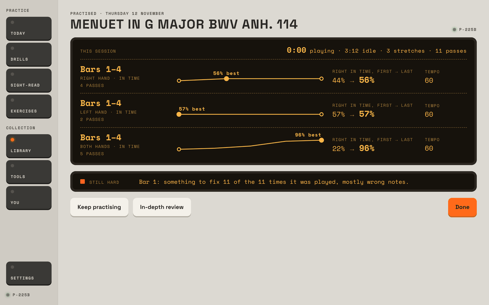
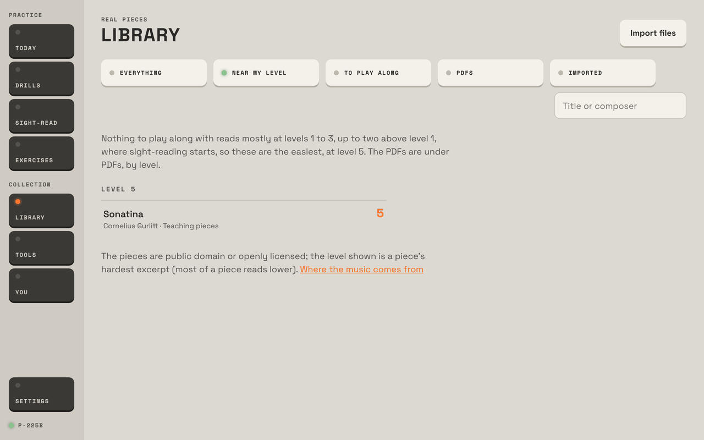
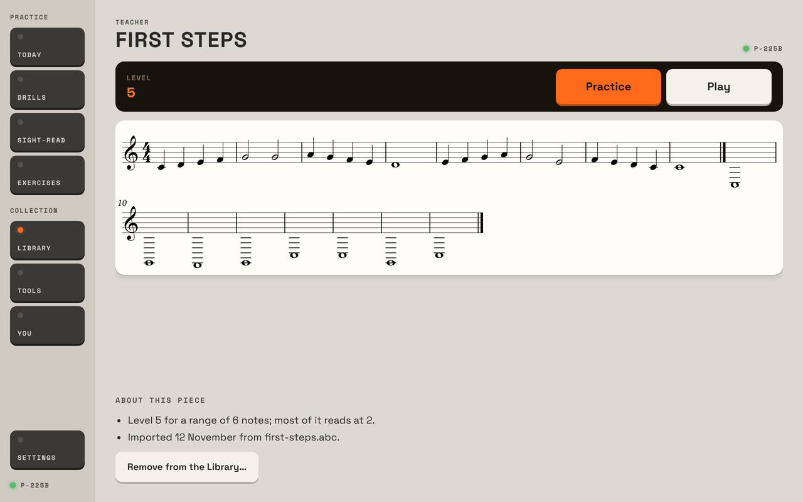
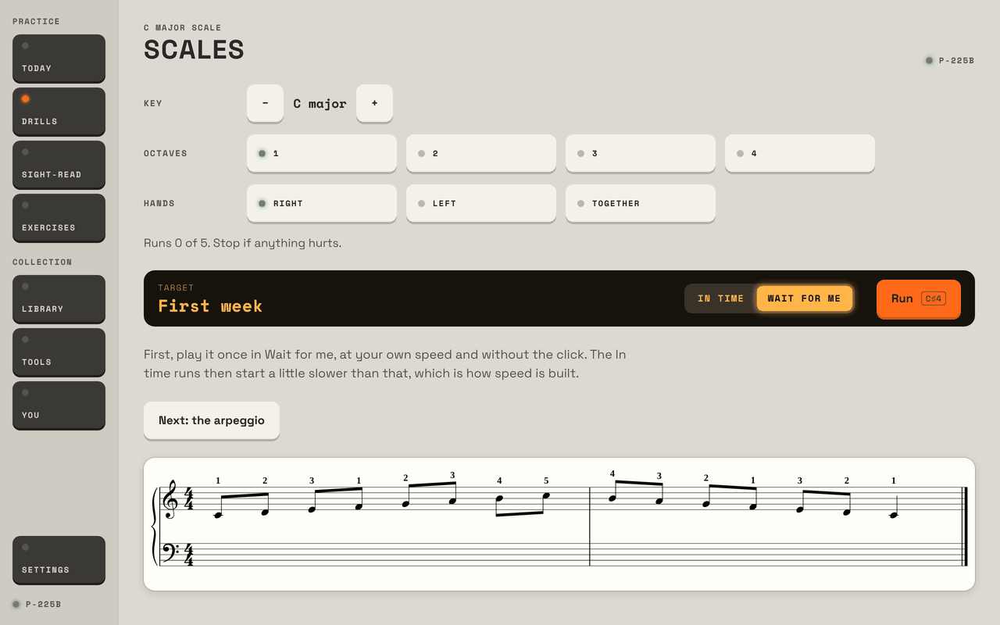
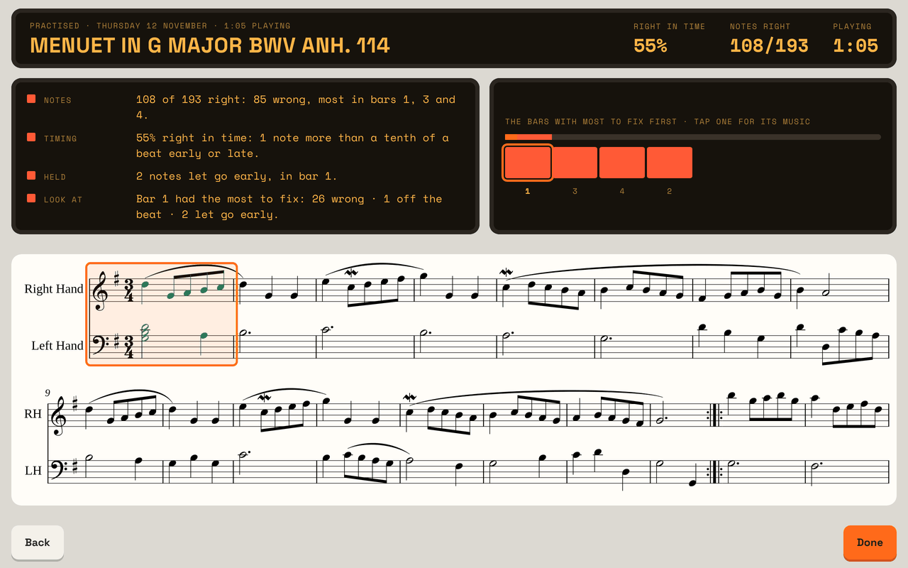
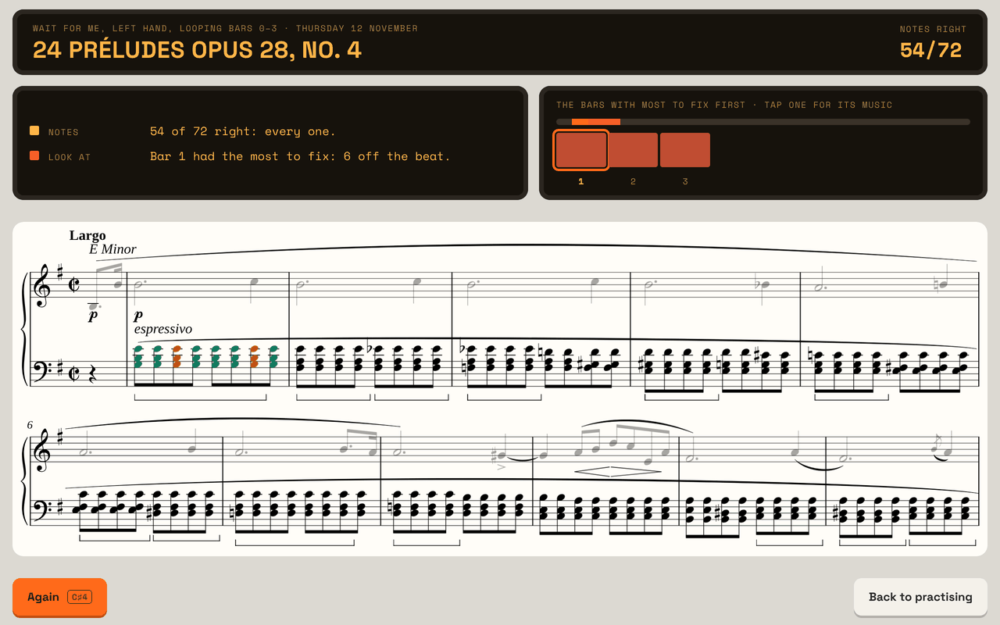
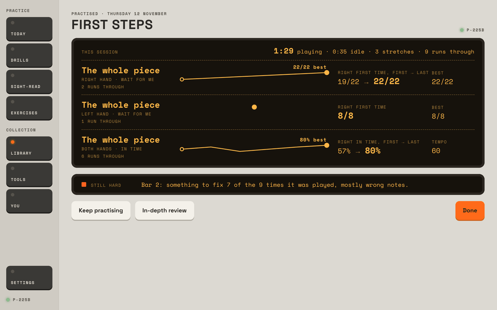

# Prima, second round: a teacher's month with three students

Written 12 November 2026, on `main` as it stands after Practice and Play (`fbc8659`), in the preview host, in the Studio look,
on the tablet's landscape 1280 × 800 (one check in portrait). Every finding says whether I **saw** it in the preview,
**inferred** it from the code or the docs, or whether only **the tablet** can show it.

## 1. In short

I was a piano teacher with three students who each have Prima at home: an adult beginner who can't read music yet, an
intermediate student a few months in, and an advanced student. I set each a week's work (the day's plan, a piece, some
technique), did it as them in the preview, then picked up the tablet at the next lesson to see how the week went.

**What most needs changing:**

1. **Finish practice doesn't finish the session** (a bug, very sure, seen and found in the code). About a second after the
   look back appears, the session is saved again as not finished. Every time the piece is opened after that, the same
   session is back under "Still practising?", its playing time different each time (1:05, then 0:00, then 0:37). For the
   look back, the comparison with "earlier today", the day's minutes, and anything a teacher would read later, this is
   the first thing to fix.
2. **A teacher can't see the week.** The look back is good, but it's gone once Done is pressed. Nothing lists a piece's
   sessions, the minutes spent on a piece, or what was practised on which day. You is a page of reading statistics. At the
   lesson I could tell *that* the student played the Menuet and how the last run went, not *how they practised it*.
3. **There's nothing for a beginner to learn, and the app's "level" scares them off what there is.** The Library's easiest
   piece is level 5 (about ABRSM Grade 2). Any piece with both hands sounding together is at least level 5, so the
   8-bar C-position tune I wrote for my beginner came in as "Level 5". Written in ABC, its two hands came in one after the
   other on one staff. Day one's Technique step is a full octave of C major with the thumb passing under, in eighth notes,
   right hand only.

**What's already right:** the look back after a session (stretches, first → last, best, tempo, Still hard) is the most
useful thing in the app for a teacher, and with hands-apart and hands-together as separate lines I could see the order my
student worked in. Wait for me on chords ("together") is sound teaching. Loops counted pass by pass, waiting after each
pass, and Hands-on's review with Again: all work and are fast (under 0.3 s each). The Exercises' "Ways to practise
anything" are what I'd say in a lesson, and they say plainly what MIDI can't feel.

## 2. My month

The clock can't be moved, so a "month" was each student's starting point (`fresh`, `today`, `months`) plus the runs I
played as them, then the lesson with the tablet.

### The beginner (adult, `fresh`, level 1)

**What I set:** five minutes of the plan's Technique and Sight-read, and a first piece hands separately, then together
slowly.

**What I did as them:**
- **Today** (seen): six steps; the first is "C major scale and C major arpeggio, three to five runs each". The scale is one
  octave, in eighth notes, with the fingering 1 2 3 1 2 3 4 5 and back. I played it once in Wait for me (14 of 15, one slip
  at the thumb crossing), then four In time runs at 50. The evenness figure (±2.8%) and "thumb crossings: below what anyone
  can hear" mean nothing to a student whose problem is finding the keys. ([Picture 4](#picture-4))
- **A piece**: Near my level said nothing reads below level 5 and offered one Gurlitt Sonatina. ([Picture 2](#picture-2))
  So I wrote "First Steps": 8 bars, right hand C to A stepwise in quarters and halves, left hand a held C or G. As ABC it
  came in as one treble staff, the left hand's whole notes appended after the right hand's eight bars, 5 ledger lines down,
  15 bars long. ([Picture 3](#picture-3)) Exported as MusicXML it came in right, graded "Level 5 for hands together, a
  range of 6 notes".
- **Practice** on it: right hand Wait for me (19/22, then 22/22), left hand Wait for me (8/8), both hands In time at 60, six
  runs from 57% to 80%. Finish practice gave the look back below, which is exactly what I'd want to see.
  ([Picture 7](#picture-7))
- **Sight-read**: the first passage at level 1 is three notes (two halves and a whole). Fine for day one.

**At the lesson:** You's Pieces row said "First Steps · 9 runs · 1 day · the last 80% at 60". I couldn't see that they'd
done hands separately first, or for how long, unless I caught the look back before they pressed Done. When I opened the
piece to look, I got their session back, paused (problem 1).

### The intermediate (`today`, level 4, six weeks in)

**What I set:** Bach's (Petzold's) Menuet in G, BWV Anh. 114, first four bars this week: hands apart, then together at 60,
in loops; the day's plan as usual.

**What I did as them:**
- The front says **Level 8** ("for three-note chords", one chord in bar 1), "most of it reads at 6". Honest, but a student
  sees the 8.
- **Practice**: loop bars 1–4, set to wait after each pass. Right hand four passes, left hand two, both hands five, from 22%
  to 96%. The bar under the music counts and scores each pass; it's clear.
- **Finish practice**: the look back showed three stretches, each a line, first → last. Good.
- **In-depth review**: its headline is **55% right in time, 108/193, "85 wrong"**, the whole session averaged, early
  learning passes included, when the last pass was 96%. ([Picture 5](#picture-5)) Each pass's own summary had said "2 wrong
  and 10 slips put right"; here slips put right are counted as wrong.
- **Play**: the whole Menuet at 60 (it kept the practice tempo), 87% right in time, 355 of 408 notes, look at bar 14.
  Clear and quick.

**At the lesson:** the piece's About says "Last played today… 9 runs on 1 day". You's Pieces say runs, days, last run, best
play-through. Nothing anywhere says she practised the Menuet for 1 minute of playing and 30 s idle, or that she went
hands apart first. When I opened the piece to see, I got her finished session back, with "0:00 playing · 3:12 idle".
([Picture 1](#picture-1)) The rest of You (reading score 4.2, fluent notes, Zhukov's four, technique table) is about her
reading, which is not what I'd ask about in a lesson. One useful thing I did see: "clean (every note right, kept going) in
0%" of passages this month. Honest, and worth talking about.

### The advanced (`months`, three months in)

**What I set:** Chopin's Prelude in E minor, Op. 28 No. 4: the left hand's chord changes alone first, voiced and together;
then both hands slowly; and its dynamics.

**What I did as them:**
- Practice, **Hands-on**: the left hand, bars 1–3 in Wait for me, some chords a key at a time. The review took the screen:
  "**54 of 72 right: every one.**" and "**Bar 1 had the most to fix: 6 off the beat.**" Wait for me has no beat; the six
  were chords played a key at a time. ([Picture 6](#picture-6)) The header says "looping bars 0–3" and the strip under it
  says 1, 2, 3.
- Both hands In time at 72: 95%, then Again, 100% "80 of 80 right: every one". Again is right there and the go key presses
  it: good.
- Look back: two stretches, "Still hard: Bar 0 … mostly notes let go early" (bar 0 is the pickup: one note).

**At the lesson:** as for the others. And for this piece the thing I'd most want to know (did the melody sing over the
chords, was it *p*, did the stretto grow and the *smorzando* die away) the app doesn't tell me, and doesn't say it
doesn't know. The 100% "every one" is about notes and time only.

## 3. What works

Leave these alone:

- **The look back.** Stretches as lines, first → last and best, the tempo, Still hard. Hands and mode are on each line, so
  the *order* of practice shows. ([Picture 7](#picture-7))
- **Practice and Play as two keys** on a piece's front, both deliberate taps. Play's strip, its Start-first, and its one-line
  review ("87% right in time · 355 of 408 notes · look at bar 14").
- **Loops pass by pass**, and **Wait after each pass**: a breath between passes is good teaching.
- **Wait for me's "together"** on chords, and rolled chords taken as rolls.
- **Hands-on's Again**, from the same bar, on the go key.
- **The Exercises' "Ways to practise anything"** and "When to stop": short, right, and honest about evidence.
- **Honest numbers on You** ("clean in 0%", "a plateau after early gains is normal").
- **Speed**: every screen I timed answered within 0.7 s (table at the end of section 4).

## 4. Problems, the most painful first

### 4.1 Bug: Finish practice doesn't finish the session

**What happens.** Finish practice shows the look back. Within a second the session is saved again as not finished. Done
goes to the front, but the next time the piece is opened (from the Library's row, no reload) it's back in Practice under
"Still practising?", the same session with the same runs, idle still counting. Its playing time is shown differently each
time: the look back said 1:05; the next opening 0:00 playing, 3:12 idle; later 0:37; the data file held 55 s.
([Picture 1](#picture-1))

**Why** (inferred from the code, sure). `FinishPractice` pauses the clock and saves the session with `Finished` set
(`Piece.razor`, `FinishPractice` → `KeepSession(end)`). The strip still ticks each second, and `Ticked` sees the clock paused
but the page not covered, sets `covered` and calls `KeepSession()`, whose `finished` defaults to null, so it overwrites
`Finished` with null. Nothing stops the tick on the look back.

**What follows for a teacher:** every day's practice on a piece is one session that never ends until the next day; the look
back's "Earlier today" can never appear; the session's playing time, and so the day's minutes, can't be trusted; and the
student has to finish a phantom session every time they open the piece.

**To see it:** `seed/today`, open any piece, Practice, play a run, Finish practice, Done; then the menu's Library and the
piece's row: "Still practising?".

**What I'd change:** stop the tick once the session is finished (or have `KeepSession` keep `Finished` once it's set), and
test it in `PracticeClock`'s tests' spirit: finished stays finished.

**How sure:** very (seen four times, cause in the code). On the tablet: the same code, so the same.

### 4.2 Gap: the week isn't kept where a teacher can see it

**What happens** (seen; confirmed in code: `GetSessionsAsync` is used only by the piece's page for the open session and the
look back's comparison). Once Done is pressed, a session's look back is gone. Nowhere lists:
- a piece's sessions (when, how long playing and idle, which way: Simple, Standard, Hands-on);
- minutes per piece, this week or ever (You has minutes a week for everything together);
- what was practised: which bars, which hand, Wait for me or In time, the tempo reached;
- whether the student did the day's plan, or skipped Technique every day.

You's Pieces table (runs, days, last run, best play-through) is the closest. The rest of You is reading statistics.

**What I'd want at a lesson, most useful first:**
1. **The week, by day**: each day's minutes, split into plan steps and pieces, and each piece's sessions as a line ("Tue ·
   Menuet · 12 min playing · bars 1–4 hands apart then together · 60 → 72 · best 96%").
2. **Each session's look back, kept and reopenable** from the piece (a list under About this piece) and from the week.
3. **A piece's own trend**: its best play-through, and its working tempo, over the days, with the marked tempo as the goal.
4. **What's stuck**: Still hard across sessions, not just one ("bar 14 has been the bar to look at on 4 of 5 days").
5. **The first try of the day** at each stretch, kept apart from the rest. Research says retention shows on the next day's
   first try, not the session's best ([Duke, Simmons & Cash 2009](https://doi.org/10.1177/0022429408328851); `research.md`
   §5; "judge an exercise by how the first try goes the next day" is already the app's own advice in "Sleep on it").

**How sure:** very that it's missing. All of it is in the data already, except "first try of the day", which is a query.

### 4.3 Gap: nothing for a beginner to learn, and levels that put them off

**What happens** (seen):
- The Library's easiest piece is level 5; Near my level for a level-1 reader says so and offers one Gurlitt Sonatina.
  ([Picture 2](#picture-2)) In my experience an adult method book's first month is 15–25 pieces of 4–16 bars in five-finger positions.
- **Any piece with both hands sounding together is level 5**, since the ladder is the sight-reading exams' ("Hands
  together" at level 5). My 8-bar C-position tune: "Level 5 for hands together, a range of 6 notes". For reading at sight
  that's fair; for a piece to learn, it isn't. A student who reads "Level 5" on their first piece thinks they're out of
  their depth.
- **ABC with two voices comes in as one staff**, the left hand appended after the right (with `[V:1]` lines and with the
  standard `V:` blocks and `%%score`). ([Picture 3](#picture-3)) ABC goes through Verovio's reader, which seems to be where
  it happens (inferred). A teacher writing a quick piece is likely to try ABC.

**What I'd change:**
- **The generator writes the beginner's pieces**, not just passages: 8–16 bars, a title, a five-finger position, both hands
  shared then together, repeated and kept for the week like a Library piece, so they can be *learned* (practised, looped,
  played through) rather than read once. The generator already writes tonal music at each level.
- **Grade a piece to learn on its own scale**, or say "to learn: about level 2" beside the reading level, since a piece is
  practised, not read at sight.
- **ABC**: either fix multi-voice ABC or say on import that ABC with voices isn't supported, and to use MusicXML.

**How sure:** sure of what I saw. The ABC cause is an inference.

### 4.4 Friction (teaching): the in-depth review averages a learning session

**What happens** (seen): the Menuet session's in-depth review heads with **55% right in time, 108/193 notes, "85 wrong"**,
over every pass, though it went from 22% to 96% and ended at 96%. ([Picture 5](#picture-5)) And its "85 wrong" counts slips
put right as wrong, where each pass's own summary said "2 wrong and 10 slips put right".

**Why it matters:** a learning session starts badly *by design*. Averaging it punishes exactly the practice I'd want
(slow, hands apart, a stretch at a time) and rewards playing what you already know. It breeds percentage-chasing.

**What I'd change:** head the in-depth review with **where the session ended** (each stretch's last two or three passes, and
the tempo reached) and **how far it came** (first → last), as the look back does; keep the session's totals below. Keep
"slips put right" apart from "wrong" everywhere.

**How sure:** sure; seen.

### 4.5 Bug: Wait for me's review says "every one" and "off the beat"

**What happens** (seen, Hands-on, Wait for me, the left hand of the E minor Prelude with chords played a key at a time):
"54 of 72 right: **every one.**" and "Bar 1 had the most to fix: **6 off the beat.**" ([Picture 6](#picture-6)) Wait for me
has no beat; the 18 notes not right first time were six chords not struck together. The header says "looping bars 0–3"
while the strip says 1, 2, 3.

**What I'd change:** in Wait for me, say "6 chords not together", never "off the beat", and don't say "every one" unless
every note was right first time. Name a pickup bar "the upbeat", not "bar 0".

**How sure:** sure of the words; the cause (not-together counted as "off" in the bars' trouble) is inferred.

### 4.6 Teaching: the day's Technique is too hard for a beginner, one-handed for everyone, and keyed to reading

**What happens:** the day's scale and arpeggio are picked by the *reading* level, and always for the right hand
(`TechniqueChoice.Today`, `HandUse.Right`; inferred from code, and You's Technique table in both seeds lists only Right).
At level 1 that's a one-octave C major scale with the thumb under, in eighths, on day one (seen,
[Picture 4](#picture-4)). The left hand is never set by the plan; a student who follows Today never practises a left-hand
scale.

**Why it matters:** the adult method books and RCM start with five-finger patterns and reach a one-octave scale weeks in
(Faber's adult course: its first scale in Unit 12; `exercises.md`). The thumb passing under is a real hurdle for a beginner
and the app can't see whether it's done with a twisted wrist. Reading and playing levels part company quickly in adults:
my advanced student reads at 5 and plays at 8–10.

**What I'd change:** the plan's Technique follows its own track (a technique level, started at five-finger patterns,
which the Exercises already have), alternates hands day by day, and goes hands together only after both hands are even
alone.

**How sure:** sure; seen and in the code.

### 4.7 Gap: pieces get two minutes of the plan

**What happens** (inferred from `DailyPlan.Build`, seen on Today): of twenty minutes, Technique 4, Notes 3, Rhythm 3, a
pause, Sight-reading 7, "One spot" 2. A piece is only the alternative to One spot. A piece practised in a session counts
towards the day's minutes but isn't a step of the plan.

**Why it matters:** for a beginner or intermediate who is learning pieces, the piece is the centre of the week, and my
students would spend 20–30 minutes on it after the plan, with nothing in the plan or Today showing it as part of the day.
The research's case for reading volume is about *sight-reading* skill (`research.md`, finding 1); it isn't a case for
spending a third of the time a student has on reading rather than on their pieces.

**What I'd change:** a step **"Your piece"** in the plan, with its own minutes, opening the piece's practice session on
this week's goal (section 5). Its share set by the student's aim (reading, pieces, or both), the teacher's, or a default of
about a third.

**How sure:** sure of what's there; the share is my judgement.

### 4.8 Gap: no reminder to rest in a long session

**What happens** (inferred from code): a practice session pauses after 15 minutes with *nothing* played. There's nothing
for the opposite: 40 minutes of loops on one hard bar. The plan's one-minute Pause exists only in the plan; Technique says
"Stop if anything hurts"; "When to stop" in Exercises says "take a short break every twenty minutes or so". Practice says
nothing.

**What I'd change:** after about 20 minutes of *playing* in a session, a quiet line on the strip: "20 minutes: stand up,
shake out your hands." After a loop's passes stop improving (say three passes in a row no better), "Leave it for today:
it settles overnight." ([Duke et al. 2009](https://doi.org/10.1111/j.1749-6632.2009.04795.x): an early 5-minute break gave
the largest overnight gains; `research.md` §4: breaks are a sensible precaution, not a proven one.)

**How sure:** sure it's missing (only the tablet can show what 40 minutes feels like).

### 4.9 Teaching: what it can't hear, said where the score is

**What happens** (seen): on Chopin's E minor Prelude, "100% right in time" and "80 of 80 right: every one", nothing about
the melody over the chords, *p*, *espressivo*, or the *smorzando*. Loudness is judged only where a dynamic is marked,
pedal only where marked; tone, voicing, fingering, posture and tension aren't judged at all. The Exercises say so in their
words; a piece's summary doesn't. In time also marks expressive rubato as off the beat: in a Largo that's at odds with the
music (Following you without a click is on hold).

**What I'd change:** under a piece's summary, one fixed line: "Prima hears notes, timing, holds, and loud and soft and
pedal where they're marked. It can't hear your tone or see your hands." For a slow, expressive piece (Largo, Adagio,
*espressivo*), show timing as information, not as part of the headline; or let the student choose "notes only" for the
headline.

What MIDI *could* judge and doesn't: **voicing** (the melody note's velocity against the chord's in the same moment), and
**evenness of a repeated chord** (velocity spread across the E minor Prelude's eighth-note chords). Both from data the app
already has.

**How sure:** sure of the words; the voicing measure is my suggestion.

### 4.10 Friction: Still hard mixes things

**What happens** (seen): "Still hard" counts every run and pass of the session together, any hand and mode. In my
beginner's session it named bar 2 ("7 of the 9 times"), counting the left hand's Wait for me run, where bar 2 is one
whole note. In the Prelude it named bar 0 (the pickup, one note, "let go early") over bar 1's wrong notes.

**What I'd change:** count Still hard within a stretch (the same bars, hand and mode), and rank wrong and missed notes
over held notes, as the in-depth review's weighting already does (three to one).

**How sure:** fairly; seen, the ranking read from `SessionReview.Of`.

### 4.11 Friction: smaller things

- **Play starts at the practice tempo** (60), with no goal. A play-through has a target: the marked tempo, or the teacher's.
  Show "goal ♩ = 100" beside the tempo. (Seen.)
- **Play's end** has two Done keys and Start still lit at the top beside Again at the bottom. (Seen.)
- **The day's plan shows "Sight-read ▸ up next"** in the big panel while Technique is the step highlighted below. (Seen.)
- **Library titles**: "Sample tune - abcm2ps (voices.abc) - Praeludium II (WT II)", "Op 82", "Aria Notebook Anna Magdalena
  - repetitions". A student can't tell what these are. (Seen.)
- **Imported MusicXML prints "Piano"** as a part name on the first line. (Seen.)
- **Preview only:** the seeds don't clear practice sessions (`Program.cs`'s table list), so a session from one seed turns up
  on the next.

### Times measured (preview)

| What | Time |
| --- | --- |
| Opening Für Elise (985 notes) from the Library's row | 630 ms |
| Practice on its front | 59 ms |
| A 985-note In time run summed up, after its last note | 146 ms |
| Finish practice → look back (Prelude) | 27 ms |
| In-depth review (Prelude) | 291 ms |
| Done → the front | 34 ms |
| The Library's first opening after a seed | about 10 s (one-time store) |

No slow moment or hitch in the preview beyond the Library's first opening. On the tablet, Für Elise's opening is the one I'd
time first. The 15-minute pause, the cover after the tablet sleeps, and a key carrying a session on are tablet-only.

## 5. How I'd arrange it: the app as instructor

What MIDI lets the app judge is enough to run a teacher's way of learning a piece: **which notes, when, how long, how hard,
the pedal, and whether a chord's keys land together**. It can't see fingers, wrists, posture or tension, and can't hear
tone except as velocity. So the instructor leads the *process* (what to play next, how slowly, when to move on, when to
stop) and is honest about the rest. Where the research supports a choice I cite it; the rest is my judgement as a teacher.

### Three kinds of session

**1. The lesson (weekly; new).** Once a week, ten minutes. It's the app's check and the next week's setting:
- **The check**: the week's goal played *cold*, first try, before any warm-up on it: e.g. "Menuet bars 1–8, hands
  together, ♩ = 72, Play". Its result is the week's result. (Retention shows on a later day's first try:
  [Duke, Simmons & Cash 2009](https://doi.org/10.1177/0022429408328851), [Simmons 2012](https://doi.org/10.1177/0022429411424798).)
- **The week's look back**: days practised, minutes on each piece and on the plan, each piece's tempo and best by day,
  the bars that stayed hard. This is section 4.2's page.
- **Next week's goals**: one per piece, specific and a little hard ("bars 9–16 hands together at 66, three clean in a
  row"), set by the app from the check, which the student or a teacher can change. (Specific, hard goals beat "do your
  best": [Locke & Latham 2002](https://doi.org/10.1037/0003-066X.57.9.705).)
- **One question the app can't answer itself**, asked and kept: "Did anything hurt or feel tight this week?" A yes holds
  the tempo and points to "When to stop".

**2. The practice session on a piece (exists; I'd add a Learn way to it).** Keep Simple, Standard and Hands-on. Add
**Learn**, where the app leads through this week's goal in steps, each step one stretch the session already understands
(bars, hand, mode, tempo):

| Step | What the student plays | Moves on when (my starting values) |
| --- | --- | --- |
| 1. Hear and look | Listen to the section once; the app names its shape (key, hand position, repeats) | After one listen |
| 2. Hands apart, Wait for me | Each hand alone, a phrase (2–4 bars) at a time | 3 passes in a row right first time, or 8 passes, whichever first |
| 3. Hands apart, In time, slow | Each hand at about 60% of the goal tempo | 2 of the last 3 passes ≥ 90% |
| 4. Hands together, Wait for me | The phrase together | 2 passes in a row right first time |
| 5. Hands together, In time, the ladder | Start slow; a notch faster after 2 clean passes, a notch back after one under 75% | The goal tempo with 2 of 3 passes ≥ 90% |
| 6. Join | The next phrase from step 2; then the two phrases as one loop | As step 5 |
| 7. Play it through | The week's section with Play | Once a session, at the end |

Rules the app keeps through it:
- **Short stretches, mostly right.** The share of right passes predicts the next day; the best practisers fixed errors at
  once and stopped before repeating them ([Duke, Simmons & Cash 2009](https://doi.org/10.1177/0022429408328851)). So a
  pass under 60% moves the tempo back a notch *straight away*, and three wrong passes in a row in one bar shrink the stretch
  to that bar with a note either side ("Small sections", "Stop and fix it at once", already in Exercises).
- **Hands together soon.** Hands apart only until it's right first time: "together is its own skill"
  (Exercises, "Hands separately, then together"; my judgement on the thresholds).
- **Less said as it's learned.** In steps 2–4 each pass's figure and marks; in step 5 the figure every other pass and the
  marks only on a miss; at step 7 only after. Faded, summary feedback helps retention in simple skills, though complex ones
  can need more ([Winstein & Schmidt 1990](https://doi.org/10.1037/0278-7393.16.4.677),
  [Wulf & Shea 2002](https://doi.org/10.3758/bf03196276); `research.md` §5). Wait for me's stop-start habit is limited by
  leaving it at step 4, never returning to it once In time is clean.
- **When to stop for the day**: when the goal tempo is reached; or 20 minutes of playing on the piece; or three passes in
  a row no better (the app says "it settles overnight: leave it here"). Tomorrow starts two notches below today's top
  ("The metronome ladder", Exercises).
- **Mix once learned**: once two phrases are both at step 5, the session alternates them rather than finishing one
  ([Brunmair & Richter 2019](https://pubmed.ncbi.nlm.nih.gov/31556629/) on interleaving; untested on piano, `research.md`
  §2).

**3. The look back (exists; change it).**
- Fix 4.1 so it's kept, and list past look backs under the piece.
- In Learn, say which step each stretch reached and what's next ("Bars 1–4: together at 66, two notches to go").
- The in-depth review heads with where the session ended, not the average (4.4).
- Keep the "no next time line" rule for Standard; Learn is the place where the app suggests.

### How it fits the day

Today's plan gets a step **Your piece** (its minutes the student's or teacher's choice; I'd start at about a third),
which opens the piece's Learn session on this week's goal. The lesson appears on Today once a week, on the day the student
chooses ("Saturday morning, before breakfast": the cue the app already has, [Gollwitzer & Sheeran
2006](https://doi.org/10.1016/S0065-2601(06)38002-1)).

### The three students' months (in short; in full in the appendix)

- **The beginner**: four weeks from five-finger C position, hands separately, to two short pieces hands together and the
  C five-finger pattern in both hands, with reading at levels 1–2. Pieces written by the app. No full scales until week 4.
- **The intermediate**: the Menuet in G, a section a week (A section apart then together; A to tempo and B apart; B
  together; the whole at ♩ = 100–110 and a check), with G major two octaves in *each* hand, and a second, contrasting piece
  started in week 3.
- **The advanced**: Chopin's E minor Prelude as voicing and pedal study (left hand's chords alone and even, then the melody
  over them, the stretto, the whole), beside a Bach Little Prelude for finger independence and four-octave scales
  hands together, both hands alternating.

## 6. The five changes I'd make first

1. **Make Finish practice finish** (4.1): stop the tick saving the session after it's finished, and test it.
2. **Keep and show the week** (4.2): each piece's sessions with their look backs, minutes per piece, and a week page on You
   by day. All of it is in the data.
3. **Give the beginner something to learn** (4.3): generated pieces kept for the week, and a "to learn" level apart from
   the reading level. Fix or refuse two-voice ABC.
4. **A Learn way in Practice, with a weekly goal and a cold check** (section 5): the app as the instructor, run from what
   it already measures.
5. **Teach truthfully in the summaries** (4.4–4.6, 4.9): the in-depth review led by where it ended; "not together", not
   "off the beat"; a technique track of its own with both hands; one line saying what Prima can't hear.

## 7. Since the first round

Written after reading the first round's [teacher.md](../teacher.md).

**Fixed:**
- *A piece's practice kept and never shown* (its first problem): now shown in part. About this piece says when it was last
  played, how, how often it's been played through and its best; You has a Pieces table; Today's line names the pieces
  played. What's still missing is the practice itself (4.2): sessions, minutes per piece, a look back to reopen.
- *A loop's review pooled and off the screen* (the owner's own complaint): fixed. Each pass is counted and scored on the bar,
  a pass can be its own run, the summary sits with the music, and the look back draws first → last.
- *The Library failing to open on an empty data file*: fixed; I opened it after every seed.
- *"29% in time", a notes figure with a timing name*: fixed. The headline is "right in time", and the timing line speaks
  only of the right notes.
- *Play mode and then a summary*: built, as Practice's look back and Play's quick review, and good.

**Still there:**
- *No piece in the day's plan* (4.7): still One spot's two minutes.
- *Nothing for a beginner, and a scale on day one* (4.3, 4.6): both unchanged.
- *No goal tempo* (4.11): Play still starts at whatever tempo Practice left.
- *No rest outside the plan* (4.8): the new 15-minute pause is for idleness, not for playing too long.
- *No triage, and Wait for me ending in "notes a minute"*: a both-hands run of 17 of 30 right still goes on to "Every right
  note in time. Steady", and the beginner's Wait for me run on a piece still reports "Notes a minute 120".
- *You as a sight-reading report*: unchanged under its new Pieces table.

**New, or worse:**
- **Finish practice doesn't finish** (4.1), the one serious new bug.
- **The in-depth review averages a learning session** (4.4), and counts slips put right as wrong.
- **Wait for me's review says "every one" and "off the beat"** (4.5).
- **The pickup bar is now "bar 0"** in a session's words and header, and 1 on the strip (it had no number before).
- Two-voice ABC imports as one staff (4.3), which I hadn't tried in the first round.

The first round's "app as instructor" is the part still on hold; section 5 here is my version of it, built on what Practice
now has (stretches, passes, the look back) rather than on new screens.

---

## Appendix A. The three months in full

These are my judgement as a teacher, shaped for what the app can run. The thresholds are starting values.

### The beginner: an adult who can't yet read music

**Aim for the month:** read and play two short pieces hands together in C position, steady at ♩ = 80, and the C and G
five-finger patterns in each hand. 15–20 minutes a day, five days a week.

| Week | Pieces (generated, 8–16 bars) | Technique | Reading | Goal at the week's check |
| --- | --- | --- | --- | --- |
| 1 | "Piece 1": right hand alone, C position, quarters and halves. "Piece 2": left hand alone, the same | C five-finger pattern, each hand alone, Wait for me then ♩ = 60 | Notes: middle C, treble G, bass F (landmarks); Sight-read level 1 | Piece 1 right hand In time at 72, ≥ 90%, first try |
| 2 | Piece 1 with a left-hand held note under each bar (hands together, one moving); Piece 3: a tune passed between the hands | The pattern hands alone at 72; long–short | Level 1–2; Rhythm with the click | Piece 1 together at 66, ≥ 85% |
| 3 | Piece 3 to tempo; Piece 4 in G position | G five-finger pattern; the pattern then its chord | Level 2 | Piece 3 at 80, ≥ 90%; Piece 4 hands apart |
| 4 | Pieces 1 and 3 played through (Play); Piece 4 together | C major one octave, each hand alone, Wait for me only: the thumb under, slowly; "Sitting and hand shape" read again | Level 2 | Two pieces played through at 80, ≥ 90% each, first try |

The thumb under waits until week 4, as in the adult method books ([Faber's adult course](https://pianoadventures.com/qr/ff1302/),
via `exercises.md`). Each week's lesson asks the tension question, and the beginner reads "Sitting and hand shape" and
"Warm-ups" in week 1; the app can't see either, and says so.

**What the app would show me at the end:** four checks, each a first try; minutes on each piece by day; for each piece the
step reached; the notes most missed (from the Notes drill).

### The intermediate: learning pieces, reading at level 4

**Aim:** the Menuet in G (32 bars, A and B sections each repeated) played through at ♩ = 100–110, ≥ 90% right in time, and
a second piece started. 25–30 minutes a day: the plan's twenty with "Your piece" taking about ten, plus extra on the piece.

| Week | Menuet | Second piece | Technique | Goal at the check |
| --- | --- | --- | --- | --- |
| 1 | A section (bars 1–8, 9–16) in phrases of four: Learn steps 1–5 to ♩ = 72 | – | G major two octaves, right hand Mon/Wed/Fri, left Tue/Thu/Sat; contrary motion | Bars 1–8 together at 72, ≥ 90% |
| 2 | A section joined, to ♩ = 88; B section (17–32) hands apart | – | G major hands together one octave; D major arpeggio each hand | A section at 88; B hands apart at 72 |
| 3 | B section together to ♩ = 80; A and B alternated (mixed) | Petzold's G minor Minuet, its pair (in the Library as "Minuet BWV 115"), A section hands apart | Hands together two octaves at a comfortable tempo; the jumps exercise for the left hand | B together at 80 |
| 4 | The whole with repeats, Play at ♩ = 100; then 110 if clean | Minuet in G minor, A section together | Keep the week-3 work | Menuet played through at 100, ≥ 90%, first try |

Dynamics: the MuseScore file's slurs are judged as expression; I'd ask for the slurs and the phrase ends as the week-3
focus, and the app's expression line shows them. The ornaments in bars 3 and 5 aren't counted as slips, which is right.

### The advanced: reading at level 5, playing at 8–10

**Aim:** Chopin's E minor Prelude played through at ♩ = 50–56 with the melody over the chords, the left hand even, the
pedal clean, the stretto growing; a Bach Little Prelude as the contrasting piece; scales four octaves hands together. 40
minutes a day, with a break at 20.

| Week | Chopin Op. 28 No. 4 | A Bach Little Prelude | Technique | Goal at the check |
| --- | --- | --- | --- | --- |
| 1 | Left hand alone, all 25 bars: Wait for me for the chord changes ("together"), then In time at ♩ = 40, chords soft and even | Hands apart, Learn steps 2–3 | Four octaves, each hand alone, in keys of the week's pieces (E minor, C/D minor) | Left hand through at 40, ≥ 95%, velocity spread across each bar's chords under ±8 |
| 2 | The melody alone, then with the left hand from bar 1 to 12, ♩ = 44; pedal changed with each harmony | Hands together, ♩ = 60 | Hands together, contrary motion | Bars 1–12 at 44 with the melody louder than the chords (voicing) |
| 3 | Bars 13–25: the stretto, the *forte*, the *smorzando*; loudness judged where marked | To tempo; alternate with Chopin in the session | Arpeggios four octaves | Bars 13–25 at 48, the dynamics shown as "as asked" |
| 4 | The whole, Play at ♩ = 52–56 | Played through | Keep | Both pieces played through, first try; the timing shown, not judged, for the Chopin |

Two things the app can't do for this student: hear tone, and allow rubato. I'd tell them so, and ask them to record a
minute each week ("Record yourself", in Exercises) and listen "once without the music in front of you". The Learn way's
"voicing" check would need the measure in 4.9.

## Appendix B. How each finding was seen

All in the preview at http://127.0.0.1:5299, landscape 1280 × 800 unless said, Studio look.

- **4.1** `seed/today`; open `library/pdmx-QmPcZ5vXeX5YEK77qDFMLrNkswKpMsRczQgeg3wfWeki6V` (Menuet in G); Practice; a run
  (`/keys/perform?right=0.9`); Finish practice; Done; the menu's Library, the piece's row: "Still practising?". The data
  file (`artifacts/bin/Prima.Preview/debug/preview.db`, table `PracticeSession`) shows `Finished` empty.
- **4.3** `seed/fresh`; Library › Near my level. ABC: a two-voice file through `/files/next?path=…` and Import files.
- **4.4** The Menuet: loop bars 1–4 (tap bar 1 on the strip, Loop, tap bar 4), Options › Wait after each pass, In time at
  60; passes from `/keys/perform?right=0.6` up to `0.95`; Finish practice; In-depth review.
- **4.5** `library/pdmx-QmfM3JtYkeZXaQbaDJrJV3V54mujUrEcGLBEn1djBtaUHM-04`; Practice; Options › Hands-on, Left; Wait for
  me; loop bars 1–4; `/keys/answer?right=true`, every fifth with `&apart=400`.
- **4.6** `seed/fresh`; Today's Technique step.
- **4.7, 4.8** `Music/src/Prima.Core/Practice/DailyPlan.cs`; `PracticeClock.PauseAfter`.

Pictures:

1. 
   The Menuet's session, finished earlier, back when the piece is opened again: "0:00 playing · 3:12 idle", where its
   look back had said 1:05 playing.
2. 
   Near my level at level 1: nothing below level 5.
3. 
   An 8-bar two-hand piece in ABC, imported: the left hand's notes follow the right hand's on one treble staff.
4. 
   Day one's Technique for a beginner: a one-octave C major scale, thumb under, in eighths, right hand.
5. 
   The Menuet session's in-depth review: 55% and "85 wrong" over a session that ended at 96%.
6. 
   Hands-on, Wait for me: "54 of 72 right: every one" and "6 off the beat", for chords played a key at a time.
7. 
   What works: the beginner's look back, hands apart then together, first → last.
