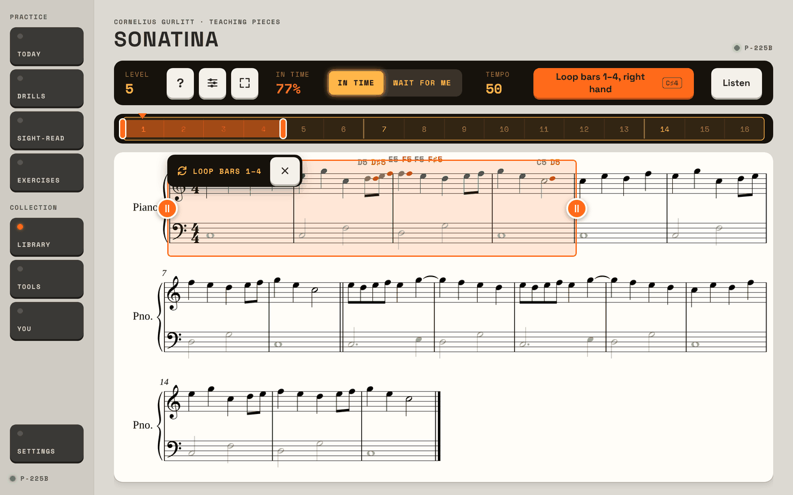
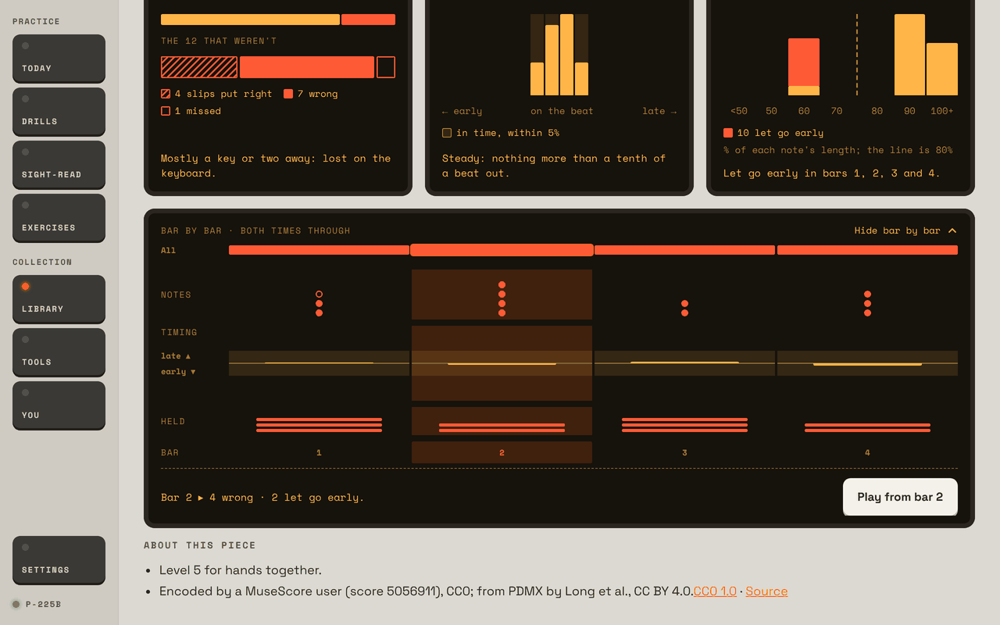
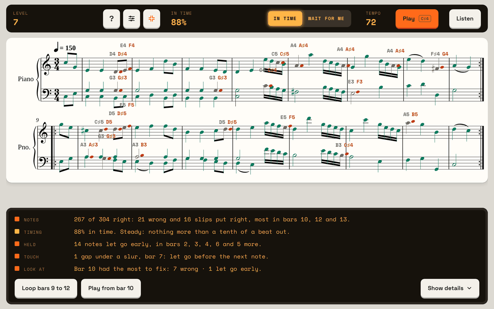
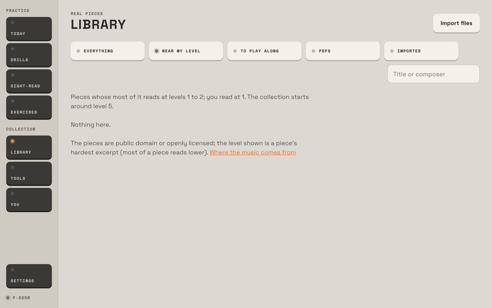

# Prima, reviewed by a piano teacher

12 November 2026, against `main` (two changes past 1.0.4). I used the preview host in the Studio look, at 1280 × 800 and
800 × 1280, with the simulated piano. Each finding says where it comes from: **seen** (in the preview), **code** (read, not
run), or **tablet** (only the tablet can confirm). Nothing in the app was changed.

## 1. In short

I was a teacher with three students on Prima: a beginner (the `fresh` seed), an intermediate player six weeks in (`today`)
and one three months in (`months`). I set each a week: the day's plan, a piece to learn, some technique. I did it as them,
then sat down as the teacher with the tablet to see how the week went.

The three things that most need changing:

1. **Prima teaches sight-reading and has nowhere to learn a piece.** The plan, the levels, the progress page and the day's
   closing line are all about reading new music. A piece is a screen you visit. Every run on it is saved and then never shown
   again: not on the piece, not on You, not in the day's line. At the next lesson I could not tell which piece a student
   worked on, for how long, at what tempo, or which bars are stuck.
2. **The review after a run is built for a single take, and practice is repetition.** After three passes of a loop the
   review pools them into one figure, labels them "both times through", and sits wholly below the screen in the normal view.
   It never says how many passes, how long, or whether the last was better than the first, which is the only thing a loop is
   for.
3. **It grades, but it doesn't instruct.** After a run it says what was wrong and never what to do next: slower, one hand,
   this phrase, enough for today. A student left alone with a percentage repeats until the number goes up. The app as
   instructor (section 5) is the answer to this, and the first two changes are what it needs underneath.

What's already right, and should be left alone: the order of correction (notes, then time, then touch); the click that never
waits for sight-reading; the strict rule that a slip put right is still a slip; "Loop bars 9 to 12" and "Play from bar 10"
offered from the worst bar; hands separately with the other hand dimmed; Listen; the plain, unflattering wording; and the
honesty about what MIDI can't carry.

## 2. My month

The clock in the preview can't move, so a "month" here is the seeds plus the runs I played.

**The beginner (level 1).** I set: the daily plan, the five-finger pattern from Exercises, and a first piece, right hand alone.
What happened (all seen):

- Day one's first step was a C major scale and arpeggio. After one Wait for me pass the scale ran In time in eighth notes at
  72, thumb crossing included. Level 1's reading is one hand in a five-finger position, in whole, half and quarter notes. I
  would not give a first-week student a scale.
- The first sight-read passage (four notes; I played three right) was reviewed in four lines: notes, timing "75% in time",
  one note let go early, and the bar to look at. Accurate, but the 75% is the one wrong note, not the timing.
- There is no piece for this student. Library › Near my level said "Nothing here… The collection starts around level 5"
  (picture 4). I gave them the only notation piece at level 5, Gurlitt's Sonatina, right hand only: Wait for me through the
  piece (60 of 69 right first time), then bars 1–4 looped In time at 50, three passes.
- At the lesson: You showed one passage and a technique row of dashes. The Sonatina appeared nowhere. Today said "2 min".

**The intermediate player (level 4, six weeks in).** I set: finish the plan, and Mozart's Minuet in C, K. 1f. Seen:

- Three sight-read passages, played clean, slightly rushed, and falling apart. The clean one got "All 16 right. 100% in time"
  and then "The crescendo in bar 2 went the other way": right order, no fuss. The one that fell apart (4 of 14, stopped) was
  still told its *f* was played nearer *mf*, and that its timing was "Steady".
- The Minuet in Full screen, both hands, In time at 72: 88%, the worst bar named, "Loop bars 9 to 12" offered (picture 3).
  That is exactly what I'd say. Then that loop in Wait for me, every note right: the review gave a count and "1361 notes a
  minute", and no word on what to do next.
- The Minuet is marked ♩ = 150. Prima opened it at 72 and never mentions the distance.
- At the lesson: You is rich on reading (88% in time, up from 72%; 28 passages a week), notes, rhythm and two scales. The
  Minuet, again, appeared nowhere, and One spot was a bar from that morning's sight-reading, not from the piece.

**The three-month player (level 5 in the seed).** I set: Bach's Invention No. 15 (22 bars), upright on the stand. Seen: a
whole run In time at 72 gave 91% and "Loop bars 13 to 16", but in portrait the review began 1,228 px down a 1,280 px screen.
You showed three months of reading trends, "clean in 0%" of passages, and no piece.

**What I could see at a lesson:** reading level and its twelve-week trend, the notes that are slow, rhythm lean and steadiness,
two technique rows, minutes a week and the streak. All good, all about reading.
**What I couldn't:** anything about a piece; what was done on which day; how long was spent on what; any exercise other than
on its own page; whether the student played hands apart or together, slow or fast; the bars that stay stuck from day to day.
**What is kept and not shown** (code: `Piece.razor` line 754 writes it, nothing reads it): for every piece run the date, mode,
tempo, hand, start bar, where it stopped, right, wrong and missed notes, and every key played with its time. The lesson
view I wanted is already in the data.

## 3. What works

- **The order of feedback.** Notes, then timing, then held notes and touch only where there's something to say. This is how a
  lesson goes.
- **Strictness about slips**, and saying "lost on the keyboard" apart from misreading. The research the app rests on agrees:
  what carries to tomorrow is the share of correct tries (research.md §5, Duke, Simmons & Cash 2009).
- **Sight-read as designed**: fresh music, in time, level moved on three passages not one, tempo dropped before the music
  gets easier.
- **The worst bar turned into an action.** "Loop bars 9 to 12" takes the phrase, not the bar. Keep it.
- **Hands, Listen, play along, the strip of bars.** The tools for learning a piece are all here; only the order of use is
  missing.
- **Honesty.** Exercises says "Prima hears the notes; the movement is yours to feel." No points, no badges, a streak that
  forgives. "Stop if anything hurts" on the technique runs.
- **Full screen after a run** (picture 3): bar, music, review, all in view. This is the layout the normal view should have.

## 4. Problems, the most painful first

**1. A piece's practice is kept and never shown. Gap. Sure (seen, and code).**
Seed `fresh` or `today`; open a piece, play a run (`/keys/perform`); then open You, Today, the Library row and the piece
again. Nothing. The Library doesn't even mark which pieces have been played. Change: a history on the piece (days, minutes,
the tempo reached, a map of the bars by how sure they are), a Pieces section on You, and the piece in the day's closing line.

**2. A loop's review pools the passes and is off the screen. Friction, and the owner's own complaint. Sure (seen).**
Seed `fresh`; Gurlitt's Sonatina; drag bars 1–4 on the strip; Play; `/keys/perform?live=true&right=0.8&slips=0.1&early=0.3&stop=13`;
wait a minute; Stop. The bar shows "77%"; the review starts at 810 px of 800 (picture 1). It reads "40 of 52 right" for three
passes together, under "Bar by bar · both times through" (picture 2), and the names of wrong keys from different passes
overlap on the music. No count of passes, no time, no first pass against last. Change: a loop's review is a row a pass
(notes right, in time), the trend in a line ("pass 1: 9 of 13; pass 3: 12 of 13"), and it replaces About this piece in view,
as Full screen already arranges it. In portrait, the same (1,228 of 1,280 on the Invention).

**3. The daily plan has no piece in it. Gap. Sure (seen, and `DailyPlan.cs`).**
Twenty minutes, none on a piece; One spot is cut from the day's sight-reading. The concept says "or a piece from the
Library" but no step leads there. For someone "learning songs" the plan and the main activity never meet. Change: when a
piece is being learned, the plan's last step is that piece's session, and One spot is its stuck bar.

**4. Nothing for a beginner to learn, and a scale on day one. Gap. Sure (seen).**
Seed `fresh`: Library › Near my level is empty (picture 4); the notation pieces start at level 5 with one piece and are mostly
7 and up. Today's first step is a scale and arpeggio at any level (`DailyPlan.Build` takes them from the level's keys, not
its hand position). Change: twenty or so pieces at levels 1 to 4 (five-finger tunes; the Library tool can take them), and
below level 4 the Technique step is the five-finger pattern from Exercises.

**5. The Library fails to open while it is empty. Bug. Sure in the preview (seen twice); on the tablet only on a fresh
install (code).**
On a new machine: any seed, `go` to `library`. The page dies ("An unhandled exception… PieceRow materialization… Byte[]
HasNotes") and, since the collection is stored only after that query, it never fills. `PrimaStore.Library.cs` line 106 reads
`… AS HasNotes` into a whole number, and with no rows SQLite reports that column as bytes. The owner's tablet already has its
pieces, so it won't show there; a reinstall would. I got past it by putting one throwaway row in the preview's own data file.

**6. The review doesn't triage. Friction. Sure (seen).**
Seed `today`, Sight-read, `/keys/perform?right=0.6&stop=3`: 4 of 14 notes, stopped, and the review still says "Steady:
nothing more than a tenth of a beat out" and "Marked f… you played nearer your mf". When the notes aren't there, nothing else
matters yet; a teacher says one thing. And "29% in time" is a notes figure wearing a timing name: the headline counts a wrong
or missed note as not in time, so a student with perfect time and wrong notes is told their timing is poor. Change: under
about 80% of notes right, show notes only and one instruction (slower, or one hand); call the headline "right and in time".

**7. Wait for me ends with a speed and no next step. Friction. Fairly sure (seen; the habit is my judgment).**
A clean loop in Wait for me reports "notes a minute", which invites racing, and doesn't say "now with the click, at 60". It
is the right tool for finding notes and the wrong place to stay: it trains stopping at every difficulty. Change: drop notes a
minute from a piece's Wait review; after two clean passes offer In time at a slow tempo; after two In time passes under
80%, offer Wait for me back.

**8. No tempo to aim for. Gap. Sure (seen).**
The Minuet prints ♩ = 150 and opens at 72; nothing says "72 of 150" or remembers the fastest clean tempo, though Exercises
keeps exactly that ("the fastest clean run In time"). Change: a goal tempo for each piece (its own marking, or set by hand)
and the best clean tempo beside it.

**9. No rest outside the plan. Gap. Fairly sure (code: no timer on the piece screen; I didn't play twenty real minutes).**
The plan has a one-minute pause; a piece can be looped fifty times with nothing said. The app's own words ("a short break
every twenty minutes or so") and its research (§5, Duke 2009; §4, Bragge 2006, a precaution not a proof) want one.

**10. You is a sight-reading report. Friction. Seen in the seeds; the real figures only on the tablet.**
"Zhukov's four", "RMS timing 51 ms" and "clean in 0%" after three months read as jargon or as failure. If the owner's own
You also says 0% clean, that line should go: at an 85% target it will always be near nothing.

**Smaller, all seen:** touch is judged from the first passage at level 1 ("1 note let go early" on four notes), which is
noise for a beginner; a piece's reasons can repeat themselves ("a range of 17 notes, syncopation, a range of 16 notes"); the
strip's pickup cell has no number.

**Hitches and timings (preview only; the tablet will be slower):** the Library's first store of 237 pieces took about 0.2 s
after the page was up; a 17-bar piece opened in 0.38 s from the list; I saw no slow moment anywhere else. One thing for the
other reviewers: `/keys/perform` without `live=true` on a loop ends the run as if all fifty passes were due ("40 of 850
right, 799 missed") and saves that as an attempt. That is the preview's doing, not the app's.

## 5. How I'd arrange it: the app as instructor

Three kinds of session, and one new thing to hold them together.

**The assignment** (new; what a teacher writes in the notebook). One card: the piece being learned and its goal tempo, the
scale of the week, two exercises, and a line of free text. A teacher sets it at the lesson; someone teaching themselves
picks a piece and Prima fills in the rest. Today reads from it instead of rotating by the date. Without a piece chosen,
Today stays as it is now.

**A lesson** (ten minutes, once a week or on starting a piece). The app looks the piece over with you: Listen once with the
music in view; the piece cut into phrases (the Library already cuts every piece at phrase starts for its excerpts); the
hardest phrase named; the week's target said plainly ("bars 1–8 hands together at 60 by Sunday"). Nothing is judged. The
research supports the listening and looking (§5, mental practice, Bernardi 2012); the rest is how lessons go, my judgment.

**A practice session on a piece** (ten to twenty minutes; the answer to "session mode"). You press one button and the app
runs the steps, each one a run on the screen that exists today:

1. *First try.* The phrase from last time, once, In time, marks off. This is the day's honest measure: the app's own Ways to
   practise says "judge an exercise by how the first try goes the next day".
2. *Notes, a hand at a time.* Wait for me, right then left. Move on at two passes with nine notes in ten right first time;
   after five tries, move on anyway and say so.
3. *Together, slowly.* In time at about half the goal tempo. Hands together early, at a slower tempo, is the app's own advice.
4. *The ladder.* Three passes in a row with the notes right and 85% in time: one metronome mark up. A messy pass: one down.
   The marks and the 85% are already the app's (concept, Levels); three in a row is my judgment.
5. *Join.* The phrase with the one before it, looped twice.
6. *A take.* Everything learned so far, once through, nothing on the music but the cursor. Feedback after, not during
   (§5 and finding 6 in research.md).
7. *Stop.* The session ends itself: at the time set; at twenty minutes with a break offered; when a phrase is passed (don't
   grind what's done); or when two passes in a row get worse, which is tiredness, not learning (my judgment).

Throughout, one instruction at a time on the bar, in words: "Right hand, bars 5–8, at your own pace." What it can't hear it
asks: at the end, "Same fingering every time? Shoulders down?" with Yes / Not sure, kept with the session.

**A look back** (the review screen the owner asked for, and my lesson view). After a session: minutes; passes of each phrase;
where each phrase started and ended ("bars 5–8: 6 passes, 9 of 13 right to 13 of 13, 50 to 60"); today's first try against
yesterday's; the bars still stuck; tomorrow's first step. On the piece itself: the same over weeks, as a map of the bars
shaded by state (not started, notes found, slow, at tempo), the best clean tempo against the goal, and the days and minutes.
On You: a Pieces section above Reading.

So to the owner's question, play mode and then a summary: yes. While playing, the music and one line. After, a review that
takes the screen, with the music a tap away. For a single run that review is today's summary; for a loop or a session it is
the look back. Someone learning a piece needs the second far more than the first.

A month for each student is in the appendix. In one line each: the beginner learns two eight-bar pieces hands apart and joins
one; the intermediate player takes one 16–24-bar piece from notes to three-quarters tempo; the advanced player brings one
piece to tempo with its touch and pedal, and starts a second.

## 6. The five changes I'd make first

1. **Show what's kept.** A piece's history on its page, a Pieces section on You, the piece in the day's line. No new data.
2. **A loop's review, pass by pass, on the screen**, using Full screen's arrangement in the normal view too.
3. **A practice session on a piece** (steps 1–7 above), started from the piece and from Today's last step.
4. **Triage the review**: notes first and alone when they're under 80%, one instruction, and the headline renamed.
5. **A beginner's shelf and a goal tempo**: twenty pieces at levels 1–4, the five-finger pattern in place of scales below
   level 4, and each piece's tempo to aim for. With it, fix the Library opening empty.

---

## Appendix

### Pictures

1. 
2. 
3. 
4. 

### What MIDI lets a session judge, and what it must ask

| The teacher wants to know | From MIDI | How the session uses it |
| --- | --- | --- |
| Are the notes right | Yes | Gate for every step |
| Is it in time, steady | Yes | Gate for the ladder |
| Held notes, staccato, slurs, loud and soft, pedal | Yes, where marked | Only once notes and time pass |
| Hands together | Yes (chord spread, the hands' sync) | Step 3 |
| Getting better across passes and days | Yes, it's all kept | The look back |
| Fingering, posture, tension, tone, a loose wrist | No | Asked at the end; filmed for the teacher |

### A month for the beginner (level 1–2, ten minutes a day)

Needs the beginner's shelf. Research: volume of easy reading first (§1); short, spaced sessions (§5).

- **Week 1.** Plan: notes, rhythm, sight-reading; five-finger pattern in C in place of scales. Exercises to read: sitting,
  hand shape. Piece A (eight bars, five-finger): lesson, then right hand alone in Wait for me, phrase by phrase. Check: first
  try of bars 1–4, right hand, nine in ten.
- **Week 2.** Piece A left hand; right hand In time at 50. Five-finger pattern in G. Check: each hand through, In time, 85%.
- **Week 3.** Piece A hands together, slowly, two bars at a time, then four. Piece B begun, right hand. Check: A together at
  50, notes right.
- **Week 4.** Piece A up the ladder to 66; a take with marks off. Piece B left hand. Check, the lesson's "performance":
  piece A once through, first try of the day. Next month's piece chosen.

### A month for the intermediate player (level 4–5, twenty minutes a day; the owner's seat)

Mozart's Minuet K. 1f or the like, goal ♩ = 110 (three quarters of its marking; my judgment for a first month).

- **Week 1.** Plan as now, with the last step the piece. Lesson: Listen, phrases marked (four of four bars and a pickup).
  Sessions: bars 1–8, hands apart, then together at 56. Check: first try of bars 1–8 together.
- **Week 2.** Bars 9–17 the same; bars 1–8 up the ladder. Exercises: broken chords in the piece's key (finger work carries
  over best to the patterns practised, §4, Furuya 2013). Check: all phrases together at 60.
- **Week 3.** Joins: 1–8 with 9–17; the stuck bars looped at the start of each session ("the hard bit first"). Ladder to 84.
  Check: whole piece, one take, 85% in time.
- **Week 4.** Ladder to 100–110; marks off; touch and dynamics now shown. Check: a take at goal tempo on the first try of the
  day. Then choose: keep polishing, or put it away and bring it back in three weeks, as read excerpts already rest.

### A month for the advanced player (level 7 and up, thirty minutes a day in two sittings)

Bach's Invention No. 15 or a Chopin prelude, goal the marked tempo.

- **Week 1.** The piece read through once in Wait for me to find the three hardest phrases; those first, each hand, then
  together. Scales in the piece's key, hands together. Check: the three phrases at 60% of tempo.
- **Week 2.** The rest phrase by phrase; mixed order within a session ("mix things up"; interleaving, §2, strong in general,
  untested at the piano). Check: whole piece at 70%, kept going.
- **Week 3.** Ladder to 90%; the review opened to touch, held notes and pedal; play along with one hand taken by the piano
  (duet playing did best in the piano course, §1, Zhukov 2016). Check: a take with marks and cursor off.
- **Week 4.** At tempo; two takes a day at most, the first try counted; a recording on the phone for the teacher. Second
  piece's lesson. Check: three takes on three days at 90% or better, and the bars that failed twice named for next month.

### How sure I am, overall

Sure of what the screens do and don't show (seen, and matched to the code). Fairly sure of the habits I warn about (a
teacher's experience, not the repo's evidence). Unsure of anything about speed or feel on the tablet, of how the real
P-225B's touch reads against the loudness bands, and of the numbers in my session's gates: they are starting values to
tune on the owner's own playing, as the app's other numbers were.
